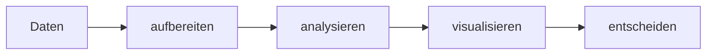

# Kursüberblick: Generative KI in der Datenanalyse

## Die Entwicklung von KI in der Datenanalyse

- Sprachmodelle schreiben seit 2022 Code, Formeln und Texte auf Zuruf.
- Machine Learning findet Muster, die keine feste Regel beschreibt.
- KI-Assistenten stecken heute in Excel, Power BI und VS Code.
- Offen bleibt: Wer garantiert, dass die Zahl im Bericht stimmt?

## Was ist Datenanalyse mit KI?

- **Machine Learning** lernt aus Beispielen: Prognose, Segmente, Auffälligkeiten.
- **Sprachmodelle** verstehen und erzeugen Text: Code, Kommentare, Erklärungen.
- **Datenanalyse mit KI** verbindet beides mit einem nachprüfbaren Ablauf.

Details: [Lab 1.1](../m01-ai-analysis-basics/l01-ai-landscape/l01-ai-landscape-thx.md)

## Warum ein Skript, wenn es KI-Chats gibt?

| Weg | Ergebnis | Gut für | Grenze |
| --- | --- | --- | --- |
| 1 · KI-Chat beantwortet die Frage | eine Zahl im Chat | schnelle Ad-hoc-Frage | jedes Mal neuer Rechenweg |
| 2 · Mit der Tabelle sprechen (PandasAI) | Antwort im Notebook | Exploration in Alltagssprache | Code muss geprüft werden |
| 3 · KI schreibt ein Skript, Mensch prüft | eine Datei, die bleibt | wiederkehrende Auswertung | Aufbauaufwand |
| 4 · ML-Modell und einfache Statistik | Modell im Skript | Muster ohne feste Regel | braucht Daten und Prüfung |

> **Leitmotiv:** Das Skript rechnet, die KI erklärt.

Details: [Lab 1.2](../m01-ai-analysis-basics/l02-four-ways/l02-four-ways-thx.md)

## Ziel und Ergebnis

- Rohdaten prüfen, bereinigen und gegen Kontrollsummen abstimmen.
- Monatsbericht als Skript: Kennzahlen, Diagramme, Prognose, Auffälligkeiten.
- Der Bericht als **Skill**: ein Satz im Chat startet das Skript.
- Das Muster auf einen zweiten Datensatz übertragen.

## Das Szenario: Nordwind Handel

- Fiktiver Großhandel für Büro- und Haushaltsbedarf.
- 4 Regionen, 6 Produktgruppen, 400 Geschäftskunden, Außendienst und Onlineshop.
- Jeden Monat eine neue Umsatzdatei, daraus der Monatsbericht.
- Alle Daten sind synthetisch: `python project/data/generate_data.py`.

## Der Monatsbericht in drei Ständen

| Stand | Entsteht in | Kann |
| --- | --- | --- |
| v1 | Lab 3.3 | eine CSV und ein Monat → HTML-Bericht |
| v2 | Lab 6.2 | Datenordner, Segmente, Auffälligkeiten, Prognose, Prüfzeilen, Excel |
| Skill | Lab 7.2 | v2 per Satz im Chat, mit Prüfergebnis in der Antwort |

## Tagesablauf

| Block | Tag 1 | Tag 2 |
| --- | --- | --- |
| 1 | 09:00–10:15 · Auftakt · Modul 1: KI in der Datenanalyse | 09:00–10:30 · Recap · Modul 5: Machine Learning |
| 2 | 10:30–12:00 · Modul 2: Datenaufbereitung → bereinigte Daten | 10:45–12:15 · Modul 6: Prognose, Bericht v2 |
| 3 | 13:00–14:30 · Modul 3: Analyse und Diagramme → Bericht v1 | 13:15–14:45 · Modul 7: Die Analyse als Skill |
| 4 | 14:45–16:30 · Modul 4: PandasAI und Kundenfeedback · Tagesabschluss | 15:00–16:30 · Modul 8: Validieren · Modul 9: Abschlussprojekt · Kursabschluss |

Pausen Tag 1: 10:15–10:30, 12:00–13:00, 14:30–14:45 · Tag 2: 10:30–10:45, 12:15–13:15, 14:45–15:00.

## Arbeitsweise in jedem Lab

| Stufe | Was passiert |
| --- | --- |
| **Basis** | vorbereitete Datei ausführen, eine markierte Stelle mit vorgegebenem Prompt ergänzen |
| **Prüfzelle** | zeigt „OK" oder „nicht OK"; bei „nicht OK" Lösungs-Snippet einsetzen |
| **Erweiterung** | eine optionale Zusatzaufgabe für Schnellere |
| **Weiterarbeit** | jedes Lab startet aus dem fertigen Beispiel des Vorgängers |

## Skill-Regeln

1. Ein festes Modell im Chat für den ganzen Kurs.
2. Löst der Skill nicht aus: „Nutze den Skill monatsbericht und …".
3. Fehlen die Zeilen „Summenkontrolle" und „Sollwert-Prüfung", hat der Agent selbst gerechnet: neuer Chat.
4. Letzter Rückfall: den Befehl aus `SKILL.md` im Terminal ausführen.
5. Im Bestätigungsdialog nur Befehle aus `SKILL.md` erlauben.

Details: [Lab 7.1](../m07-analysis-skill/l01-skill-anatomy/l01-skill-anatomy-thx.md)

## Voraussetzungen

- Python-Grundlagen: Variablen, Listen, Dictionaries, Funktionen.
- pandas, Terminal, Notebooks und Machine Learning lernt der Kurs.
- Umgebung: [Setup und Installation](../00-setup-and-installation.md)
