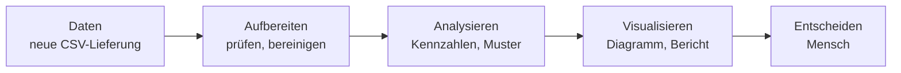
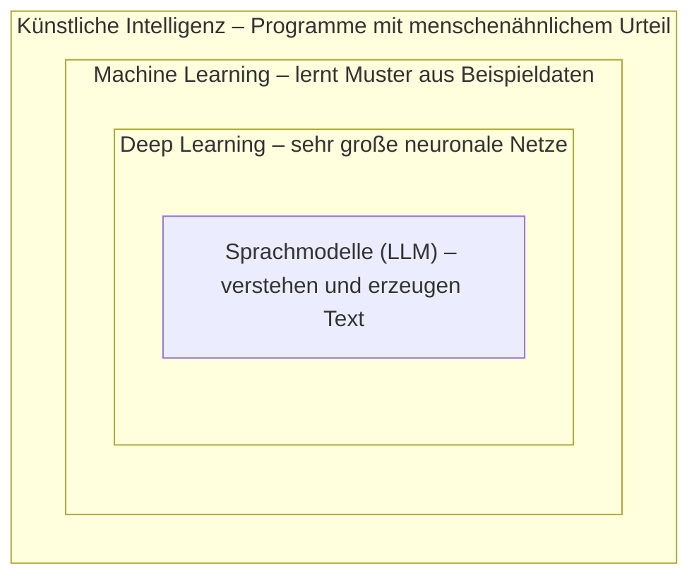
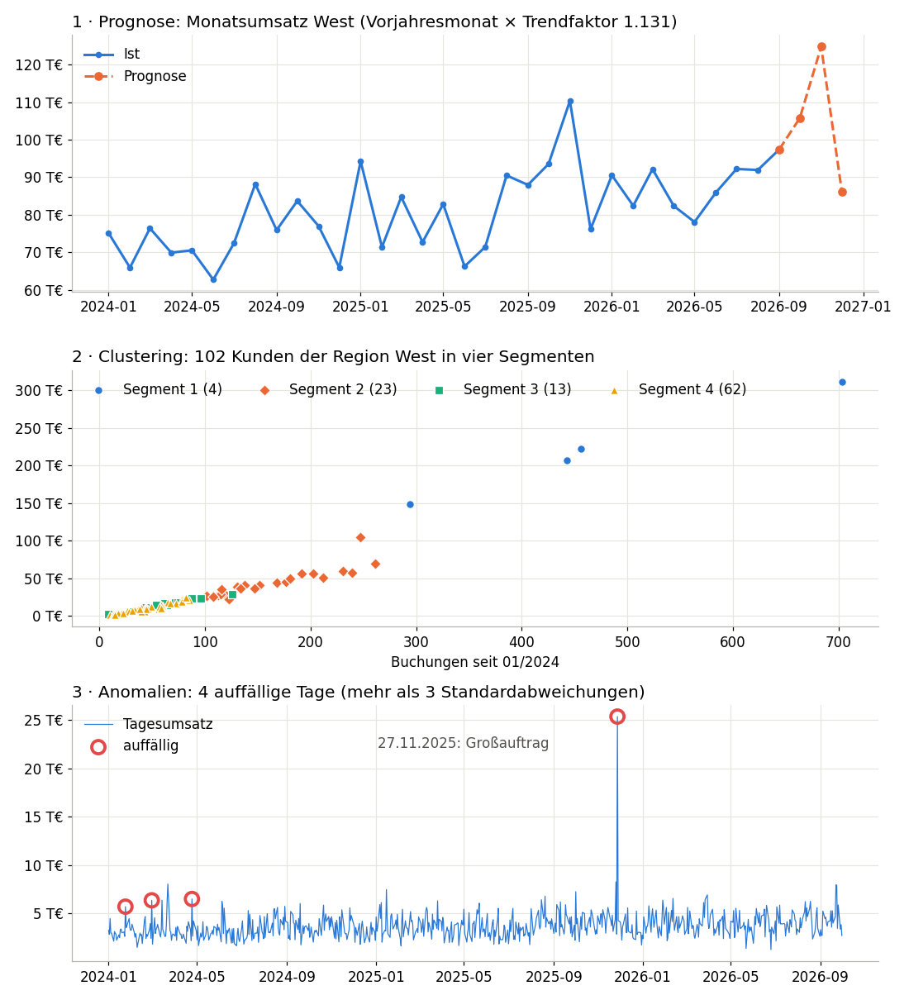
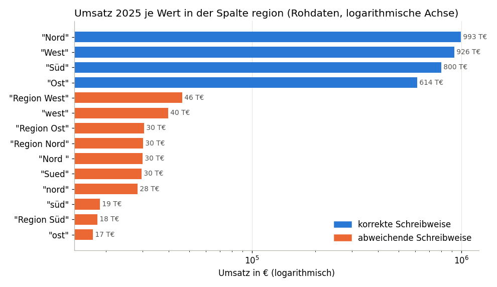

# Lab 1.1: Das große Bild und die Nordwind-Daten

**Leitfragen:**

<details>
<summary>Welche Schritte zwischen Datenlieferung und fertigem Monatsbericht kosten heute die meiste Zeit?</summary>

Meist nicht das Rechnen, sondern das Davor: Dateien zusammensuchen, Formate angleichen, Schreibweisen korrigieren, Zahlen gegenprüfen. Genau dort setzt der Kurs an (Modul 2).

</details>

<details>
<summary>Welche Analysen im eigenen Reporting beantworten „Was ist passiert?", welche „Was wird passieren?"?</summary>

Ist, Vormonat und Vorjahr beschreiben die Vergangenheit. Hochrechnung, Forecast und Budget schauen nach vorn; dafür braucht es Muster aus den Daten, etwa Saison und Trend.

</details>

<details>
<summary>Woran merkt man, dass eine feste Regel („Umsatz −20 % = Alarm") nicht mehr reicht?</summary>

Wenn sie im Juli jedes Jahr Alarm schlägt (Sommerloch) und den echten Fehler im Februar übersieht. Eine Regel, die den normalen Verlauf je Region und Monat kennt, trifft besser.

</details>

- Datenanalyse mit KI heißt: Rechner und Sprachmodelle übernehmen Handarbeit, finden Muster und erklären Ergebnisse; der Mensch prüft und entscheidet.
- Dieses Lab zeigt das große Bild, die Nordwind-Daten des Kurses und die Werkzeuge Terminal und Notebook.

## Begriffe

| Begriff | Bedeutung |
| --- | --- |
| Künstliche Intelligenz (KI) | Oberbegriff für Programme, die Aufgaben lösen, für die sonst menschliches Urteil nötig ist |
| Machine Learning (ML) | Teil der KI: das Programm lernt Regeln aus Beispieldaten, statt dass jemand sie hinschreibt |
| Deep Learning | Teil von ML mit sehr großen neuronalen Netzen (Rechenmodelle aus vielen verknüpften Schichten, lose dem Gehirn nachempfunden); stark bei Bildern, Sprache, Text |
| Sprachmodell (LLM) | Deep-Learning-Modell, das Text versteht und erzeugt, z. B. hinter ChatGPT oder GitHub Copilot |
| Modell | das Ergebnis des Lernens: eine Rechenvorschrift, die aus neuen Daten eine Antwort macht |
| strukturierte Daten | Tabellen mit festen Spalten (Umsatz, Datum, Region) |
| unstrukturierte Daten | Freitext, Bilder, E-Mails, z. B. Kundenkommentare |
| CSV | Textdatei mit einer Tabelle: eine Zeile je Datensatz, Werte durch Komma getrennt; Excel öffnet sie direkt |
| Terminal | Fenster, in dem man Befehle eintippt statt klickt; in VS Code unten eingeblendet |
| Argument | Zusatzangabe hinter einem Befehl, z. B. `--region Nord`; wie ein ausgefülltes Feld in einem Formular |
| Notebook | Datei (`.ipynb`), in der Code, Ergebnis und Text abwechselnd untereinander stehen |
| Zelle | ein Abschnitt im Notebook, der einzeln ausgeführt wird |
| Kernel | das laufende Python im Hintergrund eines Notebooks; merkt sich alle Variablen |

## Datenanalyse mit KI auf einen Blick

- **Problem:** Jeden Monat kommt eine neue Datei. Prüfen, bereinigen, rechnen, Diagramme bauen und kommentieren kostet Stunden, und jede Handarbeit ist eine Fehlerquelle.
- **Bild:** ein erfahrener Kollege im Controlling, der nie müde wird: er schreibt Auswertungen als Skript, findet Auffälligkeiten und formuliert eine erste Erklärung. Seine Zahlen prüft man trotzdem nach.
- **Definition:** Datenanalyse mit KI nutzt Machine Learning für Muster (Prognose, Segmente, Auffälligkeiten) und Sprachmodelle für Code, Text und Erklärungen, eingebettet in einen nachprüfbaren Ablauf.

| Jahr | Ereignis | Quelle |
| --- | --- | --- |
| 1956 | Dartmouth-Workshop: der Begriff „Artificial Intelligence" wird zum Forschungsfeld | McCarthy et al., Antrag vom 31.08.1955 (jmc.stanford.edu/articles/dartmouth/dartmouth.pdf) |
| 1959 | Arthur Samuel prägt „Machine Learning": sein Dame-Programm lernt aus Partien | Samuel, IBM Journal of Research and Development 3(3), 1959 |
| 2012 | AlexNet gewinnt den ImageNet-Wettbewerb deutlich: Durchbruch für Deep Learning | Krizhevsky, Sutskever, Hinton, NeurIPS 2012 (papers.nips.cc) |
| 2017 | Die Transformer-Architektur erscheint, Grundlage heutiger Sprachmodelle | Vaswani et al., „Attention Is All You Need" (arxiv.org/abs/1706.03762) |
| 30.11.2022 | OpenAI veröffentlicht ChatGPT; Sprachmodelle werden Alltagswerkzeug | openai.com/index/chatgpt |
| 2024 → 2026 | Anteil der Unternehmen in Deutschland mit KI-Einsatz: 20 % (2024, Destatis, ab 10 Beschäftigten); 57 % (2026, Bitkom-Befragung, ab 20 Beschäftigten) | destatis.de, Pressemitteilung 444 vom 25.11.2024; bitkom.org, Presseinformation vom 14.09.2026 |

Bekannte Beispiele: Absatzprognosen im Handel, Betrugserkennung bei Kartenzahlungen (Anomalien), Kundensegmente im Marketing, KI-Assistenten in Excel, Power BI und VS Code, die Formeln, Code und Kommentare vorschlagen.

Einsatz im Controlling und Reporting: Lieferdateien prüfen, Monatsberichte automatisieren, Umsatz hochrechnen, Ausreißer melden, Freitext-Feedback auszählen, Abweichungen in Worte fassen. Die beiden Unternehmenszahlen stammen aus unterschiedlichen Erhebungen und sind nicht direkt vergleichbar (Stand: 15.11.2026).

## Der Ablauf einer Analyse

Jede Auswertung im Kurs folgt diesem Bild:



| Schritt | Ohne KI | Mit KI | im Kurs |
| --- | --- | --- | --- |
| Aufbereiten | Suchen und Ersetzen von Hand | KI schreibt Prüf- und Bereinigungscode | Modul 2 |
| Analysieren | Pivot-Tabellen klicken | Skript rechnet, ML findet Muster | Modul 3, 5, 6 |
| Visualisieren | Diagramm je Monat neu bauen | Skript erzeugt den Bericht | Modul 3, 6 |
| Entscheiden | – | KI formuliert, Mensch prüft und entscheidet | Modul 7, 8 |

## Grenzen klassischer Methoden

- **Handarbeit:** Jeder Monat wiederholt dieselben Klicks; ein vergessener Filter fällt niemandem auf.
- **Starre Regeln:** „−20 % = Alarm" kennt weder Saison noch Region und meldet zu viel oder zu wenig.
- **Menge:** 33.000 Zeilen lassen sich in Excel öffnen, aber nicht mehr Zeile für Zeile ansehen; 300 Kundenkommentare liest im Alltag niemand vollständig.

## Die KI-Landkarte

KI ist der Oberbegriff; jede innere Fläche ist ein Teil der äußeren:



| Ebene | Typische Daten | Im Kurs |
| --- | --- | --- |
| Machine Learning | strukturiert: Tabellen | Segmente (Lab 5.2), Wiederkauf (Lab 5.1) |
| Sprachmodelle | unstrukturiert: Text; schreiben auch Code | Copilot (ab Lab 1.2), PandasAI und Feedback (Modul 4) |
| einfache Statistik (keine KI, aber oft ausreichend) | strukturiert | Auffälligkeiten per Regel (Lab 5.3), Prognose per Formel (Lab 6.1) |

Tabellen mit festen Spalten sind **strukturierte** Daten; Freitext wie „Lieferung kam zwei Tage zu spät" ist **unstrukturiert** und braucht ein Sprachmodell. Deep Learning, AutoML und Cloud-Plattformen ordnet der Kurs nur ein, ohne Übung.

## Fünf Aufgabentypen

| Aufgabentyp | Frage | Controlling-Beispiel | im Kurs |
| --- | --- | --- | --- |
| Prognose | Wie viel wird es? | Umsatz Oktober bis Dezember | Lab 6.1 |
| Klassifikation | Zu welcher Klasse gehört es? | Kauft dieser Kunde wieder: ja/nein? | Lab 5.1 |
| Clustering | Welche Gruppen gibt es? | Kundensegmente nach Häufigkeit und Umsatz | Lab 5.2 |
| Anomalieerkennung | Was ist ungewöhnlich? | Tag mit hundertfachem Umsatz (Kommafehler?) | Lab 5.3 |
| Textanalyse | Worum geht es im Text? | Kundenkommentare nach Thema und Stimmung | Lab 4.2 |

## Nordwind Handel und seine Dateien

Nordwind Handel ist ein erfundener Großhändler für Büro- und Haushaltsbedarf: 4 Regionen (Nord, Süd, West, Ost), 6 Produktgruppen, 400 Geschäftskunden, Kanäle Außendienst und Onlineshop. Alle Daten sind synthetisch.

| Datei | Inhalt |
| --- | --- |
| `data/nordwind_umsatz.csv` | 33.554 Buchungen 01/2024–09/2026, Spalten `beleg_nr, datum, jahr, kunde_id, region, produktgruppe, kanal, menge, umsatz, kosten`; Rohdaten mit Fehlern |
| `data/nordwind_plan_2026.csv` | Planumsatz je Monat und Region |
| `data/nordwind_feedback.csv` | kurze Kundenkommentare (Freitext) |
| `data/kontrollsummen.csv` | Sollwerte je Monat und Region zum Gegenprüfen (Lab 2.3) |
| `lieferungen/` | spätere Lieferungen (Modul 7, 9) |
| `project/starters/`, `project/examples/`, `project/playground/` | Startdateien, fertige Beispiele, eigener Arbeitsbereich |

## Terminal, Skript, Argument

VS Code öffnet den Kursordner als Arbeitsbereich. Das Terminal öffnet sich über das Menü **Terminal → Neues Terminal** und startet in genau diesem Ordner; alle Pfade im Kurs beginnen dort.


_Quelle: Microsoft, VS Code Docs „Terminal Basics" (https://code.visualstudio.com/docs/terminal/basics), abgerufen am 15.11.2026._

```text
python check_setup.py
│      └─ Skript: die Datei, die Python ausführt
└─ Programm: Python

python project/examples/m01-ai-analysis-basics/l01-ai-landscape/ki_landkarte.py --region West
                                                                               └─ Argument: Name --region, Wert West
```

- `python <datei>` führt ein Skript aus; die Ausgabe erscheint im Terminal.
- Ein Argument ändert, was das Skript tut, ohne den Code zu ändern. `--region West` zeigt dieselben Diagramme für eine andere Region.
- **Pfeil nach oben** holt den letzten Befehl zurück; so lässt sich nur das Argument austauschen.
- Skripte ohne Argument starten auch über den ▷-Knopf „Run Python File" oben rechts im Editor.

## Notebooks: Zelle, Umschalt+Enter, Kernel

Ein Notebook zeigt Code und Ergebnis direkt untereinander, ideal zum Ausprobieren. Eine Zelle läuft mit **Umschalt+Enter**; danach springt der Cursor zur nächsten Zelle. Den Kernel (Python 3.11) wählt die Kursumgebung vorab; er steht oben rechts.


_Quelle: Microsoft, VS Code Docs „Jupyter Notebooks in VS Code" (https://code.visualstudio.com/docs/datascience/jupyter-notebooks), abgerufen am 15.11.2026._

- Der Kernel merkt sich Variablen: Zellen der Reihe nach von oben ausführen, sonst fehlt z. B. `df`.
- **Neustart** (Symbol „Restart" in der Leiste oben) leert den Speicher; danach alles wieder von oben ausführen.
- Notebooks lesen Dateien relativ zum Kursordner (`data/...`), genau wie das Terminal.

## Die drei Aufgabentypen als Skript

`ki_landkarte.py` zeigt Prognose, Clustering und Anomalieerkennung an den Nordwind-Daten in einer HTML-Seite. Wie die einzelnen Bausteine funktionieren, erklärt der Kurs Schritt für Schritt; hier zählt das Bild.



_Quelle: eigene Auswertung, Nordwind-Daten, 15.11.2026._

| Diagramm | Was es zeigt (Region West) |
| --- | --- |
| 1 Prognose | Vorjahresmonat × Trendfaktor 1,131: der Umsatz der letzten 12 Monate liegt 13,1 % über den 12 Monaten davor |
| 2 Clustering | 102 Kunden in vier Segmenten; Segment 1 sind wenige, sehr große Kunden |
| 3 Anomalien | 4 auffällige Tage, darunter der 27.11.2025 (ein echter Großauftrag, kein Fehler); auffällig heißt: mehr als dreimal so weit vom Monatsmittel entfernt wie die übliche Schwankung (Standardabweichung, Lab 5.3) |

## Erste Zahlen im Notebook

Die fertige Zelle „Umsatz 2025 je Region" rechnet auf den Rohdaten. Statt vier Regionen erscheinen 14 Werte: „Nord", „Nord " (mit Leerzeichen am Ende), „Region Nord", „nord" … Für pandas sind das verschiedene Regionen.



_Quelle: eigene Auswertung, Nordwind-Daten (Rohdaten), 15.11.2026._

> **Merksatz:** Eine KI-Auswertung ist nur so gut wie die Daten davor; 2025 stehen rund 88.000 € Umsatz der Region Nord unter „Nord ", „Region Nord" und „nord" und fehlen in der Zeile „Nord".

## Typische Fehler

| Symptom | Ursache | Lösung |
| --- | --- | --- |
| `can't open file ... No such file or directory` | Terminal steht nicht im Kursordner oder Pfad vertippt | neues Terminal über das Menü öffnen; Pfad mit Tab-Taste vervollständigen |
| `python` wird nicht gefunden | Python nicht im Pfad des Terminals | VS Code neu starten; sonst `py` statt `python` (Windows) |
| `invalid choice: 'nord'` | Argument klein geschrieben | Werte genau so: `Nord`, `Süd`, `West`, `Ost` |
| `NameError: name 'df' is not defined` | Zelle übersprungen | Zellen von oben der Reihe nach ausführen |
| Notebook fragt nach einem Kernel | keiner ausgewählt | oben rechts „Select Kernel" → Python 3.11 der Kursumgebung |
| Browser öffnet sich nicht | Standardbrowser fehlt | `project/playground/ki_landkarte.html` im Explorer per Rechtsklick „Reveal in File Explorer" öffnen und doppelklicken |

## Fazit

- Eine Analyse läuft immer: Daten → aufbereiten → analysieren → visualisieren → entscheiden; KI hilft in jedem Schritt, der Mensch entscheidet.
- KI ⊃ Machine Learning ⊃ Deep Learning ⊃ Sprachmodelle; ML arbeitet auf Tabellen, Sprachmodelle auf Text und Code.
- Fünf Aufgabentypen: Prognose, Klassifikation, Clustering, Anomalieerkennung, Textanalyse.
- Terminal: `python <skript> --argument wert`; Notebook: Zelle, Umschalt+Enter, Kernel.

In der Übung laufen `check_setup.py`, die KI-Landkarte und das erste Notebook.
