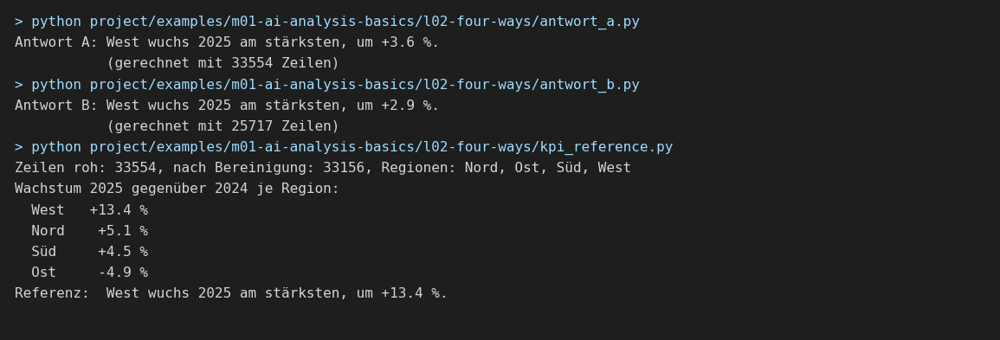

# Lab 1.2: Vier Wege, KI einzusetzen

**Leitfragen:**

<details>
<summary>Würde man eine Zahl für die Geschäftsführung übernehmen, die bei jeder Frage leicht anders herauskommt?</summary>

Nein. Eine Berichtszahl muss bei gleicher Datei gleich herauskommen und nachrechenbar sein. Deshalb rechnet im Kurs ein Skript, das bleibt; die KI hilft beim Schreiben und Erklären.

</details>

<details>
<summary>Was darf ein KI-Dienst von den eigenen Firmendaten sehen?</summary>

Nur, was Vertrag, Datenschutz und interne Freigabe erlauben. Alles, was im Chat steht oder angehängt ist, verlässt den eigenen Rechner; Kundendaten und Personaldaten brauchen eine ausdrückliche Freigabe.

</details>

<details>
<summary>Was ist bei einer wiederkehrenden Auswertung wichtiger: Tempo beim ersten Mal oder gleiches Ergebnis jedes Mal?</summary>

Gleiches Ergebnis. Beim ersten Mal darf es länger dauern, wenn danach jeder Monat auf Knopfdruck identisch und prüfbar läuft.

</details>

- KI lässt sich auf vier Arten in die Analyse einbauen: als Chat, als Gespräch mit der Tabelle, als Code-Schreiber und als lernendes Modell.
- Für wiederkehrende Zahlen gilt im ganzen Kurs: **Das Skript rechnet, die KI erklärt.**

## Begriffe

| Begriff | Bedeutung |
| --- | --- |
| KI-Assistent | Chat-Programm mit Sprachmodell, das Fragen beantwortet und Code schreibt; im Kurs GitHub Copilot Chat in VS Code |
| Prompt | die Anfrage an das Sprachmodell, als Text |
| Kontext | alles, was das Modell zusätzlich zum Prompt sieht, z. B. eine angehängte Datei |
| Token | Textstück, mit dem ein Sprachmodell arbeitet; oft ein Wortteil, bei Zahlen ein bis drei Ziffern |
| Ask / Agent | zwei Arbeitsweisen im Chat: Ask antwortet nur, Agent darf Dateien ändern und Befehle ausführen |
| deterministisch | gleiche Eingabe ergibt immer dasselbe Ergebnis, wie bei einer Excel-Formel |
| Skill | Ordner mit einer Anleitung und einem Skript, den der Agent bei passender Frage selbst nutzt (Lab 7.1) |

## Die vier Wege

| Weg | Beispiel | Ergebnis | Gut für | Grenze |
| --- | --- | --- | --- | --- |
| 1 · KI-Chat beantwortet die Frage | Copilot Chat, ChatGPT/Claude mit Datei-Upload | eine Zahl im Chat | schnelle Ad-hoc-Frage | jedes Mal neuer Rechenweg, Ergebnis nicht garantiert gleich; Daten verlassen das Haus |
| 2 · Mit dem DataFrame sprechen | PandasAI `df.chat("…")` (Modul 4) | Antwort im Notebook | Exploration, Fragen in Alltagssprache | wie Weg 1, aber lokal ausgeführt; Code muss geprüft werden |
| 3 · KI schreibt ein Skript, Mensch prüft | Copilot erzeugt `clean.py`, `monatsbericht.py` | eine Datei, die bleibt | wiederkehrende Auswertung, gleiche Eingabe = gleiches Ergebnis | Aufbauaufwand, Code-Review nötig |
| 4 · ML-Modell, ergänzt um einfache Statistik | scikit-learn: Wiederkauf, Segmente; Regel und Formel für Auffälligkeiten und Prognose | Modell bzw. Formel im Skript | Muster, die keine feste Regel beschreibt | braucht Daten, Validierung, Erklärung |

Weg 1 gegen Weg 3 in einem Satz: Weg 1 liefert eine Zahl im Chat, Weg 3 eine Datei, die nächsten Monat dieselbe Zahl wieder ausrechnet.

## Dieselbe Frage, drei Zahlen

Frage: **„Welche Region wuchs 2025 am stärksten?"** In `project/examples/m01-ai-analysis-basics/l02-four-ways/` liegen dazu Antwort A und Antwort B, zwei typische KI-Lösungen als vorbereiteter Beispielcode, und `kpi_reference.py`, die geprüfte Referenzrechnung.



_Quelle: eigene Auswertung (Terminal-Ausgabe), Nordwind-Daten, 15.11.2026._

| Datei | Antwort | gerechnet mit |
| --- | --- | --- |
| `antwort_a.py` | West, +3,6 % | 33.554 Zeilen |
| `antwort_b.py` | West, +2,9 % | 25.717 Zeilen |
| `kpi_reference.py` | West, +13,4 % | 33.156 Zeilen |

Alle drei Skripte laufen fehlerfrei und nennen dieselbe Region. Die Zahl dahinter unterscheidet sich um mehr als das Vierfache. Wer nur die Antwort sieht, merkt das nicht; wer den Code liest, findet den Grund.

## Warum ein Sprachmodell nicht zuverlässig rechnet

- Ein Sprachmodell sagt Token für Token das wahrscheinlichste nächste Textstück voraus; `9917522,56` ist dafür eine Folge von Ziffernstücken, keine Größe.
- Gute Assistenten schreiben deshalb Code und führen ihn aus. Dieser Code ist bei jeder Frage etwas anders, also auch die Zahl.
- Ein Skript, das bleibt, ist deterministisch: gleiche Datei, gleiche Zahl.

> **Merksatz:** Das Skript rechnet, die KI erklärt. Zahlen für einen Bericht kommen aus einer geprüften Datei, nie direkt aus dem Chat.

## Datenschutz: was an den KI-Dienst geht

| Inhalt | geht an den Dienst? |
| --- | --- |
| der Prompt | ja |
| angehängte Dateien (`#file`), markierter Code, geöffnete Notebook-Zellen | ja, sobald sie Kontext sind |
| Befehle und Terminal-Ausgaben, die der Agent ausführt und liest | ja |
| Dateien im Ordner, die niemand anhängt und der Agent nicht liest | nein |
| Ergebnisse eines Skripts, das lokal im Terminal läuft | nein |

Ob der Anbieter Eingaben speichert oder zum Training nutzt, regelt der Vertrag (z. B. Firmenkonto statt privatem Konto). Die Nordwind-Daten sind erfunden; für echte Firmendaten vorab Datenschutz und IT fragen.

## Copilot Chat in VS Code

Bedienung Stand: 11/2026, vor Kursbeginn prüfen (Quelle: [code.visualstudio.com/docs/agents/run/chat-view](https://code.visualstudio.com/docs/agents/run/chat-view), [ai-features-cheat-sheet](https://code.visualstudio.com/docs/agents/reference/ai-features-cheat-sheet)).

| Handgriff | So geht es |
| --- | --- |
| Chat öffnen | Menü **Chat** in der Titelleiste → **Open Chat** oder **Strg+Alt+I** (macOS: Ctrl+Cmd+I) |
| neuer Chat | **+** (New Chat) oben im Chat; ein neuer Chat vergisst den alten Verlauf |
| Ask oder Agent wählen | Auswahlfeld **Agent** unten im Eingabefeld; daneben das Modell |
| Datei als Kontext | im Prompt `#` tippen und die Datei wählen, z. B. `#file:antwort_a.py`, oder **Add Context** (+) |


_Quelle: Microsoft, VS Code Docs „Chat View and Layout" (https://code.visualstudio.com/docs/agents/run/chat-view), abgerufen am 15.11.2026._

| | Ask | Agent |
| --- | --- | --- |
| tut | beantwortet Fragen, erklärt Code, schlägt Code vor | plant, ändert Dateien, führt Befehle im Terminal aus |
| ändert Dateien | nein | ja |
| im Kurs | Code-Vorschlag für eine markierte Stelle (ab Lab 2.1) | Datei anlegen und ausführen (Lab 1.2), Skills auslösen (Modul 7) |


_Quelle: Microsoft, VS Code Docs „Add context to chat" (https://code.visualstudio.com/docs/chat/copilot-chat-context), abgerufen am 15.11.2026._

Im Agent-Modus fragt VS Code vor einem Befehl im Terminal nach: Der Dialog zeigt den Befehl, **Allow** führt ihn einmal aus, **Skip** lässt ihn aus. Nur Befehle erlauben, die man versteht. Geänderte Dateien listet der Chat unter der Antwort: **Keep** übernimmt die Änderung, **Undo** nimmt sie zurück.


_Quelle: Microsoft, VS Code Docs „Approvals and permissions" (https://code.visualstudio.com/docs/agents/run/approvals), abgerufen am 15.11.2026._

**Claude Code:** Datei mit `@datei` statt `#file:` anhängen; statt Ask den Plan-Modus nutzen (Umschalt+Tab wechselt den Modus); Befehle bestätigt Claude Code ebenfalls in einem Dialog.

## Technik-Test: der Skill `kpi-kurzcheck`

Im Kursordner liegt ein fertiger Skill unter `.github/skills/kpi-kurzcheck/`. Der Satz **„Führe den KPI-Kurzcheck für die Nordwind-Daten aus."** im Agent-Modus bringt den Agenten dazu, das Skript des Skills auszuführen. Erwartete Ausgabe des Skripts:

```text
KPI-Kurzcheck data/nordwind_umsatz.csv (Rohdaten, vor Bereinigung)
Zeilen:        33554
Monate:        2024-01 bis 2026-09 (33 Monate)
Umsatz gesamt: 9.917.522,56 €
```

Wie ein Skill aufgebaut ist und wann er auslöst, zeigt Lab 7.1; heute zählt nur, dass Agent, Bestätigungsdialog und Skript zusammen funktionieren.

## Typische Fehler

| Symptom | Ursache | Lösung |
| --- | --- | --- |
| Chat zeigt „Sign in" oder kein Modell | nicht beim KI-Assistenten angemeldet | Konto-Symbol unten links → anmelden; sonst Trainer fragen |
| `#file:` findet die Datei nicht | Datei liegt außerhalb des Kursordners oder Name vertippt | `#` tippen, die ersten Buchstaben eingeben, aus der Liste wählen |
| Antwort bezieht sich auf eine andere Datei | alter Verlauf im Chat | neuen Chat mit **+** beginnen |
| Agent ändert mehr Dateien als verlangt | Prompt zu offen | **Undo**, neuer Chat, Prompt mit „Ändere keine anderen Dateien.“ |
| Skill-Test: Agent antwortet ohne Befehl | Skill nicht erkannt | neuer Chat, Satz „Nutze den Skill kpi-kurzcheck." senden |

## Fazit

- Vier Wege: Chat, Gespräch mit der Tabelle, KI schreibt ein Skript, ML-Modell; für wiederkehrende Zahlen Weg 3 und 4.
- Dieselbe Frage kann drei verschiedene Zahlen ergeben; die Ursache steht im Code, nicht in der Antwort.
- Sprachmodelle rechnen nicht zuverlässig: Das Skript rechnet, die KI erklärt.
- Copilot Chat: Strg+Alt+I, `#file` als Kontext, Agent zum Handeln: Befehl lesen → **Allow**, Datei prüfen → **Keep**.

In der Übung laufen die drei Skripte, der Agent erklärt die Abweichung und legt eine korrigierte Datei an, und der Skill-Test prüft den Agent-Modus für Tag 2.
