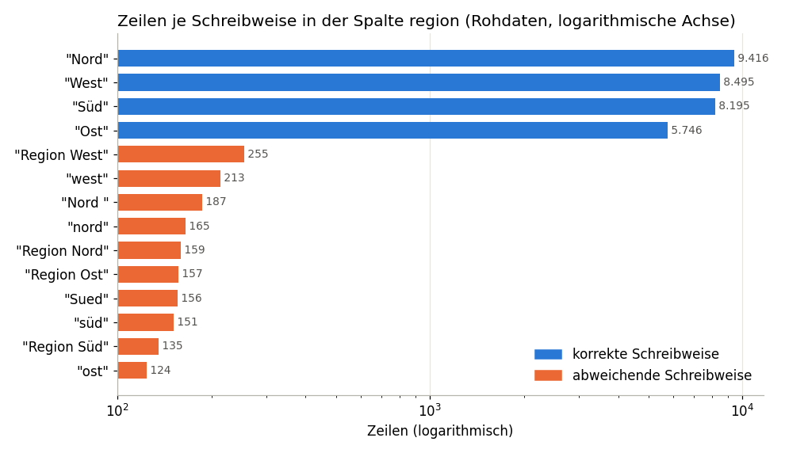

# Lab 2.1: Datenqualität prüfen

**Leitfragen:**

<details>
<summary>Welche Fehler in Lieferdateien kommen im Alltag vor?</summary>

Doppelte Zeilen, leere Zellen, Datum mal als `01.03.2026`, mal als `2026-03-01`, „Nord" neben „Region Nord", Tippfehler mit Faktor 100, eine Spalte, die plötzlich anders heißt.

</details>

<details>
<summary>Ist eine leere Zelle immer ein Fehler?</summary>

Nein. Fehlende Kosten heißen oft „noch nicht gebucht"; der Umsatz der Zeile stimmt trotzdem. Löschen würde den Umsatz verfälschen, besser markieren.

</details>

<details>
<summary>Wer entscheidet, ob eine Zeile gelöscht oder korrigiert wird: die KI oder das Controlling?</summary>

Das Controlling. Die KI schreibt den Prüfcode und schlägt vor; welche Regel gilt, ist eine fachliche Entscheidung und gehört dokumentiert.

</details>

- Bevor gerechnet wird, wird geprüft: Jede Rohdatei hat Fehler, die eine Auswertung still verfälschen (Lab 1.2).
- pandas ist das Excel von Python; sechs Befehle reichen für einen ersten Qualitätscheck.

## Begriffe

| Begriff | Bedeutung |
| --- | --- |
| pandas | Python-Bibliothek für Tabellen; im Code als `pd` abgekürzt |
| DataFrame | Tabelle mit benannten Spalten, das „Excel-Blatt in Python"; üblicher Name `df` |
| Series | eine einzelne Spalte eines DataFrame, z. B. `df["region"]` |
| Index | Zeilenbeschriftung links, Standard `0, 1, 2 …` |
| dtype | Datentyp einer Spalte: `int64` (ganze Zahl), `float64` (Kommazahl), `object` (Text) |
| NaN | „not a number": ein fehlender Wert, in Excel eine leere Zelle |
| Dublette | Zeile, die genau so schon einmal in der Datei steht |
| Ausreißer | Wert weit weg von den übrigen; kann Fehler oder echtes Ereignis sein |
| Pflichtspalte | Spalte, ohne die eine Auswertung nicht laufen darf, z. B. `umsatz` |
| Problemtabelle | Liste der gefundenen Probleme mit Anzahl und Vorschlag; Grundlage für die Bereinigung |

## pandas für Excel-Nutzer


_Quelle: pandas, „What kind of data does pandas handle?" (https://pandas.pydata.org/docs/getting_started/intro_tutorials/01_table_oriented.html), BSD-3-Lizenz, abgerufen am 15.11.2026._

| Excel | pandas | Nordwind-Beispiel |
| --- | --- | --- |
| Datei öffnen | `pd.read_csv(...)` | `df = pd.read_csv("data/nordwind_umsatz.csv")` |
| Spalte markieren | `df["spalte"]` | `df["umsatz"]` |
| Formel nach unten ziehen | neue Spalte aus Rechnung | `df["db"] = df["umsatz"] - df["kosten"]` |
| Filter | `df[bedingung]` | `df[df["jahr"] == 2025]` |
| Pivot-Tabelle | `groupby` / `pivot_table` | `df.groupby("region")["umsatz"].sum()` |
| SVERWEIS | `merge` | Planwerte je Monat und Region dazuholen (Lab 3.3) |
| `ANZAHL`, `SUMME`, `MITTELWERT` | `.count()`, `.sum()`, `.mean()` | `df["umsatz"].sum()` |

```python
import pandas as pd                               # Kurzname pd ist überall üblich

df = pd.read_csv("data/nordwind_umsatz.csv")      # Datei -> DataFrame
df.head()                                         # erste fünf Zeilen
len(df)                                           # 33554 Zeilen
df[df["jahr"] == 2025]                            # Filter: nur Zeilen mit True
```

Der Filter `df["jahr"] == 2025` liefert je Zeile `True` oder `False`; `df[...]` behält nur die Zeilen mit `True`.

## Typische Probleme in Lieferdateien

| Problem | Nordwind-Beispiel | Prüfung in pandas |
| --- | --- | --- |
| fehlende oder umbenannte Spalten | `umsatz` heißt plötzlich `umsatz_eur` | `df.columns` |
| fehlende Werte | Zeilen ohne `kosten` | `df.isna().sum()` |
| Dubletten | dieselbe Buchung zweimal geliefert | `df.duplicated().sum()` |
| uneinheitliche Formate | Datum `01.03.2026` und `2026-03-01` | Text nach Muster zählen, z. B. `.str.contains(".")` |
| uneinheitliche Kategorien | „Nord", „Region Nord", „nord", „Nord " | `df["region"].value_counts()` |
| Ausreißer | eine Zeile mit 32.800 € statt 328 € | `df["umsatz"].describe()` |

## Die sechs Prüfbefehle

| Befehl | zeigt | Ergebnis bei Nordwind |
| --- | --- | --- |
| `df.columns` | Spaltennamen | 10 Spalten, alle Pflichtspalten da |
| `df.info()` | Typ und Anzahl gefüllter Werte je Spalte | `kosten`: 32.897 von 33.554 gefüllt |
| `df.isna().sum()` | fehlende Werte je Spalte | 657 bei `kosten` |
| `df.duplicated().sum()` | Zeilen, die schon einmal vorkamen | 398 |
| `df["region"].value_counts()` | jeden Wert mit seiner Häufigkeit | 14 Schreibweisen für 4 Regionen |
| `df["umsatz"].describe()` | Anzahl, Mittelwert, Streuung (`std`), Minimum, Viertelwerte (25 %, 50 % = Median, 75 %), Maximum | Median 215 €, Maximum 32.800 € |


_Quelle: pandas, „How to calculate summary statistics" (https://pandas.pydata.org/docs/getting_started/intro_tutorials/06_calculate_statistics.html), BSD-3-Lizenz, abgerufen am 15.11.2026._

`value_counts()` zählt jeden Text genau so, wie er geschrieben ist: „Nord" und „Nord " (mit Leerzeichen) sind zwei Werte.



_Quelle: eigene Auswertung, Nordwind-Daten (Rohdaten), 15.11.2026._

Ein Ausreißer ist nicht automatisch ein Fehler. Bei Nordwind liegen vier Zeilen über 5.000 €: drei gehören zu einem echten Großauftrag am 27.11.2025, eine hat einen Kommafehler (32.800 € statt 328 €). Das entscheidet die Fachabteilung, nicht der Code.

## Prompt-Muster für Code

Ein guter Code-Prompt hat vier Teile. Beispiel für die Dublettenprüfung:

| Teil | Inhalt | Beispiel |
| --- | --- | --- |
| Kontext | wo, womit, welche Variable | „Im Notebook ist die Nordwind-Umsatzdatei als pandas-DataFrame `df` geladen." |
| Spalten | die Spalten, um die es geht | „Spalten: beleg_nr, datum, …, umsatz, kosten." |
| Regel | was genau gilt, was nicht passieren darf | „Eine Dublette ist eine Zeile, die in allen Spalten gleich ist. `df` nicht verändern." |
| gewünschte Ausgabe | Variable, Format, Umfang | „Variable `dubletten` mit der Anzahl, dazu `print`. Nur Code für eine Zelle." |

Ohne Regel rät das Modell; ohne gewünschte Ausgabe passt das Ergebnis nicht zur Prüfzelle.

## KI-Code lesen, bevor er läuft

Drei Lesefragen für jeden Vorschlag, egal ob von Copilot oder aus dem Internet:

```python
regionen = df["region"].value_counts()   # 1 Welche Datei/Tabelle? -> df, die geladene Rohdatei
                                         # 2 Was wird verändert?   -> nichts, nur gezählt
print(regionen)                          # 3 Was wird ausgegeben?  -> jede Schreibweise mit Anzahl
```

| Lesefrage | Warnzeichen |
| --- | --- |
| Welche Datei? | anderer Pfad, `to_csv` auf die Originaldatei |
| Was wird verändert? | `df = df.dropna()`, `drop_duplicates()`, `str.strip()` in einer Prüfung: Daten werden still geändert |
| Was wird ausgegeben? | gar nichts, oder ein anderer Variablenname als verlangt |

Im Notebook arbeitet Copilot im Modus **Ask**: Notebook mit `#file:` anhängen (wie in Lab 1.2), fragen, den Code über das Kopieren-Symbol am Codeblock der Antwort kopieren und in die markierte Zelle einfügen. Ask ändert keine Datei; so bleibt jede Änderung an der markierten Stelle sichtbar. Alternativ öffnet **Strg+I** in einer Zelle den Chat direkt dort (Bedienung Stand: 11/2026, vor Kursbeginn prüfen; Quelle: [code.visualstudio.com/docs/agents/guides/notebooks-with-ai](https://code.visualstudio.com/docs/agents/guides/notebooks-with-ai)).

## Typische Fehler

| Symptom | Ursache | Lösung |
| --- | --- | --- |
| `KeyError: 'Region'` | Spaltenname anders geschrieben | `print(df.columns)`; Spalten heißen klein: `region` |
| `NameError: name 'df' is not defined` | erste Zelle nicht ausgeführt | Zellen von oben ausführen |
| Prüfzelle: „13 Schreibweisen, erwartet 14" | Code bereinigt vor dem Zählen (`str.strip()`) | nur zählen, nichts ändern |
| `df.info()` zeigt `object` statt Datum | CSV speichert Datum als Text | richtig so; das Datum liest erst Lab 2.2 |
| Ausgabe wird abgeschnitten (`...`) | lange Tabelle | `print(regionen.to_string())` oder ausreichend wenige Zeilen |

## Fazit

- pandas übersetzt Excel-Handgriffe: `read_csv`, Filter `df[...]`, `groupby` für Pivot, `merge` für SVERWEIS.
- Sechs Prüfbefehle finden die typischen Probleme: `columns`, `info`, `isna`, `duplicated`, `value_counts`, `describe`.
- Code-Prompt = Kontext + Spalten + Regel + gewünschte Ausgabe; KI-Code vor dem Ausführen mit drei Lesefragen prüfen.

In der Übung entsteht die Problemtabelle der Nordwind-Rohdaten mit fünf Einträgen.
