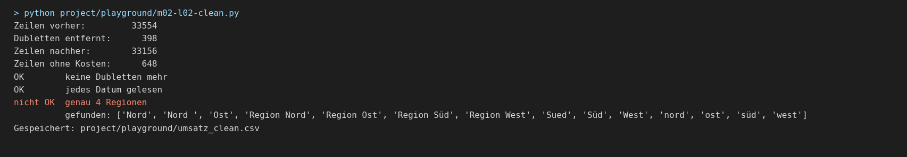
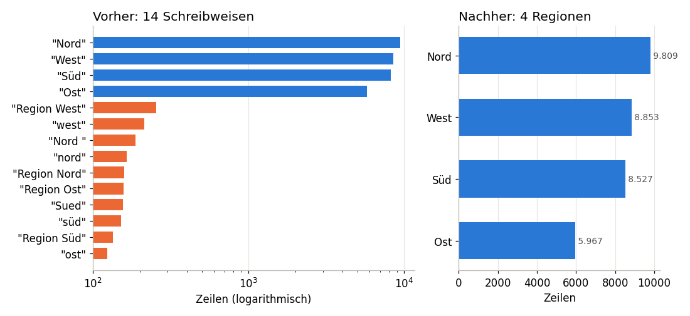

# Lab 2.2: Bereinigen und transformieren

**Leitfragen:**

<details>
<summary>Wie würde man in Excel 30.000 Zeilen mit drei Schreibweisen derselben Region bereinigen?</summary>

Filtern, Suchen und Ersetzen, Leerzeichen mit `GLÄTTEN` entfernen, Duplikate entfernen; jeden Monat von vorn, ohne Protokoll, was genau passiert ist. Ein Skript macht dieselben Schritte jedes Mal gleich.

</details>

<details>
<summary>Woran erkennt man nach der Bereinigung, dass nichts Wichtiges verloren ging?</summary>

An einer Zeilenbilanz: Zeilen vorher, entfernt, nachher, und jeder Unterschied hat einen Grund. Fehlen mehr Zeilen als erklärt, hat ein Schritt zu viel gelöscht.

</details>

<details>
<summary>Was passiert nächsten Monat, wenn eine neue Schreibweise auftaucht?</summary>

Die feste Prüfung „genau 4 Regionen" schlägt Alarm und zeigt die neue Schreibweise. Dann wird die Regel ergänzt, statt dass eine fünfte Region still im Bericht landet.

</details>

- Die Problemtabelle aus Lab 2.1 wird zu Regeln: jede Regel ein Schritt in einer Funktion, jeder Schritt mit Kommentar.
- Eine eingebaute Prüfung zeigt nach jedem Lauf, ob die Bereinigung gewirkt hat.

## Begriffe

| Begriff | Bedeutung |
| --- | --- |
| Bereinigung | Rohdaten in einen verlässlichen Zustand bringen: Dubletten weg, Formate einheitlich, Kategorien sauber |
| Funktion | benannter Codeblock mit Eingabe und Ergebnis, hier `clean_umsatz(df)` → bereinigter DataFrame |
| Skript | `.py`-Datei, die von oben nach unten läuft; startet im Terminal mit `python <datei>` |
| Zeilenbilanz | Zeilen vorher – entfernt = Zeilen nachher, als Kontrolle |
| Markierung | Zusatzspalte statt Löschen, z. B. `kosten_fehlt` = `True`/`False` |
| `.str` | Zugang zu Textfunktionen für eine ganze Spalte, z. B. `df["region"].str.strip()` |

## Notebook oder Skript?

| | Notebook | Skript |
| --- | --- | --- |
| gut für | ausprobieren, Zwischenergebnisse ansehen | wiederholen, jeden Monat gleich |
| Ablauf | Zellen einzeln, Reihenfolge frei | immer komplett von oben nach unten |
| Start | Umschalt+Enter je Zelle | `python project/playground/m02-l02-clean.py` |
| im Kurs | Prüfen (Lab 2.1), Analysieren (Modul 3) | Bereinigen, Bericht (Lab 3.3), Skill (Modul 7) |

Die Bereinigung läuft jeden Monat; deshalb steht sie in einem Skript.

## Bereinigung als Funktion

Jeder Eintrag der Problemtabelle wird eine Entscheidung und ein Schritt:

| Problem (Lab 2.1) | Entscheidung | Warum |
| --- | --- | --- |
| 398 Dubletten | entfernen | doppelt gelieferte Buchung zählt sonst zweimal |
| zwei Datumsformate | beide lesen | sonst fallen 7.837 Onlineshop-Zeilen weg (Antwort B in Lab 1.2) |
| Kosten fehlen | markieren, nicht löschen | Umsatz der Zeile stimmt; nur der Deckungsbeitrag fehlt |
| 14 Regionsschreibweisen | auf Nord, Süd, West, Ost vereinheitlichen | sonst 14 Regionen im Bericht |
| Ausreißer über 5.000 € | nicht automatisch ändern | Großauftrag oder Fehler entscheidet die Fachabteilung (Lab 5.3) |

Aufbau von `clean.py` (Schritt 4 ist im Starter die markierte Stelle):

```python
def clean_umsatz(df):
    """Bereinigt eine Nordwind-Umsatztabelle. Jede Regel steht als eigener Schritt."""
    df = df.copy()                                   # Original nicht verändern

    # Schritt 1: Dubletten entfernen (gleiche Zeile doppelt geliefert)
    df = df.drop_duplicates()

    # Schritt 2: Datum lesen – Onlineshop liefert TT.MM.JJJJ, Außendienst JJJJ-MM-TT
    deutsch = pd.to_datetime(df["datum"], format="%d.%m.%Y", errors="coerce")
    iso = pd.to_datetime(df["datum"], format="%Y-%m-%d", errors="coerce")
    df["datum"] = deutsch.fillna(iso)                # erst deutsch, Lücken mit ISO füllen

    # Schritt 3: fehlende Kosten markieren (nicht löschen: der Umsatz zählt trotzdem)
    df["kosten_fehlt"] = df["kosten"].isna()

    # Schritt 4: Regionen vereinheitlichen ("Region Nord", "nord", "Sued" …)
    ...
    return df
```

- `errors="coerce"` macht aus einem Wert, der nicht zum Format passt, einen leeren Wert (`NaT`) statt eines Fehlers.
- `fillna(iso)` füllt genau diese Lücken mit dem ISO-Ergebnis: jede Zeile hat danach ein Datum.

Textfunktionen für Schritt 4, jeweils für die ganze Spalte:

| Funktion | Wirkung | Beispiel |
| --- | --- | --- |
| `.str.strip()` | Leerzeichen am Anfang und Ende entfernen | `"Nord "` → `"Nord"` |
| `.str.replace("alt", "neu", regex=False)` | Text ersetzen | `"Region Nord"` → `"Nord"` mit `"Region "` → `""` |
| `.str.capitalize()` | erster Buchstabe groß, Rest klein | `"nord"` → `"Nord"` |
| `.replace({"alt": "neu"})` | ganze Werte ersetzen | `"Sued"` → `"Süd"` |

## Zeilenbilanz und eingebaute Prüfung

Am Ende ruft das Skript `pruefen(vorher, nachher)` auf: Zeilenbilanz plus drei feste Prüfungen. Im Starter fehlt Schritt 4, deshalb schlägt eine Prüfung an:



_Quelle: eigene Auswertung (Terminal-Ausgabe des Starters), Nordwind-Daten, 15.11.2026._



_Quelle: eigene Auswertung, Nordwind-Daten, 15.11.2026._

Bilanz: 33.554 − 398 Dubletten = 33.156 Zeilen. Jede Zeile hat ein Datum, 648 Zeilen sind als `kosten_fehlt` markiert, keine Zeile ist sonst verschwunden.

## Grenzen: KI-Vorschläge, die still Daten ändern

| Vorschlag | sieht harmlos aus | Wirkung bei Nordwind |
| --- | --- | --- |
| `df = df.dropna()` | „leere Zeilen entfernen" | löscht 648 Zeilen mit 197.201 € Umsatz |
| `pd.to_datetime(df["datum"], errors="coerce")` + `dropna()` | „ungültige Daten entfernen" | löscht alle 7.837 Onlineshop-Zeilen (Lab 1.2, Antwort B) |
| `.str.title()` statt `.capitalize()` | „schöner schreiben" | „Region Nord" wird „Region Nord", bleibt also falsch |
| Ausreißer per Regel löschen | „Daten glätten" | löscht den echten Großauftrag vom 27.11.2025 |

Gegenmittel: Zeilenbilanz nach jedem Lauf, die drei Lesefragen aus Lab 2.1 und eine Regel pro Schritt mit Kommentar.

## Typische Fehler

| Symptom | Ursache | Lösung |
| --- | --- | --- |
| `IndentationError` | eingefügter Code nicht um vier Leerzeichen eingerückt | Zeilen markieren, mit Tab einrücken, bis sie unter `# >>> AUFGABE 1` stehen |
| `nicht OK genau 4 Regionen`, gefunden `nord`, `ost` … | `.capitalize()` vor `.replace("Region ", ...)`: aus „Region Nord" wird erst „Region nord", dann „nord" | Reihenfolge: strip → Vorsilbe weg → capitalize → Sued ersetzen |
| `nicht OK genau 4 Regionen`, gefunden `Sued` | Umschreibung fehlt | `.replace({"Sued": "Süd"})` ergänzen |
| Zeilen nachher kleiner als 33.156 | Vorschlag löscht Zeilen (`dropna`) | Zeile entfernen; nur Spalte `region` ändern |
| `FileNotFoundError: data/nordwind_umsatz.csv` | Skript nicht aus dem Kursordner gestartet | im Terminal des Kursordners `python project/playground/m02-l02-clean.py` |

## Fazit

- Bereinigung gehört in eine Funktion in einem Skript: gleiche Rohdatei, gleiches Ergebnis, jeden Monat.
- Jede Regel ist eine dokumentierte Entscheidung; fehlende Kosten werden markiert, nicht gelöscht.
- Zeilenbilanz und feste Prüfungen zeigen sofort, wenn ein Schritt fehlt oder zu viel löscht.

In der Übung ergänzt Copilot Schritt 4, und die Prüfung meldet dreimal „OK".
