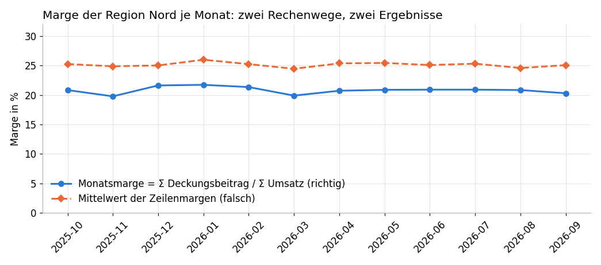
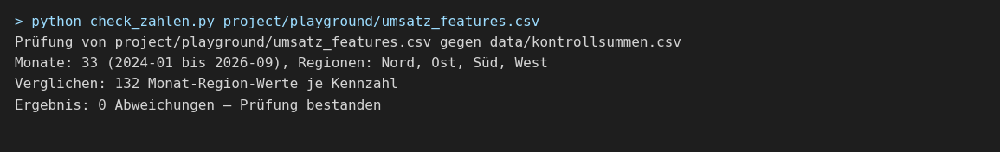

# Lab 2.3: Kennzahlen ableiten und gegenprüfen

**Leitfragen:**

<details>
<summary>Welche Kennzahl entsteht jeden Monat aus anderen Spalten?</summary>

Deckungsbeitrag (Umsatz minus Kosten) und Marge (Deckungsbeitrag geteilt durch Umsatz), dazu Monat und Quartal aus dem Buchungsdatum. Keine davon steht in der Lieferung; alle werden berechnet.

</details>

<details>
<summary>Woran würde man einen Kunden erkennen, der gerade abspringt?</summary>

Er kauft länger nicht mehr, seltener als früher, oder für weniger Geld. Genau diese drei Merkmale fasst RFM zusammen: wie lange her, wie oft, wie viel.

</details>

<details>
<summary>Wie prüft man eine berechnete Zahl, ohne dieselbe Rechnung noch einmal zu machen?</summary>

Mit einer unabhängigen Quelle: Summen aus dem Vorsystem (ERP, Hauptbuch), Zeilenzahl der Lieferung oder vorab berechnete Sollwerte. Stimmen sie überein, stimmt auch die eigene Rechnung.

</details>

- Aus vorhandenen Spalten entstehen neue: Monat, Quartal, Deckungsbeitrag, Marge, Kundenmerkmale.
- Jede berechnete Zahl wird gegen eine unabhängige Kontrollsumme geprüft, bevor sie in einen Bericht geht.

## Begriffe

| Begriff | Bedeutung |
| --- | --- |
| Feature (Merkmal) | eine Spalte, aus der eine Auswertung oder ein Modell rechnet, z. B. `monat` oder `marge` |
| Feature Engineering | neue Spalten aus vorhandenen bilden, wie eine Hilfsspalte mit Formel in Excel |
| Deckungsbeitrag | Umsatz minus Kosten einer Buchung, in Euro |
| Marge | Deckungsbeitrag geteilt durch Umsatz, als Anteil (0,20 = 20 %) |
| RFM | drei Kundenmerkmale: Recency (wie lange her), Frequency (wie oft), Monetary (wie viel) |
| Stichtag | Datum, ab dem zurückgerechnet wird; bei Nordwind der 30.09.2026 |
| Kontrollsumme | unabhängig ermittelte Summe zum Gegenprüfen, z. B. Umsatz je Monat und Region aus dem Vorsystem |
| Sollwert | erwarteter Wert, gegen den verglichen wird; bei Nordwind in `data/kontrollsummen.csv` |

## Feature Engineering: neue Spalten aus vorhandenen


_Quelle: pandas, „How to create new columns derived from existing columns" (https://pandas.pydata.org/docs/getting_started/intro_tutorials/05_add_columns.html), BSD-3-Lizenz, abgerufen am 15.11.2026._

| neue Spalte | Formel in `features.py` | Beispiel (erste Zeile) |
| --- | --- | --- |
| `monat` | `df["datum"].dt.strftime("%Y-%m")` | `2024-01` |
| `quartal` | `df["datum"].dt.to_period("Q").astype(str)` | `2024Q1` |
| `deckungsbeitrag` | `df["umsatz"] - df["kosten"]` | 39,89 − 25,92 = 13,97 |
| `marge` | Deckungsbeitrag / Umsatz | 13,97 / 39,89 = 0,350 |

- `.dt` öffnet die Datumsfunktionen einer Spalte, wie `.str` die Textfunktionen (Lab 2.2).
- Fehlen die Kosten, bleibt `deckungsbeitrag` leer (NaN), ebenso `marge`. pandas rechnet mit leeren Werten nicht weiter, statt eine falsche 0 einzusetzen.

## Die Marge wird nie aufsummiert

Eine Marge je Zeile ist ein Anteil. Anteile darf man weder addieren noch einfach mitteln: Eine Buchung über 40 € zählt sonst so viel wie eine über 4.000 €.

| Rechnung für Nord, September 2026 | Ergebnis |
| --- | --- |
| Summe Deckungsbeitrag / Summe Umsatz = 21.085,71 € / 103.872,09 € | **20,3 %** (richtig, gleich `kontrollsummen.csv`) |
| Mittelwert der Zeilenmargen | 25,1 % (falsch: kleine Buchungen mit hoher Marge zählen zu viel) |



_Quelle: eigene Auswertung, Nordwind-Daten, 15.11.2026._

Die Summe des Umsatzes enthält auch Zeilen ohne Kosten; der Deckungsbeitrag nur die Zeilen mit Kosten. So rechnen `check_zahlen.py` und `kontrollsummen.csv`.

## Kundenmerkmale für Tag 2: RFM

Für Segmente (Lab 5.2) braucht es je Kunde eine Zeile statt je Buchung. `features.py` im Beispiel erzeugt dafür `kunden_rfm.csv` (Stichtag 30.09.2026):

| kunde_id | tage_seit_kauf (Recency) | haeufigkeit (Frequency) | umsatz (Monetary) |
| --- | --- | --- | --- |
| K0001 | 1 | 64 | 10.343,82 € |
| K0002 | 26 | 38 | 7.411,20 € |
| K0003 | 345 | 74 | 18.149,81 € |

K0003 hat viel gekauft, aber seit fast einem Jahr nicht mehr: ein Kandidat für einen Anruf des Außendiensts.

**Automatisiertes Feature Engineering** heißt: Werkzeuge erzeugen aus Tabellen Hunderte Kandidaten-Spalten (Summen, Mittelwerte, Zeitabstände) automatisch, ein Modell wählt die nützlichen aus. Im Kurs bleiben die Merkmale bewusst wenige und von Hand gewählt, damit jede Zahl erklärbar ist.

## Kontrollsummen als unabhängige Prüfung

`check_zahlen.py` im Kursordner prüft jede Tabelle mit den Spalten `monat` (oder `datum`), `region`, `umsatz` und `deckungsbeitrag` (oder `kosten`):

```text
python check_zahlen.py <datei.csv>
1. summiert Umsatz und Deckungsbeitrag je Monat und Region
2. berechnet daraus die Marge = Deckungsbeitrag / Umsatz
3. vergleicht mit data/kontrollsummen.csv (nur Monate, die in der Datei vorkommen)
4. meldet "0 Abweichungen – Prüfung bestanden" oder listet die Abweichungen
```



_Quelle: eigene Auswertung (Terminal-Ausgabe), Nordwind-Daten, 15.11.2026._

| Woher Kontrollsummen im Alltag kommen | Beispiel |
| --- | --- |
| Vorsystem | Umsatz je Monat aus dem ERP oder dem Hauptbuch der Buchhaltung |
| Lieferung selbst | Zeilenzahl und Gesamtsumme, die der Absender mitschickt |
| Vormonatsbericht | bereits abgenommene Monate dürfen sich nicht ändern |

`kontrollsummen.csv` spielt im Kurs die Rolle des Vorsystems: unabhängig berechnet, bis Oktober 2026.

## Typische Fehler

| Symptom | Ursache | Lösung |
| --- | --- | --- |
| `nicht OK  Spalte marge fehlt` | Code nicht zwischen die Markierungen gesetzt oder Datei nicht gespeichert | einfügen, Strg+S, erneut ausführen |
| `nicht OK  marge weicht ... ab` | Marge in Prozent (`* 100`) oder Kosten statt Deckungsbeitrag geteilt | `df["deckungsbeitrag"] / df["umsatz"]`, als Anteil |
| `AttributeError: Can only use .dt accessor with datetimelike values` | Datum noch Text | `pd.to_datetime(df["datum"])` steht im Starter vor `monat`; Reihenfolge nicht ändern |
| `check_zahlen.py`: Abweichungen beim Umsatz | eigene Datei aus einer abweichenden Bereinigung | Starter liest `umsatz_clean.csv` aus dem Beispiel von Lab 2.2; Pfad nicht ändern |
| `FileNotFoundError` bei `check_zahlen.py` | Pfad zur Datei falsch | `python check_zahlen.py project/playground/umsatz_features.csv` |

## Fazit

- Feature Engineering bildet neue Spalten aus vorhandenen: Monat, Quartal, Deckungsbeitrag, Marge, RFM je Kunde.
- Eine Marge über mehrere Zeilen ist immer Σ Deckungsbeitrag / Σ Umsatz, nie Summe oder Mittelwert der Zeilenmargen.
- Kontrollsummen aus einer unabhängigen Quelle prüfen jede berechnete Zahl; `check_zahlen.py` meldet „0 Abweichungen".

In der Übung ergänzt Copilot die Marge, und `check_zahlen.py` bestätigt die Zahlen.
