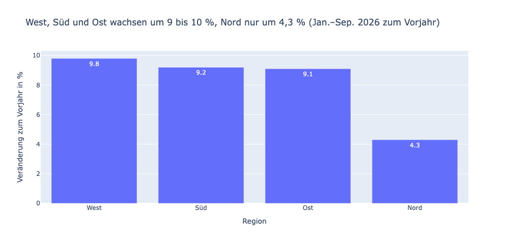

# Lab 3.2 – Lösung: Diagramme, die eine Aussage haben

Fertiges Notebook mit allen Diagrammen: [`project/examples/m03-exploration/l02-charts/diagramme.ipynb`](../../project/examples/m03-exploration/l02-charts/diagramme.ipynb). Dieselben Diagramme als Funktionen: [`diagramme.py`](../../project/examples/m03-exploration/l02-charts/diagramme.py), Aufruf im Kursordner:

```bash
python project/examples/m03-exploration/l02-charts/diagramme.py
```

```text
Gespeichert: project/examples/m03-exploration/l02-charts/diagramm_kanal.html
Gespeichert: project/examples/m03-exploration/l02-charts/diagramm_marge.html
Gespeichert: project/examples/m03-exploration/l02-charts/diagramm_wachstum.html
```

## Aufgabe 1: Diagramm 1

Zwei Linien von 2024-01 bis 2026-09; der Onlineshop steigt ab März 2026 sichtbar, der Außendienst schwankt mit der Saison ohne Trend.

## Aufgabe 2: Lösungs-Snippet `fig2`

Zwischen `# >>> AUFGABE 1` und `# <<< ENDE AUFGABE 1`:

```python
fig2 = px.bar(
    marge, x="produktgruppe", y="marge_prozent", text="marge_prozent",
    title="Schreibwaren mit der höchsten Marge (34,8 %), Technik mit der niedrigsten (14,2 %)",
    labels={"produktgruppe": "Produktgruppe", "marge_prozent": "Marge in %"},
)
```

Prüfzelle: `OK – fig2: Spalten produktgruppe und marge_prozent, Titel „Schreibwaren mit der höchsten Marge (34,8 %), Technik mit der niedrigsten (14,2 %)“`

Ein Titel, den das Modell aus `marge` selbst berechnet (z. B. mit `marge.iloc[0]`), ist ebenso richtig.

## Aufgabe 3: eigener Prompt und Lösungs-Snippet `fig3`

Beispiel-Prompt:

> Kontext: In einem Jupyter-Notebook ist `wachstum` eine pandas-Tabelle mit dem Umsatzwachstum je Region; plotly express ist als `px` importiert.
> Spalten: `region` (Nord, Ost, Süd, West), `wachstum_prozent` (Veränderung Januar–September 2026 zum Vorjahr, bereits in Prozent).
> Regel: Balkendiagramm mit `px.bar`, ein Balken je Region, Wert als Beschriftung, deutsche Achsentitel. Titel: „West, Süd und Ost wachsen um 9 bis 10 %, Nord nur um 4,3 % (Jan.–Sep. 2026 zum Vorjahr)".
> Ausgabe: Nur Python-Code für eine Notebook-Zelle, Ergebnis in der Variable `fig3`. Nichts speichern, keine Erklärung.

Zwischen `# >>> AUFGABE 2` und `# <<< ENDE AUFGABE 2`:

```python
fig3 = px.bar(
    wachstum, x="region", y="wachstum_prozent", text="wachstum_prozent",
    title="West, Süd und Ost wachsen um 9 bis 10 %, Nord nur um 4,3 % (Jan.–Sep. 2026 zum Vorjahr)",
    labels={"region": "Region", "wachstum_prozent": "Veränderung zum Vorjahr in %"},
)
```



_Quelle: eigene Auswertung, Nordwind-Daten, 15.11.2026._

Prüfzelle: `OK – fig3: Spalten region und wachstum_prozent, Titel „…“`. Liegende Balken (`orientation="h"`, `x` und `y` getauscht) und andere Befund-Titel mit richtigen Werten sind ebenso richtig. „nicht OK“ kommt bei fehlendem Titel, bei einer anderen Spalte (z. B. `2026` statt `wachstum_prozent`) oder wenn das Ergebnis nicht in `fig3` steht.

## Aufgabe 4: Speichern

```text
Gespeichert: project/playground/diagramm_kanal.html
Gespeichert: project/playground/diagramm_marge.html
Gespeichert: project/playground/diagramm_wachstum.html
```

Jede Datei ist rund 10 KB groß und braucht beim Öffnen Internet für plotly.

## Erweiterung: Ist gegen Plan

```python
features = pd.read_csv("project/examples/m02-data-preparation/l03-features/umsatz_features.csv")
plan = pd.read_csv("data/nordwind_plan_2026.csv")

ist_2026 = features[features["monat"].between("2026-01", "2026-09")].groupby("region")["umsatz"].sum()
plan_2026 = plan[plan["monat"].between("2026-01", "2026-09")].groupby("region")["plan_umsatz"].sum()
abweichung = ((ist_2026 - plan_2026) / plan_2026 * 100).round(1).reset_index(name="abweichung_prozent")
abweichung["lage"] = abweichung["abweichung_prozent"].apply(lambda w: "über Plan" if w >= 0 else "unter Plan")

fig4 = px.bar(
    abweichung, x="region", y="abweichung_prozent", color="lage", text="abweichung_prozent",
    title="Ist gegen Plan, Januar bis September 2026: Abweichung je Region in %",
    labels={"region": "Region", "abweichung_prozent": "Abweichung zum Plan in %", "lage": ""},
)
fig4
```

| Region | Ist Jan.–Sep. 2026 | Plan | Abweichung |
| --- | --- | --- | --- |
| Nord | 826.875 € | 832.000 € | −0,6 % |
| Ost | 520.397 € | 491.000 € | +6,0 % |
| Süd | 674.400 € | 656.000 € | +2,8 % |
| West | 792.757 € | 781.000 € | +1,5 % |

Ost liegt über Plan, aber ohne die auffällige Buchung vom 10.02.2026 (Lab 3.1) läge Ost mit rund −0,6 % knapp darunter.
