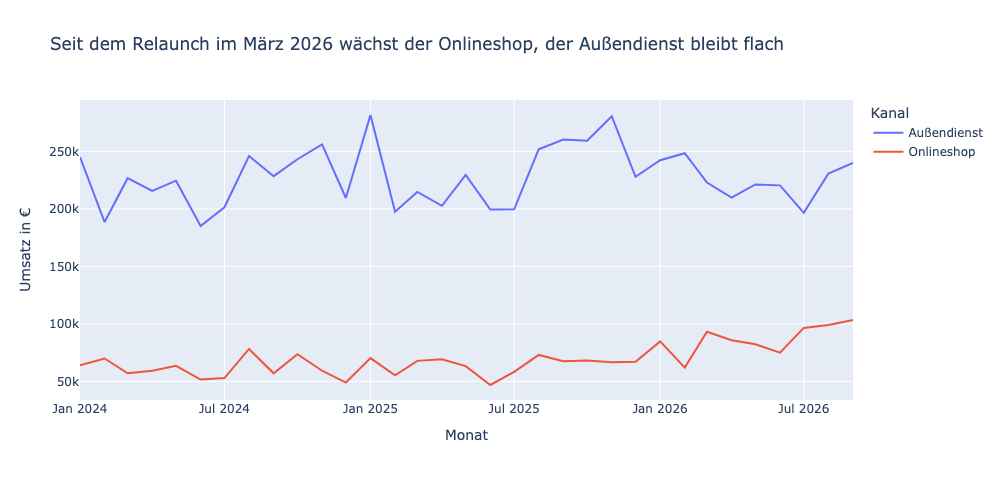
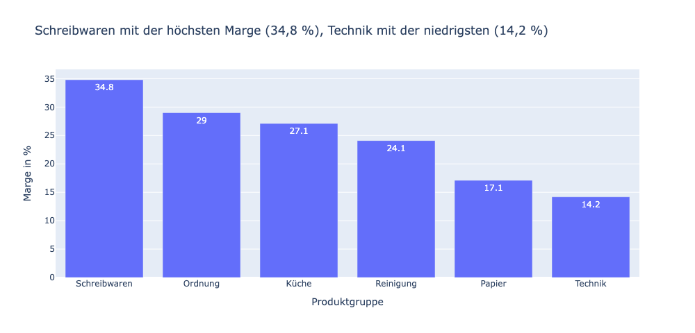

# Lab 3.2: Diagramme, die eine Aussage haben

**Leitfragen:**

<details>
<summary>Welches Diagramm im eigenen Reporting versteht niemand ohne Erklärung?</summary>

Meist eines mit vielen Linien, Farben oder einem Titel wie „Umsatz nach Region". Es zeigt Daten, aber keine Aussage. Hilfe: ein Diagramm je Aussage, der Befund steht als Titel darüber.

</details>

<details>
<summary>Wann ist eine Tabelle besser als ein Diagramm?</summary>

Wenn genaue Werte gebraucht werden, etwa Umsatz und Marge je Region im Monatsbericht. Ein Diagramm zeigt Richtung und Größenordnung; deshalb enthält der Bericht in Lab 3.3 beides.

</details>

<details>
<summary>Was soll eine Führungskraft nach drei Sekunden Blick auf ein Diagramm wissen?</summary>

Die eine Aussage, z. B. „Seit dem Relaunch im März 2026 wächst der Onlineshop". Genau dieser Satz gehört in den Titel.

</details>

- Ein Diagramm beantwortet eine Frage. Die Art der Aussage (Verlauf, Vergleich, Anteil, Abweichung) bestimmt den Diagrammtyp.
- plotly express erzeugt mit einer Zeile ein interaktives Diagramm, das als HTML-Datei in jedem Browser läuft.

## Begriffe

| Begriff | Bedeutung |
| --- | --- |
| plotly express (`px`) | Python-Bibliothek für interaktive Diagramme: eine Funktion je Diagrammtyp, z. B. `px.line`, `px.bar` |
| Figure (`fig`) | das fertige Diagramm-Objekt; im Notebook als letzte Zeile einer Zelle angezeigt |
| interaktiv | im Browser zoomen, Werte beim Darüberfahren sehen, Linien ein- und ausblenden |
| Befund-Titel | Titel, der die Aussage nennt („Nord wächst am schwächsten") statt nur das Thema („Wachstum je Region") |
| `write_html` | speichert ein Diagramm als HTML-Datei, die jeder Browser öffnet |
| KI-Dashboard | BI-Werkzeug, in dem ein Sprachmodell auf eine Frage hin Diagramme oder Seiten erstellt |

## Diagrammwahl nach Aussage

| Aussage | Frage | Diagramm | plotly express | Nordwind-Beispiel |
| --- | --- | --- | --- | --- |
| Verlauf | Wie entwickelt es sich über die Zeit? | Linie | `px.line` | Umsatz je Monat und Kanal |
| Vergleich | Welche Gruppe ist größer? | Balken | `px.bar` | Marge je Produktgruppe |
| Anteil | Wie teilt sich ein Ganzes auf? | gestapelter Balken, selten Kreis | `px.bar(..., color=...)` | Online- und Außendienst-Anteil |
| Abweichung | Wie weit weg von Vorjahr oder Plan? | Balken um die Nulllinie | `px.bar` | Wachstum je Region, Ist gegen Plan |

## plotly express statt Klickpfad

In Excel entsteht ein Diagramm über Einfügen → Diagramm → Formatieren. In plotly ist es eine Zeile, die bei neuen Daten dasselbe Diagramm wieder erzeugt:

```python
import plotly.express as px

fig1 = px.line(
    kanal_monat,                                   # Tabelle aus Lab 3.1
    x="monat", y=["Außendienst", "Onlineshop"],    # x-Achse und eine Linie je Spalte
    title="Seit dem Relaunch im März 2026 wächst der Onlineshop, der Außendienst bleibt flach",
    labels={"monat": "Monat", "value": "Umsatz in €", "variable": "Kanal"},   # Achsentitel auf Deutsch
)
fig1                                                # letzte Zeile: Notebook zeigt das Diagramm
fig1.write_html("project/playground/diagramm_kanal.html", include_plotlyjs="cdn")
```



_Quelle: eigene Auswertung, Nordwind-Daten, 15.11.2026._

| Parameter | Wirkung |
| --- | --- |
| `x`, `y` | Spaltennamen für die Achsen; `y` als Liste ergibt eine Linie je Spalte |
| `color` | Spalte, nach der eingefärbt wird (eine Farbe je Wert) |
| `text` | Spalte, deren Wert auf dem Balken steht |
| `title` | Diagrammtitel: der Befund |
| `labels` | deutsche Beschriftung für Spaltennamen |
| `include_plotlyjs="cdn"` | HTML-Datei bleibt klein (ca. 10 KB statt 4–5 MB); plotly wird beim Öffnen aus dem Internet geladen |

## Der Befund als Titel

| Thema-Titel | Befund-Titel |
| --- | --- |
| Marge je Produktgruppe | Schreibwaren mit der höchsten Marge (34,8 %), Technik mit der niedrigsten (14,2 %) |
| Wachstum je Region | West, Süd und Ost wachsen um 9 bis 10 %, Nord nur um 4,3 % |



_Quelle: eigene Auswertung, Nordwind-Daten, 15.11.2026._

Der Befund kommt aus den Zahlen, nicht aus dem Gefühl. Ein KI-Assistent kann einen Titel vorschlagen; ob er stimmt, zeigt die Tabelle darunter.

## Diagramme per Prompt

Das Prompt-Muster aus Lab 2.1 passt auch für Diagramme:

| Teil | Für ein Diagramm |
| --- | --- |
| Kontext | Notebook, Name der Tabelle, `px` ist importiert |
| Spalten | welche Spalten auf welche Achse, Einheit (z. B. schon in Prozent) |
| Regel | Diagrammtyp, Beschriftung, Titel als Befund mit Werten |
| Ausgabe | nur Code, Ergebnis in einer festen Variable (`fig2`, `fig3`), nichts speichern |

Die feste Variable ist wichtig: Die Prüfzelle sucht genau `fig2` und `fig3` und prüft Titel und Datenspalten.

## KI in BI-Werkzeugen

Stand: 11/2026, vor Kursbeginn prüfen.

| Werkzeug | Was die KI tut | Voraussetzung laut Hersteller |
| --- | --- | --- |
| Power BI mit Copilot | Berichtsseiten aus einer Beschreibung erstellen, Fragen zu einem Bericht beantworten, Zusammenfassungen schreiben | kostenpflichtige Fabric-Kapazität ab F2 oder Power BI Premium ab P1; Pro-Lizenz allein reicht nicht |
| Tableau Agent | Fragen an die Daten vorschlagen, Diagramme und berechnete Felder aus einer Frage erstellen | Tableau Cloud mit Tableau+, „AI in Tableau" in den Site-Einstellungen eingeschaltet |


_Quelle: Microsoft Learn, „Copilot for Power BI overview" (https://learn.microsoft.com/en-us/power-bi/create-reports/copilot-introduction), Seite vom 24.08.2026, abgerufen am 15.11.2026._


_Quelle: Tableau Help, „Explore Your Data with Tableau Agent" (https://help.tableau.com/current/online/en-us/web_author_einstein.htm), abgerufen am 15.11.2026._

Einordnung: Beide Werkzeuge arbeiten auf einem gepflegten Datenmodell im BI-System. Für einen wiederkehrenden Bericht aus einer CSV-Lieferung ist ein Skript mit festen Diagrammen (Lab 3.3) unabhängig von Lizenz und Kapazität.

## Typische Fehler

| Symptom | Ursache | Lösung |
| --- | --- | --- |
| Zelle zeigt kein Diagramm | `fig` steht nicht in der letzten Zeile | Variable als letzte Zeile der Zelle schreiben |
| HTML-Datei im Browser leer | kein Internet, plotly kommt per `cdn` | Internet prüfen oder `include_plotlyjs=True` (größere Datei) |
| `ValueError: Value of 'x' is not the name of a column` | Spaltenname falsch geschrieben | Spalten mit `tabelle.columns` ansehen |
| Prüfzelle: „zeigt nicht die Spalte …" | andere Tabelle oder Spalte im Diagramm | Prompt um Tabellen- und Spaltennamen ergänzen |
| Balken in falscher Reihenfolge | Tabelle unsortiert | vorher `sort_values(...)` |

## Fazit

- Erst die Aussage, dann der Diagrammtyp: Verlauf = Linie, Vergleich und Abweichung = Balken.
- Der Titel nennt den Befund mit Zahl.
- `write_html` macht aus jedem Diagramm eine Datei, die ohne Python im Browser läuft.

In der Übung entstehen drei Diagramme: eines fertig, eines mit vorgegebenem Prompt und eines mit eigenem Prompt.
