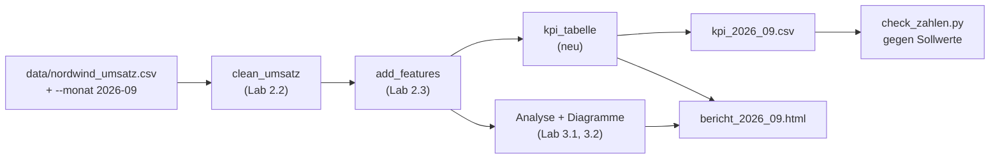
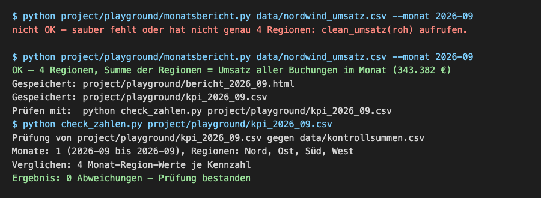
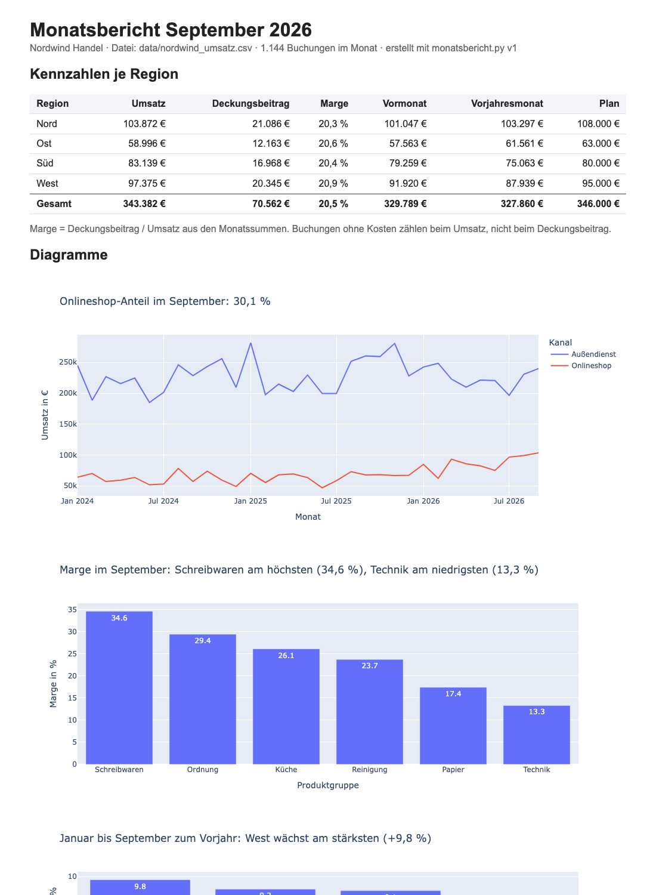

# Lab 3.3: Der Monatsbericht als Skript

**Leitfragen:**

<details>
<summary>Was müsste man heute jeden Monat neu klicken, damit der Bericht entsteht?</summary>

Datei öffnen, bereinigen, Pivot aktualisieren, Diagramme anpassen, Werte in die Berichtsvorlage kopieren. Jeder Klick ist eine Fehlerquelle. Ein Skript macht dieselben Schritte mit einem Befehl.

</details>

<details>
<summary>Welche Teile des Berichts ändern sich jeden Monat, welche nie?</summary>

Es ändern sich Eingabedatei, Berichtsmonat und damit alle Zahlen und Befund-Titel. Gleich bleiben Rechenregeln, Aufbau, Tabellenspalten und Diagrammtypen. Genau das Gleichbleibende steht im Skript, das Wechselnde kommt als Argument.

</details>

<details>
<summary>Wem würde man ein Skript übergeben, und was braucht diese Person dazu?</summary>

Einer Kollegin im Controlling: Sie braucht Python mit den Paketen, den Befehl mit zwei Argumenten und die Prüfung mit `check_zahlen.py`. Den Code muss sie dafür nicht verstehen.

</details>

- Ein Notebook dient zum Ausprobieren, ein Skript zum Wiederholen (Lab 2.2). `monatsbericht.py` fasst alles aus Modul 2 und 3 in einer Datei zusammen.
- Gleiche Datei und gleicher Monat ergeben immer denselben Bericht: Das Skript ist deterministisch.

## Begriffe

| Begriff | Bedeutung |
| --- | --- |
| Monatsbericht v1 | erste Fassung von `monatsbericht.py`: eine CSV und ein Monat rein, ein HTML-Bericht raus |
| Argument | Angabe hinter dem Skriptnamen im Terminal (Lab 1.1); hier die Datei und `--monat 2026-09` |
| `argparse` | Python-Modul, das Argumente liest, prüft und mit `--help` eine Hilfe anzeigt |
| KPI-Tabelle | Kennzahlen je Region für den Berichtsmonat: Ist, Deckungsbeitrag, Marge, Vormonat, Vorjahresmonat, Plan |
| HTML-Bericht | eine Datei, die jeder Browser öffnet; Tabelle und interaktive Diagramme in einer Seite |
| deterministisch | gleiche Eingabe, gleiches Ergebnis; darum steht kein Erstellungszeitpunkt im Bericht |

## Ablauf in einem Bild



## Aufruf im Terminal

```bash
python project/playground/monatsbericht.py data/nordwind_umsatz.csv --monat 2026-09
```

| Teil | Bedeutung |
| --- | --- |
| `python project/playground/monatsbericht.py` | das Skript starten |
| `data/nordwind_umsatz.csv` | Pflichtargument: welche Datei |
| `--monat 2026-09` | Pflichtargument mit Namen: welcher Monat, Format JJJJ-MM |
| `--help` | statt der Argumente: zeigt, welche Argumente es gibt |

So liest das Skript die beiden Argumente:

```python
parser = argparse.ArgumentParser(description="Monatsbericht v1: CSV + Monat -> HTML-Bericht")
parser.add_argument("datei", help="Umsatzdatei, z. B. data/nordwind_umsatz.csv")            # ohne --: Reihenfolge zählt
parser.add_argument("--monat", required=True, help="Berichtsmonat als JJJJ-MM, z. B. 2026-09")
args = parser.parse_args()          # danach: args.datei und args.monat
```

Ein falscher Monat wie `2026-13` endet mit einer klaren Meldung statt einer Python-Fehlermeldung.

Nach der Rechnung prüft das Skript sich selbst: vier Regionen, Summe der Regionen gleich Umsatz aller Buchungen im Monat. Oben der Starter mit leerer Stelle, darunter derselbe Aufruf nach Aufgabe 1 und die Prüfung mit `check_zahlen.py`:



_Quelle: eigene Auswertung (Terminal-Ausgabe), Nordwind-Daten, 15.11.2026._

## Rundgang durch die Datei

`monatsbericht.py` ist eine eigenständige Datei: Sie importiert keine anderen Kursdateien, sondern enthält die Beispiel-Funktionen als Kopie. So lässt sie sich weitergeben.

| Abschnitt in der Datei | Funktionen | Herkunft |
| --- | --- | --- |
| Einstellungen | `ORDNER`, `PLAN_DATEI`, `MONATSNAMEN` | neu |
| Bereinigung | `clean_umsatz(df)` | `clean.py`, Lab 2.2 |
| Kennzahlen | `add_features(df)` | `features.py`, Lab 2.3 |
| Analyse | `wachstum_je_region`, `marge_je_produktgruppe`, `kanal_je_monat` | `analyse.py`, Lab 3.1 |
| Diagramme | `diagramm_kanal`, `diagramm_marge`, `diagramm_wachstum` | `diagramme.py`, Lab 3.2 |
| KPI-Tabelle | `kpi_tabelle(df, monat, plan)`, `mit_gesamt(kpi)` | neu |
| HTML-Bericht | `euro`, `prozent`, `html_tabelle`, `html_bericht` | neu |
| Ablauf | `lies_argumente`, `pruefe_aufgabe`, `main` | neu |

Die neue Funktion `kpi_tabelle` rechnet je Region aus den Summen; die Marge entsteht nie aus Zeilenmargen:

```python
def kpi_tabelle(df, monat, plan):
    m = pd.Period(monat, freq="M")                 # Monatsrechnung: 2026-09 minus 1 = 2026-08
    vormonat, vorjahr = str(m - 1), str(m - 12)
    kpi = df[df["monat"] == monat].groupby("region")[["umsatz", "deckungsbeitrag"]].sum()
    kpi["marge"] = kpi["deckungsbeitrag"] / kpi["umsatz"]
    kpi["vormonat"] = df[df["monat"] == vormonat].groupby("region")["umsatz"].sum()
    kpi["vorjahr"] = df[df["monat"] == vorjahr].groupby("region")["umsatz"].sum()
    kpi["plan"] = plan[plan["monat"] == monat].set_index("region")["plan_umsatz"]
    ...
```

Die Befund-Titel der Diagramme entstehen jeden Monat aus den Zahlen, z. B. `f"Onlineshop-Anteil im {monatsname}: ..."`. Zahlen erscheinen im deutschen Format (`343.382 €`, `20,5 %`).

## Das Ergebnis



_Quelle: eigener Screenshot, Nordwind-Daten, Monatsbericht v1, 15.11.2026._

| Datei | Inhalt | Wofür |
| --- | --- | --- |
| `bericht_2026_09.html` | KPI-Tabelle mit Gesamtzeile, drei Diagramme | Browser, Weitergabe |
| `kpi_2026_09.csv` | Spalten `monat, region, umsatz, deckungsbeitrag, marge, vormonat, vorjahr, plan`, vier Regionen | Prüfung, Weiterverarbeitung |

Die Gesamtzeile steht nur im HTML. In der CSV stehen nur Regionen, damit `check_zahlen.py` sie mit den Sollwerten vergleichen kann:

```bash
python check_zahlen.py project/playground/kpi_2026_09.csv
```

```text
Prüfung von project/playground/kpi_2026_09.csv gegen data/kontrollsummen.csv
Monate: 1 (2026-09 bis 2026-09), Regionen: Nord, Ost, Süd, West
Verglichen: 4 Monat-Region-Werte je Kennzahl
Ergebnis: 0 Abweichungen – Prüfung bestanden
```

## Typische Fehler

| Symptom | Ursache | Lösung |
| --- | --- | --- |
| `error: the following arguments are required: datei, --monat` | Skript per ▷ ohne Argumente gestartet | im Terminal mit beiden Argumenten aufrufen |
| `FileNotFoundError: data/nordwind_umsatz.csv` | Terminal steht nicht im Kursordner | Terminal im Kursordner öffnen |
| `nicht OK – sauber fehlt …` | Funktionsaufrufe in `main()` fehlen oder heißen anders | Aufgabe 1 im Starter erledigen |
| `nicht OK – keine Buchungen für den Monat …` | Monat liegt nicht in der Datei | Monat zwischen 2024-01 und 2026-09 wählen |
| Diagramme im Bericht leer | kein Internet (plotly per `cdn`) | Internet prüfen; die Tabelle ist trotzdem vollständig |
| `check_zahlen.py` meldet Abweichungen | Datei nicht bereinigt oder Marge gemittelt | Reihenfolge `clean_umsatz` → `add_features` → `kpi_tabelle` prüfen |

## Fazit

- Ein Befehl mit zwei Argumenten ersetzt die monatliche Klickfolge.
- Die Datei enthält alle Funktionen aus Modul 2 und 3 und läuft ohne die anderen Kursdateien.
- Jede KPI-Tabelle wird mit `check_zahlen.py` gegen unabhängige Sollwerte geprüft.

In der Übung entstehen Bericht und KPI-Tabelle für September 2026 aus dem Starter mit drei fehlenden Funktionsaufrufen.
