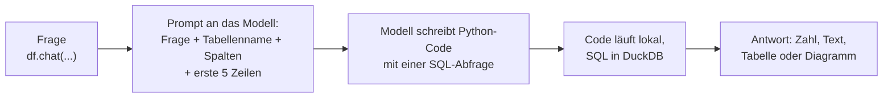
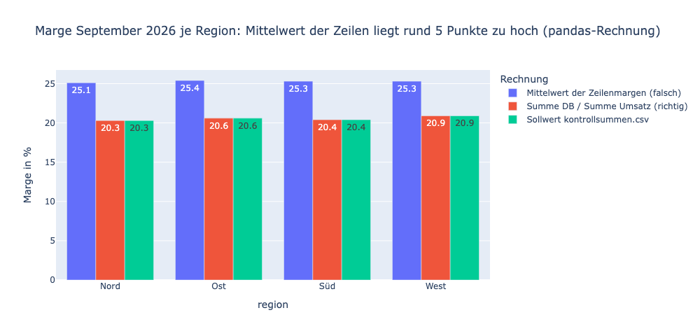

# Lab 4.1: PandasAI: fragen, prüfen, verbessern

**Leitfragen:**

<details>
<summary>Welche Frage an die eigenen Daten würde man gern einfach tippen statt programmieren?</summary>

Typisch sind schnelle Einmalfragen: „Welche Produktgruppe hatte 2025 den höchsten Umsatz?" oder „Wie viele Kunden kauften 2026 online?". Genau dafür ist PandasAI gebaut: Frage in Alltagssprache, Antwort im Notebook.

</details>

<details>
<summary>Wie prüft man eine Antwort, wenn man den Rechenweg nicht sieht?</summary>

Mit einem unabhängigen Sollwert (hier `data/kontrollsummen.csv`) oder einer zweiten Rechnung. PandasAI zeigt zusätzlich den erzeugten Code; den liest man mit den drei Lesefragen aus Lab 2.1.

</details>

<details>
<summary>Was müsste ein neuer Kollege über die Spalte `kosten` wissen, um richtig zu rechnen?</summary>

Dass sie in manchen Zeilen leer ist, dass Deckungsbeitrag = Umsatz − Kosten ist und dass die Marge einer Gruppe aus den Summen entsteht. Genau diese Sätze bekommt das Sprachmodell in Arbeitsphase 2 als Spaltenbeschreibung.

</details>

- PandasAI ist Weg 2 aus Lab 1.2: mit der Tabelle sprechen. Ein Sprachmodell schreibt zu jeder Frage Code, der Code läuft auf dem eigenen Rechner.
- Die Antwort ist so gut wie der Code. Darum gehört zu jeder Antwort der Blick in den Code und eine Gegenprobe.

## Begriffe

| Begriff | Bedeutung |
| --- | --- |
| PandasAI | Open-Source-Bibliothek: Fragen in Alltagssprache an eine Tabelle, ein Sprachmodell schreibt den Code dazu |
| Sprachmodell (LLM) | KI-Modell für Text, hier `gpt-4.1-mini` über den Kurs-Schlüssel; es schreibt Code, rechnet aber nicht selbst |
| LiteLLM | Python-Paket, das viele Anbieter von Sprachmodellen mit demselben Aufruf anspricht |
| API-Schlüssel | Zugangscode zum Dienst des Modellanbieters; kommt aus der Umgebungsvariable `OPENAI_API_KEY` |
| SQL | Abfragesprache für Tabellen, seit den 1970ern Standard in Datenbanken |
| DuckDB | kleine Datenbank, die direkt im Python-Prozess läuft; PandasAI 3 führt damit die SQL-Abfragen aus |
| Spaltenbeschreibung | kurzer Text je Spalte, den PandasAI mit jeder Frage an das Modell schickt |
| `temperature=0` | Einstellung für möglichst gleiche Antworten auf gleiche Fragen; Garantie ist es nicht |

## So arbeitet PandasAI 3



Stand: PandasAI 3.0.0 (PyPI, 07.10.2025), Python unter 3.12; geprüft im Quellcode des Pakets am 15.11.2026, vor Kursbeginn prüfen.

| Was an das Modell geht | Was nicht |
| --- | --- |
| die Frage | die übrigen 33.151 Zeilen |
| Tabellenname (`table_umsatz_features`), Zeilen- und Spaltenzahl | Ergebnisse der Rechnung |
| Spaltennamen mit Typ und Beschreibung | andere Dateien im Kursordner |
| die ersten 5 Zeilen der Tabelle | |

Die ersten fünf Zeilen verlassen den Rechner. Bei echten Firmendaten heißt das: nur freigegebene Daten verwenden (Lab 1.2).


_Quelle: PandasAI README, Sinaptik GmbH (https://github.com/sinaptik-ai/pandas-ai), MIT-Lizenz, abgerufen am 15.11.2026. Beispiel des Herstellers zur Frage „Plot the histogram of countries showing for each one the gdp"._

## Einrichtung in einer Zelle

```python
import pandasai as pai
from pandasai_litellm.litellm import LiteLLM

MODELL = "gpt-4.1-mini"
df = pai.read_csv("project/examples/m02-data-preparation/l03-features/umsatz_features.csv")
pai.config.set({"llm": LiteLLM(model=MODELL, temperature=0)})   # Schlüssel aus OPENAI_API_KEY

antwort = df.chat("Welche Produktgruppe hatte 2025 den höchsten Umsatz?")
antwort.value                  # Zahl, Text, Tabelle oder Pfad zum Diagramm (PNG in exports/charts/)
antwort.last_code_executed     # der erzeugte Code
```

`df` ist danach eine normale pandas-Tabelle mit der zusätzlichen Methode `chat`. Der Starter packt das in die Hilfsfunktion `frage(text)`, die Code und Antwort anzeigt und ohne Schlüssel nur einen Hinweis ausgibt.

## Den erzeugten Code lesen

Der Code von PandasAI 3 hat laut Prompt-Vorlage des Pakets immer denselben Aufbau: eine SQL-Abfrage als Text, der Aufruf `execute_sql_query(...)` und am Ende eine Variable `result` mit Typ und Wert. Die drei Lesefragen aus Lab 2.1 gelten weiter:

| Lesefrage | Wo im Code |
| --- | --- |
| Welche Datei? | `FROM table_umsatz_features`: die geladene Tabelle |
| Was wird verändert? | nichts, solange nur `SELECT` vorkommt |
| Was wird ausgegeben? | `result = {"type": ..., "value": ...}` |

**SQL in drei Zeilen lesen:**

| SQL | Bedeutung | Excel / pandas |
| --- | --- | --- |
| `SELECT region, SUM(umsatz)` | welche Spalten und Rechnungen | Spalten auswählen, Summe |
| `WHERE monat = '2026-09'` | welche Zeilen | Filter, `df[...]` |
| `GROUP BY region` | je Gruppe rechnen | Pivot, `groupby` |

Zwei Abfragen zum Lesen üben, von Hand geschrieben und mit DuckDB auf `umsatz_features.csv` ausgeführt:

```sql
-- A: Mittelwert der Zeilenmargen
SELECT region, AVG(marge) AS marge
FROM table_umsatz_features
WHERE monat = '2026-09'
GROUP BY region
```

```sql
-- B: Marge aus den Summen
SELECT region, SUM(deckungsbeitrag) / SUM(umsatz) AS marge
FROM table_umsatz_features
WHERE monat = '2026-09'
GROUP BY region
```

| Region | A: `AVG(marge)` | B: Summe / Summe | Sollwert |
| --- | --- | --- | --- |
| Nord | 25,1 % | 20,3 % | 20,3 % |
| Ost | 25,4 % | 20,6 % | 20,6 % |
| Süd | 25,3 % | 20,4 % | 20,4 % |
| West | 25,3 % | 20,9 % | 20,9 % |

A liegt rund 5 Prozentpunkte zu hoch: Viele kleine Buchungen mit hoher Marge (z. B. Schreibwaren) zählen beim Mittelwert so viel wie große Technik-Buchungen mit niedriger Marge.



_Quelle: eigene Auswertung (pandas-Rechnung, keine PandasAI-Antwort), Nordwind-Daten, 15.11.2026._

## Typische Fehler im erzeugten Code

| Fehler | Erkennungszeichen im Code | Abhilfe |
| --- | --- | --- |
| falscher Filter | `WHERE` fehlt oder nennt einen anderen Monat oder alle Septembermonate | Monat mit Jahr in die Frage schreiben |
| falsche Spalte | `marge` statt `deckungsbeitrag`, `menge` statt `umsatz` | Spaltenbeschreibungen setzen |
| Mittelwert statt Summe | `AVG(...)` bei Umsatz oder Marge | Regel in die Spaltenbeschreibung |
| Text statt Tabelle | `"type": "string"` | „Gib eine Tabelle mit … aus" in die Frage |

## Spaltenbeschreibungen verbessern Antworten

Spaltennamen allein sagen nicht, wie gerechnet wird. Beschreibungen gehen mit jeder Frage an das Modell:

```python
for spalte in df.schema.columns:
    if spalte.name == "marge":
        spalte.description = ("Marge EINER Buchung (deckungsbeitrag / umsatz). Nie mitteln: Die Marge "
                              "einer Gruppe oder eines Monats ist SUM(deckungsbeitrag) / SUM(umsatz).")
df.schema.description = "Umsatzbuchungen von Nordwind Handel, 01/2024 bis 09/2026, eine Zeile je Buchung"
```

Vorher/Nachher: dieselbe Frage einmal ohne, einmal mit Beschreibungen stellen und beide Antworten mit dem Sollwert vergleichen. Ob die erste Antwort schon stimmt, hängt von Modell und Tag ab; die Vergleichstabelle zeigt es.

Nicht Teil des Kurses: die semantische Schicht von PandasAI (`pai.create`), Zwischenspeicher und lokale Modelle.

## Fragen, Chat oder Skript?

| Situation | Weg |
| --- | --- |
| einmalige Frage, Ergebnis wird nicht weitergegeben | Chat oder PandasAI, Antwort kurz prüfen |
| Zahl für einen Bericht | Skript (Lab 3.3), geprüft mit `check_zahlen.py` |
| wiederkehrende Auswertung | Skript, später als Skill (Modul 7) |

## Typische Fehler

| Symptom | Ursache | Lösung |
| --- | --- | --- |
| `Ohne Dienst – keine PandasAI-Antwort` | `OPENAI_API_KEY` fehlt | Schlüssel einrichten wie in `00-setup-and-installation.md`, VS Code neu starten; sonst Zelle „Ohne Dienst" |
| `Dienst nicht erreichbar: AuthenticationError` | Schlüssel falsch oder abgelaufen | Trainer fragen, `python check_setup.py --llm` |
| `Dienst nicht erreichbar: RateLimitError` | Kontingent erschöpft | kurz warten, sonst Zelle „Ohne Dienst" |
| Prüfzelle: „keine Tabelle mit Region und Marge" | Antwort ist Text | Frage mit „Gib eine Tabelle mit region und marge aus" stellen |
| Antwort bei gleicher Frage anders als beim Nachbarn | Modell erzeugt jedes Mal neuen Code | Code vergleichen, gegen den Sollwert prüfen |

## Fazit

- PandasAI übersetzt eine Frage in Code; die Rechnung läuft lokal, die Frage und fünf Beispielzeilen gehen an das Modell.
- Jede Antwort wird geprüft: Code lesen, Sollwert oder Gegenrechnung.
- Spaltenbeschreibungen mit der Rechenregel sind der wirksamste Hebel für bessere Antworten.

In der Übung entstehen vier Antworten und eine Vorher/Nachher-Vergleichstabelle gegen den Sollwert.
