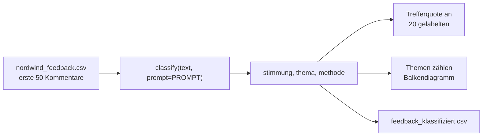
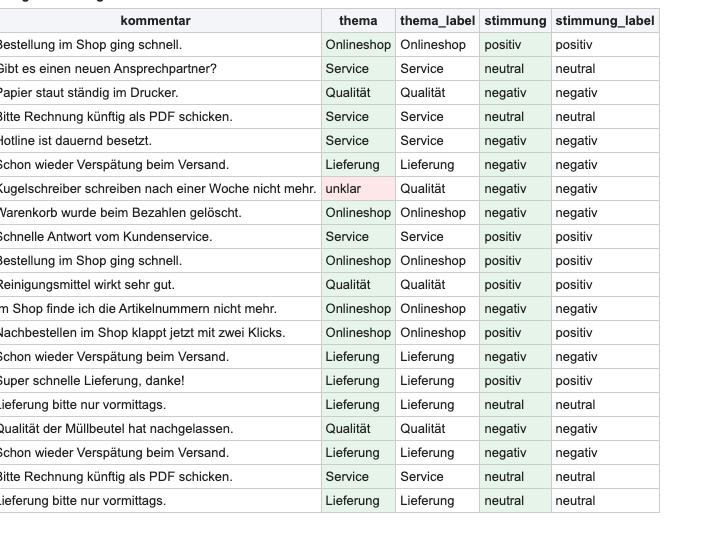
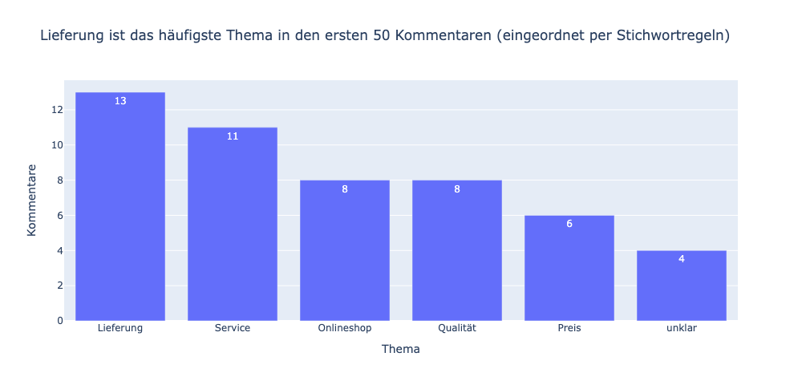

# Lab 4.2: Kundenfeedback auswerten

**Leitfragen:**

<details>
<summary>Wie wertet man heute 300 Freitextkommentare aus?</summary>

Meist gar nicht oder von Hand: lesen, Strichliste führen, ein paar Zitate in den Bericht. Bei 300 Kommentaren im Monat ist das ein halber Arbeitstag, und jede Person sortiert etwas anders.

</details>

<details>
<summary>Ist „Lieferung kam, endlich." positiv oder negativ?</summary>

Eher negativ: „endlich" klingt nach zu langem Warten, obwohl kein negatives Wort vorkommt. Solche Fälle sind schwer für feste Wortlisten; ein Sprachmodell liest den Ton mit, liegt aber auch nicht immer richtig.

</details>

<details>
<summary>Woran würde man merken, dass die KI Kommentare falsch einordnet?</summary>

Durch eine kleine Stichprobe, die ein Mensch vorher eingeordnet hat: Weicht die KI dort oft ab, stimmt auch der Rest nicht. Genau das misst die Trefferquote in der Übung.

</details>

- Freitext ist unstrukturierte Information (Lab 1.1): Zahlen lassen sich summieren, Kommentare erst nach einer Einordnung.
- Ein Sprachmodell ordnet Kommentare nach festen Feldern ein; eine kleine, von Hand gelabelte Stichprobe zeigt, wie zuverlässig das ist.

## Begriffe

| Begriff | Bedeutung |
| --- | --- |
| Textanalyse (NLP) | Natural Language Processing: Computer werten Sprache aus, z. B. Stimmung oder Thema eines Satzes |
| Klassifikation | jedem Text eine Kategorie aus einer festen Liste zuordnen (Aufgabentyp aus Lab 1.1) |
| Stimmung | positiv, neutral oder negativ |
| Label | die richtige Kategorie, von einem Menschen vergeben; hier `thema_label` und `stimmung_label` |
| Trefferquote | Anteil der gelabelten Texte, bei denen die Einordnung mit dem Label übereinstimmt |
| JSON | Textformat für Felder und Werte: `{"stimmung": "negativ", "thema": "Lieferung"}` |
| Stichwortregeln | feste Wortlisten: kommt „liefer" vor, ist das Thema Lieferung; kein Sprachmodell |

## Der Ablauf



`data/nordwind_feedback.csv` hat 300 kurze Kommentare (Spalten `id, datum, kanal, kommentar, thema_label, stimmung_label`). Unter den ersten 50 sind 20 von Hand gelabelt.

## Der Prompt mit festen Feldern

```python
PROMPT = """Ordne einen Kundenkommentar eines Großhändlers für Büro- und Haushaltsbedarf ein.
Antworte nur mit JSON in dieser Form: {"stimmung": "...", "thema": "..."}
stimmung: genau einer der Werte positiv, neutral, negativ
thema: genau einer der Werte Lieferung, Preis, Qualität, Onlineshop, Service
Kommentar: """
```

| Teil des Prompts | Wofür |
| --- | --- |
| Rolle und Kontext | Großhändler: „Toner" ist ein Produkt, kein Fremdwort |
| „nur JSON" | die Antwort lässt sich mit Python lesen, statt Fließtext |
| feste Werte je Feld | jede Antwort passt in eine Spalte und lässt sich zählen |

## `classify()` – fertig im Starter

```python
def classify(text, prompt=PROMPT):
    if MIT_DIENST:                                        # Schlüssel vorhanden
        antwort = litellm.completion(
            model=MODELL,                                 # gpt-4.1-mini, derselbe Kurs-Schlüssel wie in Lab 4.1
            messages=[{"role": "user", "content": prompt + text}],
            temperature=0,                                # möglichst gleiche Antwort bei gleicher Frage
            response_format={"type": "json_object"},      # Antwort muss JSON sein
        )
        felder = json.loads(antwort.choices[0].message.content)
        return {"stimmung": felder.get("stimmung"), "thema": felder.get("thema"), "methode": "Sprachmodell"}
    return stichwortregeln(text)                          # ohne Dienst: feste Wortlisten
```

Jede Zeile bekommt in der Spalte `methode` den Vermerk, wer eingeordnet hat: `Sprachmodell` oder `Stichwortregeln`. Ohne Schlüssel oder bei einer Störung laufen die Stichwortregeln, damit das Notebook trotzdem durchläuft.

## Prüfen an der gelabelten Stichprobe

```python
gelabelt = kommentare[kommentare["thema_label"].notna()]                # 20 Zeilen
treffer = (gelabelt["thema"] == gelabelt["thema_label"]).mean()         # True zählt als 1
```

Ergebnis im Beispiel, eingeordnet **per Stichwortregeln** (ohne Schlüssel ausgeführt):



_Quelle: eigene Auswertung (Stichwortregeln, kein Sprachmodell), Nordwind-Daten, 15.11.2026._

| Methode | Thema | Stimmung |
| --- | --- | --- |
| Stichwortregeln (Beispiel) | 19 von 20 (95 %) | 20 von 20 (100 %) |

Die Stichwortregeln treffen hier fast alles, weil die Wortlisten für genau diese kurzen Kommentare geschrieben sind. Neue Formulierungen treffen sie nicht: „Toner kam zerbrochen an." ergibt `thema: unklar, stimmung: neutral`, „Lieferung kam, endlich." ergibt `neutral`. Ein Sprachmodell braucht keine Wortliste, wird aber genauso an der Stichprobe gemessen.



_Quelle: eigene Auswertung (Stichwortregeln, kein Sprachmodell), Nordwind-Daten, 15.11.2026._

## Kosten und Datenschutz

| Punkt | Bedeutung für 50 Kommentare |
| --- | --- |
| Anfragen | 50 Aufrufe, je Kommentar einer; Kosten nach Textmenge (Token, Lab 1.2), bei kurzen Kommentaren gering; Preise beim Anbieter prüfen |
| Dauer | 50 Aufrufe nacheinander; die Zelle läuft deutlich länger als mit Stichwortregeln |
| Daten | jeder Kommentar geht an den Modellanbieter; Namen, E-Mail-Adressen oder Kundennummern vorher entfernen |
| Nachvollziehbarkeit | Prompt, Modell und Trefferquote mit dem Ergebnis speichern |

## Typische Fehler

| Symptom | Ursache | Lösung |
| --- | --- | --- |
| Spalte `methode` zeigt `Stichwortregeln` | Schlüssel fehlt oder Dienst gestört | Meldung über der Ausgabe lesen; ohne Dienst weiterarbeiten |
| `KeyError: 'thema'` | Modell hat andere Feldnamen gewählt | Feldnamen im `PROMPT` exakt vorgeben |
| Werte wie „Logistik" statt „Lieferung" | Liste der erlaubten Werte fehlt im Prompt | „genau einer der Werte …" angeben |
| Trefferquote 0 % | Spalten verwechselt oder alle 50 statt der 20 gelabelten | nur `gelabelt` vergleichen, `thema` mit `thema_label` |

## Fazit

- Ein Sprachmodell macht aus Freitext feste Felder, die sich zählen und zeigen lassen.
- Ohne Prüfung an einer gelabelten Stichprobe ist jede Einordnung eine Behauptung.
- Die Spalte `methode` zeigt bei jeder Zeile, ob ein Modell oder eine Regel eingeordnet hat.

In der Übung entstehen Trefferquote, Themendiagramm und `feedback_klassifiziert.csv` für die ersten 50 Kommentare.
