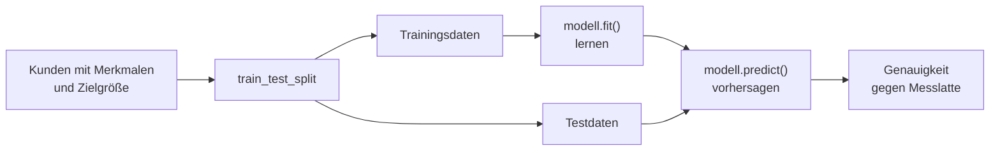
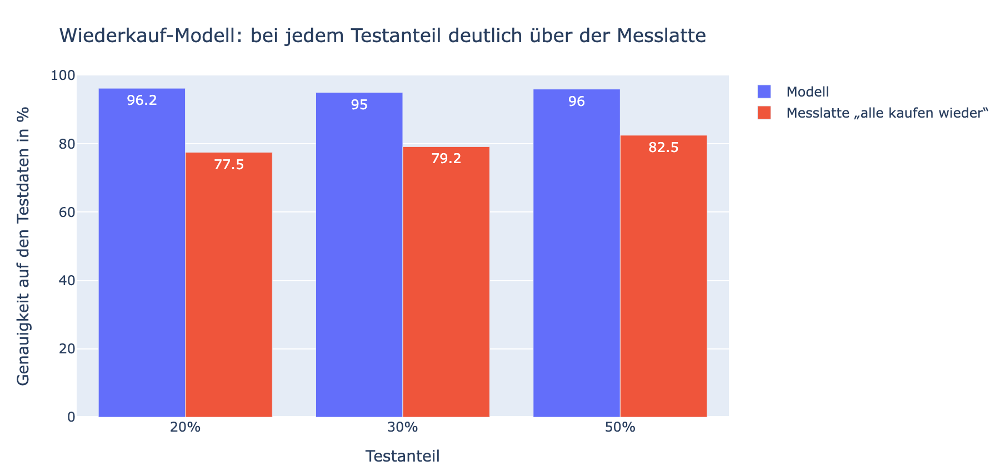

# Lab 5.1: Wie eine Maschine aus Daten lernt

**Leitfragen:**

<details>
<summary>Woran erkennt ein erfahrener Vertriebler, dass ein Kunde abspringt?</summary>

Am Verhalten der letzten Monate: lange keine Bestellung, seltener als früher, kleinere Beträge. Genau diese Signale stecken in den RFM-Spalten aus Lab 2.3; ein Modell lernt aus vielen Kunden, wie stark jedes Signal zählt.

</details>

<details>
<summary>Warum testet man eine Regel nicht an denselben Daten, aus denen man sie abgeleitet hat?</summary>

Weil eine Regel die Fälle, aus denen sie entstanden ist, immer gut erklärt. Ob sie trägt, zeigt sich erst an Fällen, die beim Aufstellen nicht bekannt waren.

</details>

<details>
<summary>Ist 90 % Treffer gut, wenn 90 % der Kunden ohnehin wieder kaufen?</summary>

Nein. „Alle kaufen wieder“ trifft ohne jedes Modell schon 90 %. Ein Modell ist erst dann nützlich, wenn es diese einfache Messlatte schlägt.

</details>

- Machine Learning heißt: Ein Programm leitet die Regel aus Beispielen ab, statt dass ein Mensch sie hinschreibt.
- Lab 5.1 zeigt den Ablauf an einer Ja/Nein-Frage: Kauft ein Nordwind-Kunde in den nächsten drei Monaten wieder?

## Überwacht und unüberwacht

Aus Lab 1.1 sind die Aufgabentypen bekannt. Sie teilen sich in zwei Arten des Lernens:


_Quelle: Wikimedia Commons, Balkiss.hamad, CC BY-SA 4.0 (https://commons.wikimedia.org/wiki/File:Supervised_and_unsupervised_learning.png), abgerufen am 15.11.2026._

| Art | Was die Daten enthalten | Nordwind-Beispiel | Lab |
| --- | --- | --- | --- |
| überwacht | Beispiele **mit** bekannter richtiger Antwort | Kunde kauft wieder: ja/nein (Klassifikation) | 5.1 |
| unüberwacht | Beispiele **ohne** Antwort; das Verfahren sucht Muster selbst | Kundensegmente (Clustering) | 5.2 |

## Begriffe

| Begriff | Bedeutung |
| --- | --- |
| Merkmal (Feature) | Eingabespalte, aus der das Modell lernt; hier `tage_seit_kauf`, `haeufigkeit`, `umsatz` (RFM aus Lab 2.3) |
| Zielgröße | Spalte, die vorhergesagt werden soll; hier `wiederkauf` (1 = kauft wieder, 0 = nicht) |
| Stichtag | Trennlinie in der Zeit: Merkmale aus den Buchungen bis 30.06.2026, Zielgröße aus Juli bis September 2026 |
| Trainingsdaten | Kunden, aus denen das Modell lernt |
| Testdaten | zurückgehaltene Kunden, an denen das Modell gemessen wird; wie eine Prüfung mit unbekannten Aufgaben |
| Genauigkeit (Accuracy) | Anteil der Testkunden, die das Modell richtig einordnet |
| Messlatte | einfachste Vorhersage ohne Modell; hier „alle kaufen wieder“ |
| logistische Regression | Modell für Ja/Nein-Fragen: rechnet aus den Merkmalen eine Wahrscheinlichkeit zwischen 0 und 1, ab 0,5 lautet die Vorhersage „ja“ |

Die Spalte `wiederkauf` gibt es in `umsatz_features.csv` nicht; die erste Zelle des Starters berechnet sie aus den Buchungen nach dem Stichtag.

## Der Ablauf: fit → predict → bewerten



Derselbe Ablauf gilt für jedes scikit-learn-Modell; nur die Zeile mit dem Modell ändert sich.

```python
from sklearn.linear_model import LogisticRegression
from sklearn.model_selection import train_test_split
from sklearn.metrics import accuracy_score

X = kunden[["tage_seit_kauf", "haeufigkeit", "umsatz"]]   # Merkmale
y = kunden["wiederkauf"]                                    # Zielgröße
X_train, X_test, y_train, y_test = train_test_split(X, y, test_size=0.2, random_state=42)

modell = LogisticRegression(max_iter=1000)   # max_iter: mehr Rechenschritte erlaubt
modell.fit(X_train, y_train)                 # lernen nur aus den Trainingsdaten
vorhersage = modell.predict(X_test)          # vorhersagen für unbekannte Kunden
print(accuracy_score(y_test, vorhersage))    # Anteil richtiger Vorhersagen
print(y_test.mean())                         # Messlatte: Anteil "kauft wieder" im Test
```

- `test_size=0.2` hält 20 % der Kunden zurück; `random_state=42` sorgt dafür, dass bei jedem Lauf dieselben Kunden im Test landen.
- Die Messlatte „alle kaufen wieder“ liegt genau bei den Kunden richtig, die wirklich wieder kaufen; ihre Genauigkeit ist deshalb der Anteil der Einsen im Test (`y_test.mean()`).

## Ergebnis am Nordwind-Beispiel

329 von 400 Kunden kaufen nach dem Stichtag wieder (82 %). Das Modell schlägt die Messlatte bei jedem Testanteil deutlich:



_Quelle: eigene Auswertung, Nordwind-Daten, 15.11.2026._

Die Messlatte schwankt mit dem Testanteil, weil jedes Mal andere Kunden im Test landen.

## Überanpassung

Ein Modell kann sich die Trainingsdaten merken, statt das Muster zu lernen. Es trifft dann im Training fast alles und versagt bei neuen Fällen.


_Quelle: Wikimedia Commons, Chabacano, CC BY-SA 4.0 (https://commons.wikimedia.org/wiki/File:Overfitting.svg), abgerufen am 15.11.2026._

- Grüne Linie: trennt die Trainingspunkte perfekt, ist aber überangepasst und liegt bei neuen Punkten oft falsch.
- Schwarze Linie: macht im Training ein paar Fehler, verallgemeinert besser.
- Erkennungszeichen: Genauigkeit auf den Trainingsdaten deutlich höher als auf den Testdaten. Im Notebook liegt sie bei Testanteil 20 % mit 92,8 % sogar etwas darunter: kein Hinweis auf Überanpassung.

## Typische Fehler

| Symptom | Ursache | Lösung |
| --- | --- | --- |
| `NameError: name 'kunden' is not defined` | Zellen nicht von oben ausgeführt | Notebook von oben neu ausführen (**Alle ausführen**) |
| Genauigkeit ändert sich nach Änderung von `TESTANTEIL` nicht | nur die geänderte Zelle ausgeführt | ab der geänderten Zelle alle darunter ausführen |
| `ConvergenceWarning` | zu wenige Rechenschritte | `LogisticRegression(max_iter=1000)` beibehalten |
| 100 % auf den Trainingsdaten, viel weniger im Test | Überanpassung | einfacheres Modell, mehr Daten, an Testdaten messen |

## Fazit

- Überwachtes Lernen braucht Beispiele mit bekannter Antwort; der Ablauf ist immer Split → `fit` → `predict` → bewerten.
- Eine Genauigkeit sagt nur etwas im Vergleich mit einer einfachen Messlatte.
- Gemessen wird an Testdaten, die das Modell beim Lernen nicht gesehen hat.

In der Übung läuft das Wiederkauf-Notebook mit drei Testanteilen.
