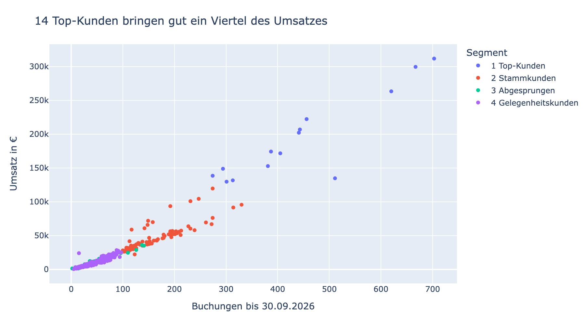
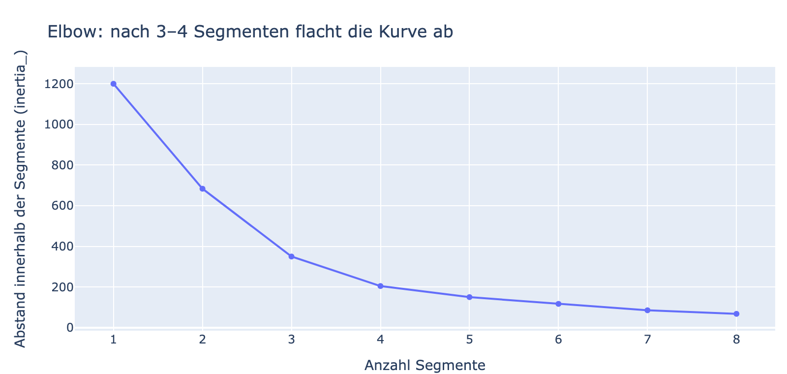

# Lab 5.2: Kundensegmente mit Clustering

**Leitfragen:**

<details>
<summary>Nach welchen Kriterien teilt das eigene Unternehmen Kunden heute ein?</summary>

Meist nach festen Regeln: Umsatzklassen (A/B/C), Branche, Region, Größe. Clustering ergänzt das: Es sucht Gruppen, die sich im Kaufverhalten ähneln, ohne dass vorher Grenzen festgelegt werden.

</details>

<details>
<summary>Was passiert, wenn man Umsatz in Euro und Bestellungen als Anzahl ungewichtet vergleicht?</summary>

Der Umsatz gewinnt: 1.000 € Unterschied wiegen dann so viel wie 1.000 Bestellungen. Deshalb werden die Spalten vor dem Vergleich auf einen gemeinsamen Maßstab gebracht (Skalieren).

</details>

<details>
<summary>Wie viele Kundengruppen kann ein Vertriebsteam sinnvoll unterschiedlich behandeln?</summary>

Selten mehr als drei bis fünf. Die Zahl der Segmente ist deshalb eine fachliche Entscheidung; im Kurs ist sie fest 4.

</details>

- Clustering ist unüberwachtes Lernen (Lab 5.1): Es gibt keine Zielgröße, das Verfahren findet Gruppen ähnlicher Kunden selbst.
- Die Gruppen haben zunächst nur Nummern; erst Menschen geben ihnen Namen und eine Bedeutung.

## Begriffe

| Begriff | Bedeutung |
| --- | --- |
| Clustering | Datenpunkte so in Gruppen teilen, dass sich Punkte einer Gruppe ähnlich sind und Gruppen sich unterscheiden |
| Segment / Cluster | eine dieser Gruppen; hier eine Gruppe von Kunden mit ähnlichem Kaufverhalten |
| k-Means | bekanntestes Clustering-Verfahren; `k` = Anzahl der Gruppen, „Means“ = Mittelpunkte |
| Mittelpunkt (Zentrum) | Durchschnittskunde eines Segments: Mittelwert jeder Merkmalsspalte |
| Skalieren | Spalten auf einen gemeinsamen Maßstab bringen, damit keine Spalte nur wegen ihrer Einheit dominiert |
| `StandardScaler` | skaliert jede Spalte auf Mittelwert 0 und Standardabweichung 1 (Standardabweichung = typische Abweichung vom Mittelwert, wie in `describe()` aus Lab 3.1 als `std`) |

## k-Means anschaulich


_Quelle: Wikimedia Commons, Chire, CC BY-SA 4.0 (https://commons.wikimedia.org/wiki/File:K-means_convergence.gif), abgerufen am 15.11.2026._

1. `k` Mittelpunkte zufällig setzen.
2. Jeden Kunden dem nächstgelegenen Mittelpunkt zuordnen.
3. Jeden Mittelpunkt in die Mitte seiner Kunden verschieben.
4. Schritte 2 und 3 wiederholen, bis sich nichts mehr ändert.

Weil der Start zufällig ist, rechnet `n_init=10` zehn Starts und behält den besten; `random_state=42` macht das Ergebnis wiederholbar. Die Nummern 0 bis 3 vergibt k-Means in zufälliger Reihenfolge; das Notebook nummeriert sie deshalb neu nach Ø Umsatz (Segment 1 = höchster Ø Umsatz).

## Warum skalieren?

Die drei RFM-Spalten aus `kunden_rfm.csv` (Lab 2.3, Stichtag 30.09.2026) haben völlig verschiedene Größenordnungen:

| | tage_seit_kauf | haeufigkeit | umsatz |
| --- | ---: | ---: | ---: |
| Mittelwert | 59 | 83 | 24.499 |
| Standardabweichung | 106 | 93 | 38.563 |
| Maximum | 491 | 703 | 311.637 |

Ohne Skalieren misst k-Means den Abstand zweier Kunden fast nur in Euro. Nach `StandardScaler` hat jede Spalte Mittelwert 0 und Standardabweichung 1; ein Wert von 2 heißt dann in jeder Spalte „zwei typische Abweichungen über dem Durchschnitt“.

```python
from sklearn.preprocessing import StandardScaler
from sklearn.cluster import KMeans

MERKMALE = ["tage_seit_kauf", "haeufigkeit", "umsatz"]
skaliert = StandardScaler().fit_transform(kunden[MERKMALE])        # gemeinsamer Maßstab
kmeans = KMeans(n_clusters=4, random_state=42, n_init=10)          # 4 Segmente, wiederholbar
kunden["segment"] = kmeans.fit_predict(skaliert)                   # Segmentnummer je Kunde
```

## Ergebnis: vier Nordwind-Segmente

| Segment | Kunden | Ø Tage seit Kauf | Ø Buchungen | Ø Umsatz | Anteil am Umsatz | Name (Vorschlag) |
| ---: | ---: | ---: | ---: | ---: | ---: | --- |
| 1 | 14 | 2 | 443 | 191.977 € | 27,4 % | Top-Kunden |
| 2 | 90 | 4 | 157 | 45.684 € | 42,0 % | Stammkunden |
| 3 | 55 | 302 | 54 | 13.040 € | 7,3 % | Abgesprungen |
| 4 | 241 | 27 | 41 | 9.474 € | 23,3 % | Gelegenheitskunden |



_Quelle: eigene Auswertung, Nordwind-Daten, 15.11.2026._

Segment 3 ist im Diagramm kaum von Segment 4 zu trennen: Der Unterschied steckt in der dritten Spalte `tage_seit_kauf`, die das Bild nicht zeigt.

## Segmente nutzen

| Segment | Marketing / Vertrieb | Controlling |
| --- | --- | --- |
| Top-Kunden | persönliche Betreuung, Rahmenverträge | Klumpenrisiko: 14 Kunden = gut ein Viertel des Umsatzes |
| Stammkunden | Zusatzsortimente anbieten | stabile Basis der Prognose |
| Abgesprungen | Rückgewinnungsaktion | Umsatz fehlt im Vorjahresvergleich |
| Gelegenheitskunden | Onlineshop-Angebote, Newsletter | viele Kunden, kleiner Umsatz je Kunde |

## Anzahl Segmente: eine fachliche Wahl

Mehr Segmente machen die Gruppen immer enger, aber nicht unbedingt nützlicher. Das Elbow-Diagramm (Erweiterung) zeigt, wie eng die Gruppen bei 1 bis 8 Segmenten sind; wo die Kurve abknickt, bringt ein weiteres Segment wenig.



_Quelle: eigene Auswertung, Nordwind-Daten, 15.11.2026._

## Typische Fehler

| Symptom | Ursache | Lösung |
| --- | --- | --- |
| Segmente nur nach Umsatz getrennt | nicht skaliert | `StandardScaler` vor `KMeans` |
| anderes Ergebnis bei jedem Lauf | `random_state` fehlt | `random_state=42` setzen |
| Namen passen nicht zur Tabelle | Namen nach alter Nummernfolge vergeben | Segmenttabelle ansehen, dann Namen je Nummer vergeben |
| Prüfzelle meldet mehrere Namen je Segment | Namen pro Kunde statt pro Segment vergeben | Namen über die Spalte `segment` zuordnen (`map`) |

## Fazit

- k-Means gruppiert Kunden um Mittelpunkte; vorher müssen die Merkmale skaliert werden.
- Die Zahl der Segmente und ihre Namen sind fachliche Entscheidungen, keine Rechenergebnisse.
- Bei Nordwind bringen 14 Top-Kunden gut ein Viertel des Umsatzes; 55 Kunden haben im Schnitt seit 302 Tagen nicht gekauft.
- Im Bericht v2 (Lab 6.2) wird daraus die Funktion `segmente(df, monat)`: dieselbe Methode mit RFM bis zum Ende des Berichtsmonats, Anzahl als Einstellung `ANZAHL_SEGMENTE = 4`; die Namen bleiben eine fachliche Entscheidung, der Bericht zeigt Nummern 1–4.

In der Übung entstehen die Segmente im Notebook und bekommen Namen.
