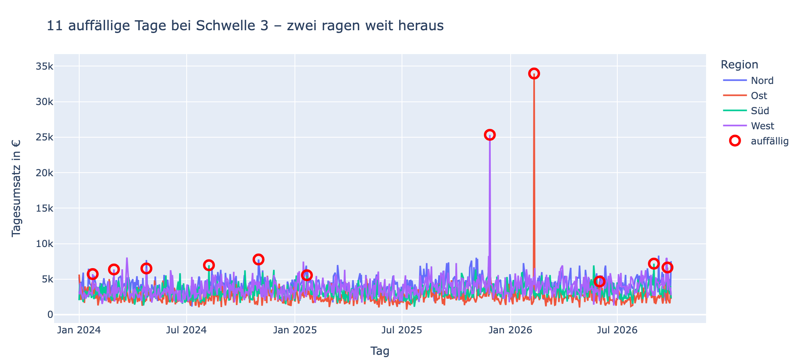

# Lab 5.3: Auffälligkeiten erkennen

**Leitfragen:**

<details>
<summary>Welche Zahl im letzten Bericht hätte man gern früher gesehen?</summary>

Typisch: ein Tippfehler in einer Buchung, ein ausgefallener Großkunde, ein Rekordtag. Solche Ausreißer verstecken sich in Monatssummen; auf Tagesebene fallen sie auf, wenn eine Regel sie markiert.

</details>

<details>
<summary>Ist ein Rekordumsatz am Black Friday eine Anomalie?</summary>

Rechnerisch ja, fachlich nein: Er ist ungewöhnlich, aber erklärbar und erwünscht. Eine Regel findet ungewöhnliche Werte; ob ein Fehler dahintersteckt, entscheidet ein Mensch.

</details>

<details>
<summary>Wie viele Fehlalarme pro Monat akzeptiert ein Controlling-Team?</summary>

So wenige, dass jede Meldung noch geprüft wird, oft nur eine Handvoll. Daraus ergibt sich, wie streng die Schwelle sein muss.

</details>

- Eine Anomalie ist ein Wert, der stark vom Üblichen abweicht. Anomalie ≠ Fehler: Sie kann ein Datenfehler oder ein echtes Ereignis sein.
- Die Regel in diesem Lab: Ein Tag ist auffällig, wenn er mehr als drei Standardabweichungen vom Mittel abweicht.

## Mittelwert, Streuung, Ausreißer

| Begriff | Bedeutung | Nordwind-Beispiel |
| --- | --- | --- |
| Mittelwert | Durchschnitt; in pandas `mean` | Ø Tagesumsatz der Region West im November 2025: 5.517 € |
| Standardabweichung (Streuung) | typische Abweichung der Werte vom Mittelwert; in pandas `std` (bekannt aus `describe()` in Lab 3.1) | 4.807 € |
| Abstand in Standardabweichungen | (Wert − Mittelwert) / Standardabweichung; sagt, wie ungewöhnlich ein Wert ist, unabhängig von der Größe der Region | 27.11.2025: (25.329 − 5.517) / 4.807 = 4,1 |
| Ausreißer | Wert weit außerhalb des Üblichen | 27.11.2025 West |
| Schwelle | Grenze für „auffällig“, als Parameter `schwelle` | Standard 3 |


_Quelle: Wikimedia Commons, M. W. Toews, CC BY 2.5 (https://commons.wikimedia.org/wiki/File:Standard_deviation_diagram.svg), abgerufen am 15.11.2026._

Bei gleichmäßig schwankenden Werten liegen rund 99,7 % innerhalb von drei Standardabweichungen. Was darüber hinausgeht, ist selten genug, um einen Blick wert zu sein.

## Die Regel als Funktion

Mittel und Streuung werden **je Region und Monat** berechnet: Region Ost ist kleiner als West, und der November ist stärker als der Juli. So vergleicht die Regel jeden Tag nur mit seinesgleichen.

```python
# fertig im Notebook: Tagesumsatz je Region, dazu Mittel und Streuung je Region und Monat
gruppe = tage.groupby(["region", "monat"])["umsatz"]
tage["mittel"] = gruppe.transform("mean")    # transform: Gruppenwert in jede Zeile der Gruppe
tage["streuung"] = gruppe.transform("std")

def find_anomalies(df, schwelle=3):
    df = df.copy()
    df["abstand"] = (df["umsatz"] - df["mittel"]) / df["streuung"]
    df["auffaellig"] = df["abstand"].abs() > schwelle    # abs: nach oben und nach unten
    return df
```

`groupby(...).transform("mean")` unterscheidet sich von `groupby(...).mean()`: Es liefert keine kleine Tabelle mit einer Zeile je Gruppe, sondern schreibt den Gruppenwert in jede Zeile der großen Tabelle. Dadurch steht neben jedem Tag direkt der Vergleichswert.

## Ergebnis: zwei dokumentierte Fälle und neun weitere



_Quelle: eigene Auswertung, Nordwind-Daten, 15.11.2026._

| Tag | Region | Abstand | Was dahintersteckt |
| --- | --- | ---: | --- |
| 10.02.2026 | Ost | 4,2 | Kommafehler: eine Buchung mit Umsatz und Kosten ×100 → **Datenfehler**, korrigieren |
| 27.11.2025 | West | 4,1 | Großauftrag, vier Technik-Buchungen → **echtes Ereignis**, im Bericht erklären |
| 9 weitere Tage | alle | 3,0–3,4 | normale Schwankung starker Tage → Fehlalarme |

## Die Schwelle steuert Treffer und Fehlalarme

| Schwelle | auffällige Tage | davon dokumentiert | Fehlalarme |
| ---: | ---: | ---: | ---: |
| 2 | 114 | 2 | 112 |
| 3 | 11 | 2 | 9 |
| 4 | 2 | 2 | 0 |

Kleinere Schwelle = mehr Treffer und mehr Fehlalarme; größere Schwelle = weniger Meldungen, aber kleinere Fehler bleiben unentdeckt. Schwelle 4 wirkt hier ideal, weil beide Fälle sehr groß sind; ein Fehler mit Faktor 10 statt 100 läge vielleicht darunter.

## Grenzen

- Ein extremer Wert vergrößert selbst die Streuung seines Monats; dadurch wirkt er kleiner, als er ist (West im November 2025: Streuung 4.807 € statt sonst rund 1.000 €).
- Die Regel findet nur Abweichungen in der Höhe, keine falschen Regionen oder doppelt gebuchten Belege; dafür gibt es den Qualitätscheck aus Lab 2.1.
- Jede Meldung braucht eine fachliche Prüfung: Wer die Kunden kennt, erkennt den Großauftrag sofort.

## Typische Fehler

| Symptom | Ursache | Lösung |
| --- | --- | --- |
| nur Tage nach oben gefunden | `abstand > schwelle` ohne `abs()` | `df["abstand"].abs() > schwelle` |
| sehr viele oder sehr wenige Treffer | Mittel über alle Tage statt je Region und Monat | Spalten `mittel` und `streuung` aus Schritt 1 verwenden |
| Spalten tauchen doppelt auf oder `tage` ändert sich | Funktion ändert die Eingabe direkt | am Anfang `df = df.copy()` |
| `NameError: find_anomalies` in späteren Zellen | Zelle mit der Funktion nicht ausgeführt | Zelle `AUFGABE 1` ausführen, dann weiter |

## Fazit

- Abstand in Standardabweichungen macht Tage verschiedener Regionen und Monate vergleichbar.
- `find_anomalies(df, schwelle=3)` findet bei Nordwind 11 Tage, darunter beide dokumentierten Fälle; Schwelle 4 nur diese zwei.
- Die Regel meldet, der Mensch entscheidet: Datenfehler korrigieren, echte Ereignisse erklären.

In der Übung entsteht `find_anomalies` mit Copilot und wird im Diagramm geprüft.
