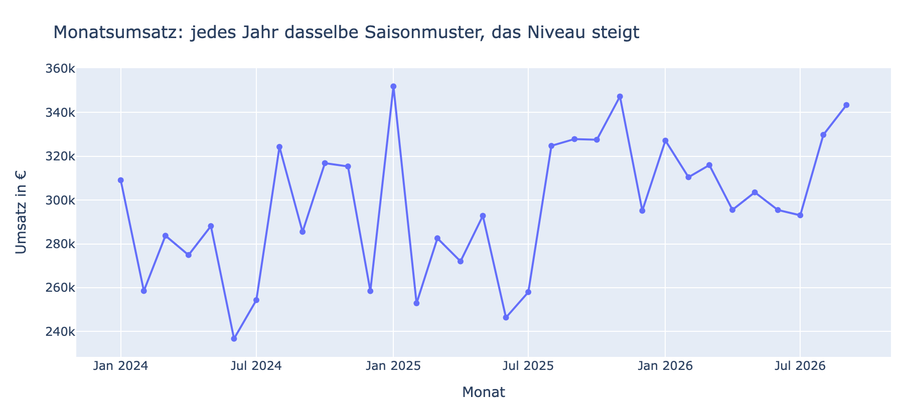
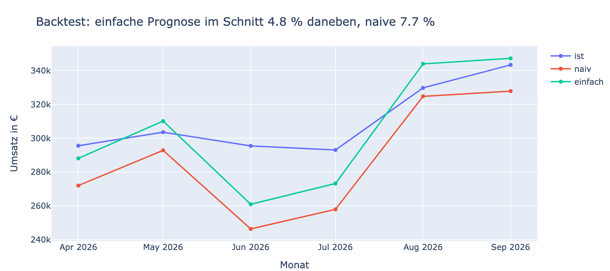
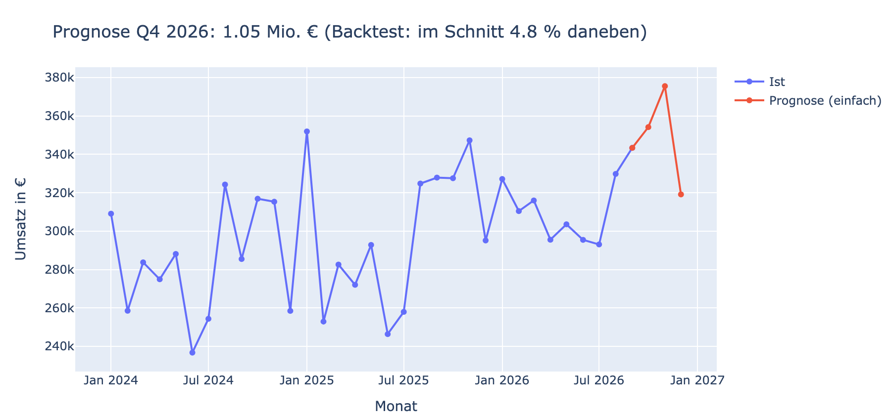

# Lab 6.1: Umsatz prognostizieren

**Leitfragen:**

<details>
<summary>Wie entsteht heute die Hochrechnung für das Jahresende?</summary>

Oft per Excel: Vorjahreswerte plus ein geschätzter Prozentsatz, oder die Einschätzung des Vertriebs. Lab 6.1 macht genau diese Idee zur festen Formel und misst, wie gut sie in der Vergangenheit getroffen hätte.

</details>

<details>
<summary>Was wäre eine faire Messlatte, die jede Prognose schlagen sollte?</summary>

„Wie im Vorjahresmonat.“ Diese naive Prognose kennt bereits die Saison und kostet nichts. Eine Methode, die schlechter ist, braucht niemand (dieselbe Idee wie die Messlatte in Lab 5.1).

</details>

<details>
<summary>Was weiß ein Modell nicht, das der Vertrieb weiß?</summary>

Alles, was nicht in den Zahlen steht: ein gewonnener Großkunde, eine Preiserhöhung, ein neuer Onlineshop. Eine Prognose aus der Vergangenheit setzt voraus, dass die Zukunft ähnlich verläuft.

</details>

- Eine Prognose aus Zahlen der Vergangenheit ist eine Rechnung, keine Vorhersage im Sinn von Wissen: Sie wird gemessen, bevor man ihr glaubt.
- Lab 6.1 vergleicht zwei einfache Formeln und prüft sie an Monaten, deren Ergebnis schon bekannt ist.

## Begriffe

| Begriff | Bedeutung |
| --- | --- |
| Zeitreihe | Werte in zeitlicher Reihenfolge, hier der Umsatz je Monat |
| Trend | langfristige Richtung: steigt das Niveau von Jahr zu Jahr? |
| Saison | Muster, das sich jedes Jahr wiederholt (bei Nordwind: Juli schwach; August, September, November stark) |
| naive Prognose | Prognose = Wert im selben Monat des Vorjahres |
| Trendfaktor | Umsatz der letzten 12 Monate / Umsatz der 12 Monate davor; 1,08 = 8 % mehr als im Jahr davor |
| einfache Prognose | Vorjahresmonat × Trendfaktor: Saison aus dem Vorjahr plus aktuelles Wachstum |
| Stand | letzter Monat, dessen Ist-Umsatz bekannt ist |
| Backtest | Prognose für Monate, deren Ergebnis man schon kennt, und Vergleich mit dem Ist |
| MAPE | mittlerer absoluter prozentualer Fehler: „im Schnitt x % daneben“ |

## Zeitreihe = Trend + Saison



_Quelle: eigene Auswertung, Nordwind-Daten, 15.11.2026._

Jedes Jahr zeigt dasselbe Auf und Ab (Saison), und jedes Jahr liegt etwas höher (Trend). Eine brauchbare Prognose braucht beides.

## Zwei Formeln

| Prognose | Formel | Saison | Trend | Historie |
| --- | --- | --- | --- | --- |
| naiv | Vorjahresmonat | ja | nein | 12 Monate |
| einfach | Vorjahresmonat × Trendfaktor | ja | ja | 24 Monate |

Rechenbeispiel für Oktober 2026 mit Stand September 2026:

| Schritt | Rechnung | Ergebnis |
| --- | --- | ---: |
| Vorjahresmonat | Umsatz Oktober 2025 | 327.549 € |
| Trendfaktor | Umsatz 10/2025–09/2026 ÷ Umsatz 10/2024–09/2025 | 1,081 |
| einfache Prognose | 327.549 € × 1,081 | 354.164 € |

Im Notebook ist die Formel eine Funktion mit drei Eingaben:

```python
def prognose_einfach(umsatz, monat, stand):
    bekannt = umsatz[umsatz.index <= stand]                        # nur Monate bis einschließlich stand
    trendfaktor = bekannt.iloc[-12:].sum() / bekannt.iloc[-24:-12].sum()
    return umsatz[vorjahresmonat(monat)] * trendfaktor             # '2026-10' -> Umsatz '2025-10' × Faktor
```

`umsatz` ist eine Spalte (Series) mit dem Monat als Index; `iloc[-12:]` nimmt die letzten 12 Einträge, `iloc[-24:-12]` die 12 davor.

## Backtest und MAPE

Der Backtest tut so, als wäre heute Ende März 2026, und prognostiziert April bis September 2026. Diese sechs Monate sind inzwischen bekannt; der Vergleich zeigt, wie gut jede Formel getroffen hätte.

MAPE an einem kleinen Beispiel: Prognose 90 statt 100 → 10 % daneben; Prognose 105 statt 100 → 5 % daneben; MAPE = (10 + 5) / 2 = 7,5 %. Die Vorzeichen fallen weg, damit sich Fehler nach oben und unten nicht aufheben.



_Quelle: eigene Auswertung, Nordwind-Daten, 15.11.2026._

| Monat | Ist | naiv | Fehler naiv | einfach | Fehler einfach |
| --- | ---: | ---: | ---: | ---: | ---: |
| 2026-04 | 295.548 | 272.033 | −8,0 % | 288.113 | −2,5 % |
| 2026-05 | 303.561 | 292.847 | −3,5 % | 310.157 | +2,2 % |
| 2026-06 | 295.463 | 246.399 | −16,6 % | 260.964 | −11,7 % |
| 2026-07 | 293.057 | 257.979 | −12,0 % | 273.228 | −6,8 % |
| 2026-08 | 329.789 | 324.778 | −1,5 % | 343.976 | +4,3 % |
| 2026-09 | 343.382 | 327.860 | −4,5 % | 347.240 | +1,1 % |
| **MAPE** | | | **7,7 %** | | **4,8 %** |

Die einfache Prognose ist im Schnitt 4,8 % daneben, die naive 7,7 %. Der Juni 2026 bleibt für beide schwierig: Er lag deutlich über dem schwachen Juni 2025.

## Ergebnis: Oktober bis Dezember 2026



_Quelle: eigene Auswertung, Nordwind-Daten, 15.11.2026._

| Monat | naiv | einfach |
| --- | ---: | ---: |
| 2026-10 | 327.549 € | 354.164 € |
| 2026-11 | 347.316 € | 375.537 € |
| 2026-12 | 295.129 € | 319.110 € |

## Grenzen

- **Strukturbrüche:** Der Relaunch des Onlineshops im März 2026 verschiebt Umsatz vom Außendienst in den Shop. Für den Gesamtumsatz wirkt er wie Trend; eine Prognose je Kanal mit Vorjahreswerten läge deutlich daneben.
- **Datenfehler:** Der Kommafehler vom 10.02.2026 (32.800 € statt 328 €, Lab 5.3) steckt im Trendfaktor. Ohne ihn läge der Faktor bei 1,072 statt 1,081 und die Prognose knapp 1 % niedriger.
- **Wissen außerhalb der Daten:** Großaufträge, Preisänderungen und Kundenverluste kennt die Formel nicht.
- **Komplexere Verfahren** (z. B. statistische Zeitreihenmodelle) brauchen mehr Historie und Erklärung; bei 33 Monaten Daten und einem klaren Saisonmuster bringen sie selten mehr als wenige Prozentpunkte. Messen lässt sich das mit demselben Backtest.

## Typische Fehler

| Symptom | Ursache | Lösung |
| --- | --- | --- |
| Prüfzelle: falscher Wert für 2026-04 | Trendfaktor über alle Monate statt bis `stand` | erst `umsatz[umsatz.index <= stand]`, dann `iloc` |
| Prüfzelle: 2026-10 falsch, 2026-04 richtig | `stand` fest eingetragen | Parameter `stand` verwenden |
| `KeyError: '2023-10'` | Vorjahresmonat liegt vor dem Datenbeginn 01/2024 | nur Monate ab 2025-01 prognostizieren; Trendfaktor braucht 24 Monate bis `stand` |
| MAPE negativ oder nahe 0 | Vorzeichen nicht entfernt | Betrag (`abs()`) vor dem Mittelwert |

## Fazit

- Saison steckt im Vorjahresmonat, Trend im Trendfaktor; zusammen ergeben sie eine einfache, erklärbare Prognose.
- Erst der Backtest zeigt, ob eine Formel taugt: 4,8 % MAPE gegen 7,7 % für die naive Messlatte.
- Eine Prognose weiß nur, was in den Daten steht; Strukturbrüche und Datenfehler wirken direkt auf das Ergebnis.

In der Übung entsteht `prognose_einfach` mit Copilot, danach laufen Backtest und Prognose.
