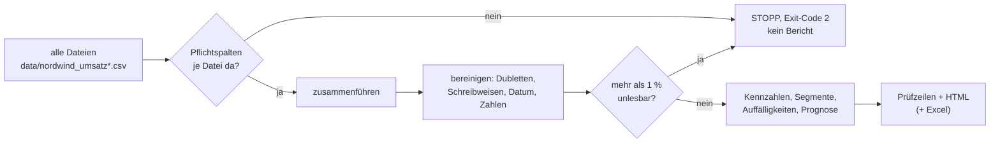
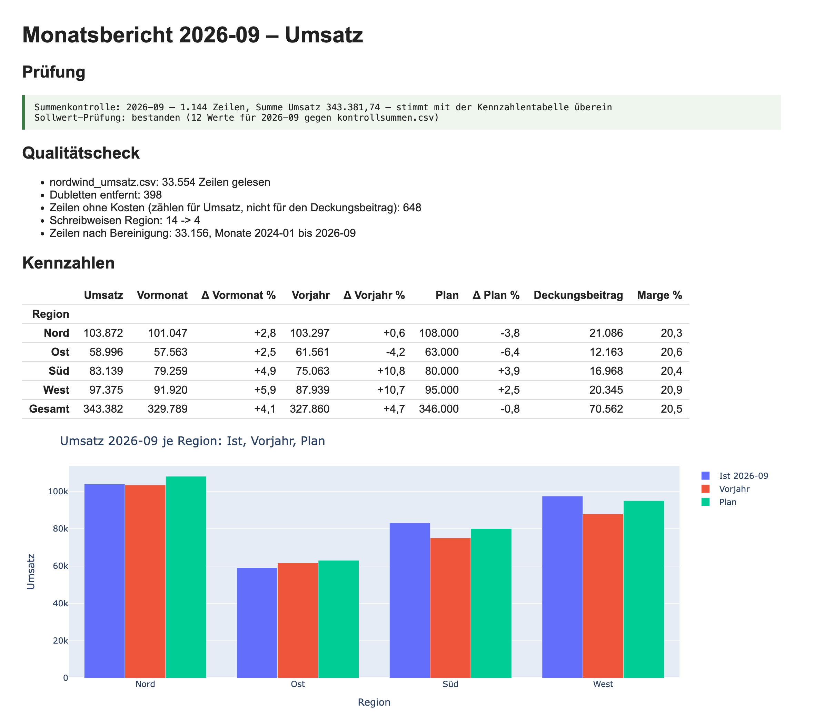
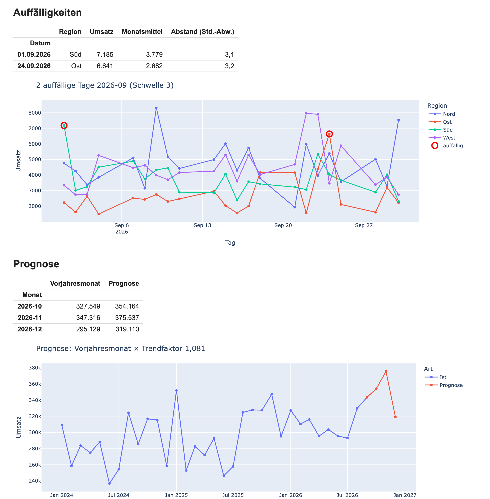

# Lab 6.2: Der Bericht v2 mit Excel-Export

**Leitfragen:**

<details>
<summary>Was soll ein Monatsbericht neben den Zahlen noch zeigen?</summary>

Was auffällig ist, wohin es geht und ob die Zahlen stimmen. v2 ergänzt deshalb Segmente, auffällige Tage, eine Prognose und zwei feste Prüfzeilen.

</details>

<details>
<summary>Wo sollen die Zahlen am Ende landen, damit sie jemand nutzt?</summary>

Dort, wo die Empfänger ohnehin arbeiten: im Browser, in Excel oder in einem BI-Werkzeug. v2 schreibt HTML und auf Wunsch eine Excel-Datei.

</details>

<details>
<summary>Was muss sich ändern, wenn nächsten Monat eine Spalte anders heißt?</summary>

Im besten Fall eine Zeile in den Einstellungen. Fehlt eine Pflichtspalte, soll das Skript laut stoppen statt still falsch zu rechnen.

</details>

- `monatsbericht.py` v2 vereint die Bausteine aus Modul 2–6 in einer Datei, die jede neue Lieferung gleich auswertet.
- Das Skript rechnet; jede Ausgabe endet mit zwei festen Prüfzeilen, an denen man sieht, dass wirklich das Skript gelaufen ist.

## Drei Stände von `monatsbericht.py`

| Stand | Lab | Eingabe | Inhalt |
| --- | --- | --- | --- |
| v1 | 3.3 | eine CSV-Datei + `--monat` | Bereinigung, Kennzahlen, Diagramme, KPI-Tabelle → HTML |
| **v2** | **6.2** | Datenordner `--daten` + Dateimuster `--muster` + `--monat` | Einstellungen, Prüfung je Datei, Qualitätscheck als Sperre, Unterbefehle, Segmente, Auffälligkeiten, Prognose, Prüfzeilen, Excel |
| Skill | 7.2 | Kopie von v2 | ein KI-Agent ruft v2 auf und erklärt das Ergebnis |

## Rundgang: Aufbau der Datei

v2 ist eine eigenständige Datei mit acht nummerierten Abschnitten, ohne Klassen; jede Funktion hat einen Kommentar.

| Abschnitt | Inhalt |
| --- | --- |
| 1 · Einstellungen | Datenordner, Dateimuster, Lese-Optionen, Spaltenrollen, Prüf- und ML-Werte |
| 2 · Hilfsfunktionen | `stopp`, deutsche Zahlen (`zahl`), Monate rechnen |
| 3 · Lesen und Qualitätscheck | Dateien finden, Pflichtspalten je Datei prüfen, zusammenführen, bereinigen |
| 4 · Kennzahlen | Ist, Vormonat, Vorjahr, Plan, Deckungsbeitrag, Marge je Gruppe und gesamt |
| 5 · ML-Bausteine | `segmente` (Lab 5.2), `find_anomalies` (Lab 5.3), `prognose` (Lab 6.1) |
| 6 · Prüfzeilen | `summenkontrolle`, `sollwert_pruefung` |
| 7 · Ausgabe | HTML-Bericht, `export_excel`, eingebaute Excel-Prüfung |
| 8 · Ablauf | Befehle und Optionen, Reihenfolge der Schritte |

### Einstellungen: Lese-Optionen und Spaltenrollen

```python
DATEN_STANDARD = "data"                   # Ordner mit den Lieferungen (relativ zum Kursordner)
MUSTER_STANDARD = "nordwind_umsatz*.csv"  # welche Dateien im Ordner gelesen werden

LESE_OPTIONEN = {
    "trennzeichen": "auto",               # "auto" erkennt "," oder ";"
    "dezimalzeichen": "auto",             # "auto" erkennt 12.50 und 12,50
    "zeichensatz": "auto",                # "auto" versucht utf-8, dann cp1252 (Excel-Export)
    "datumsformate": ["%d.%m.%Y", "%Y-%m-%d"],  # zuerst TT.MM.JJJJ, dann ISO
}

# Spaltenrollen: Rolle -> Spaltenname in der Datei (None = Spalte gibt es nicht)
SPALTEN = {
    "datum": "datum",       # Pflicht
    "betrag": "umsatz",     # Pflicht
    "gruppe": "region",     # optional: Kennzahlen und Auffälligkeiten je Gruppe
    "kunde": "kunde_id",    # optional: Kundensegmente
    "kosten": "kosten",     # optional: Deckungsbeitrag und Marge
}
ANZEIGENAMEN = {"betrag": "Umsatz", "gruppe": "Region", "kunde": "Kunde", "kosten": "Kosten"}
SOLLWERT_DATEI = "kontrollsummen.csv"     # im Datenordner; fehlt sie, wird die Prüfung übersprungen
PLAN_DATEI = "nordwind_plan_2026.csv"     # im Datenordner; fehlt sie, entfällt die Plan-Spalte
```

- **Spaltenrolle:** Das Skript rechnet nicht mit „umsatz“, sondern mit der Rolle `betrag`. Welche Spalte der Datei diese Rolle spielt, steht nur hier. Heißt die Spalte nächsten Monat `umsatz_eur`, ändert sich eine Zeile.
- **Anzeigename:** wie die Rolle im Bericht heißt, z. B. „Umsatz“ bei Nordwind, „Kosten“ bei einer Kostenstellen-Datei.
- **Pflicht und optional:** Fehlt `datum` oder `betrag`, stoppt das Skript. Fehlt eine optionale Rolle, entfällt nur der passende Abschnitt mit einer Meldung (ohne `kunde` keine Segmente, ohne `kosten` kein Deckungsbeitrag).

### Prüfung je Datei und Qualitätscheck als Sperre



- Jede Datei wird **vor** dem Zusammenführen geprüft. So nennt die Meldung die schuldige Datei: `STOPP: Pflichtspalte umsatz fehlt in nordwind_umsatz_2026_10_defekt.csv`.
- **Exit-Code:** Zahl, die ein Programm beim Beenden an das Terminal meldet; 0 = fertig, 2 = STOPP. Ein KI-Agent (Modul 7) erkennt daran, dass kein Bericht entstanden ist.
- Automatisch bereinigt und im Abschnitt „Qualitätscheck“ protokolliert: Dubletten, Regionsschreibweisen („Region Nord“, „nord“, „Sued“), Datumsformate TT.MM.JJJJ und ISO, fehlende Kosten.

### Befehle und Optionen

Ein Skript mit **Unterbefehlen** (wie `pip install` oder `pip list`) bündelt mehrere Aufgaben unter einem Namen. Das erste Wort nach dem Dateinamen wählt die Aufgabe, danach folgen die Optionen aus Lab 3.3.

| Aufruf | Ergebnis |
| --- | --- |
| `python <pfad>/monatsbericht.py --help` | Liste der Befehle |
| `… bericht --help` | Optionen eines Befehls |
| `… bericht --daten data --monat 2026-09` | `berichte/bericht_2026_09_v2.html` + Terminal-Zusammenfassung |
| `… bericht --daten data --monat 2026-09 --excel` | zusätzlich `berichte/kpi_2026_09.xlsx` |
| `… auffaelligkeiten --daten data --monat 2026-09 --schwelle 2` | nur die auffälligen Tage im Terminal |
| `… prognose --daten data --monat 2026-09` | nur die Prognose der drei Folgemonate |

Weitere Optionen: `--muster "nordwind_umsatz*.csv"` (welche Dateien), `--ausgabe berichte` (Zielordner). Ohne `--monat` nimmt v2 den letzten Monat in den Daten.

### Die zwei Prüfzeilen

```text
Summenkontrolle: 2026-09 – 1.144 Zeilen, Summe Umsatz 343.381,74 – stimmt mit der Kennzahlentabelle überein
Sollwert-Prüfung: bestanden (12 Werte für 2026-09 gegen kontrollsummen.csv)
```

- **Summenkontrolle:** Zeilen und Summe des Monats nach der Bereinigung, gegen die Gesamtzeile der Kennzahlentabelle.
- **Sollwert-Prüfung:** Umsatz, Deckungsbeitrag und Marge je Region gegen `kontrollsummen.csv` (Idee aus Lab 2.3: `check_zahlen.py`). Mögliche Ergebnisse: `bestanden`, `n Abweichungen` oder `keine Sollwert-Datei – übersprungen`.

## Der Bericht im Browser



_Quelle: eigener Screenshot, `bericht_2026_09_v2.html`, Nordwind-Daten, 15.11.2026._



_Quelle: eigener Screenshot, `bericht_2026_09_v2.html`, Nordwind-Daten, 15.11.2026._

| Abschnitt | September 2026 |
| --- | --- |
| Kennzahlen | Umsatz 343.382 €, +4,1 % zum Vormonat, +4,7 % zum Vorjahr, −0,8 % zum Plan, Marge 20,5 % |
| Kundensegmente | 14 · 90 · 55 · 241 Kunden (Segment 1–4, wie Lab 5.2) |
| Auffälligkeiten (Schwelle 3) | 01.09.2026 Süd, 24.09.2026 Ost |
| Prognose | Oktober 354.164 €, November 375.537 €, Dezember 319.110 € (wie Lab 6.1) |

## Excel-Export mit pandas

`DataFrame.to_excel` schreibt eine Tabelle als Excel-Blatt (über das Paket `openpyxl` aus der Kursumgebung). Für mehrere Blätter in einer Datei sammelt `pd.ExcelWriter` sie:

```python
kpi.to_excel("berichte/kpi_2026_09.xlsx", sheet_name="Kennzahlen")      # ein Blatt

with pd.ExcelWriter("berichte/kpi_2026_09.xlsx") as writer:              # mehrere Blätter
    kpi.to_excel(writer, sheet_name="Kennzahlen")
    auffaellige.to_excel(writer, sheet_name="Auffaelligkeiten", index=False)
```

Im Starter ist die Funktion `export_excel(kpi, auffaellige, pfad)` leer; der Schalter `--excel` ruft sie schon auf, danach prüft `excel_pruefen` Datei, Blatt und Zeilenzahl und meldet `OK` oder `nicht OK`.

## Wege in den Alltag

Stand: 11/2026, vor Kursbeginn prüfen. Einordnung ohne Hands-on.

| Weg | Was passiert | Quelle |
| --- | --- | --- |
| Excel/CSV für Power BI oder Excel | `kpi_2026_09.xlsx` oder eine CSV wird in Excel geöffnet oder in Power BI Desktop über **Daten abrufen** → Excel bzw. Text/CSV als Datenquelle eingebunden | [Power BI: Excel](https://learn.microsoft.com/de-de/power-bi/connect-data/desktop-connect-excel), [Power BI: CSV](https://learn.microsoft.com/de-de/power-bi/connect-data/desktop-connect-csv), abgerufen 15.11.2026 |
| Skript zeitgesteuert starten | Die Windows-Aufgabenplanung startet `python … bericht --excel` zu einem festen Termin, z. B. am dritten Werktag; unter Linux/macOS übernimmt das cron | [Aufgabenplanung (Microsoft Learn)](https://learn.microsoft.com/de-de/windows/win32/taskschd/task-scheduler-start-page), abgerufen 15.11.2026 |
| AutoML / DataRobot | Plattformen probieren automatisch viele Modelle aus und wählen das beste; sinnvoll bei vielen Merkmalen, ersetzt nicht Backtest und fachliche Prüfung | [DataRobot-Doku](https://docs.datarobot.com/), [Automatisiertes ML (Microsoft Learn)](https://learn.microsoft.com/de-de/azure/machine-learning/concept-automated-ml), abgerufen 15.11.2026 |
| KI in BI-Tools | Copilot in Power BI beantwortet Fragen zu Berichten, erstellt Visuals und Zusammenfassungen; Voraussetzung laut Doku: kostenpflichtige Fabric-Kapazität ab F2 oder Power BI Premium ab P1 | [Copilot in Power BI](https://learn.microsoft.com/de-de/power-bi/create-reports/copilot-introduction) (Doku vom 24.08.2026), abgerufen 15.11.2026 |

## Typische Fehler

| Symptom | Ursache | Lösung |
| --- | --- | --- |
| `STOPP: keine Datei nordwind_umsatz*.csv im Ordner …` | Terminal nicht im Kursordner oder falscher `--daten`-Ordner | Terminal im Kursordner öffnen, `--daten data` angeben |
| `error: argument {bericht,auffaelligkeiten,prognose}: invalid choice` | Befehl falsch geschrieben oder vergessen | `bericht`, `auffaelligkeiten` oder `prognose` direkt nach dem Dateinamen |
| `nicht OK – … fehlt: Funktion export_excel schreibt noch keine Datei` | Funktion noch leer | Aufgabe der Übung lösen |
| `PermissionError` beim Excel-Export | `kpi_2026_09.xlsx` ist in Excel geöffnet | Excel schließen, erneut ausführen |
| Diagramme im HTML leer | kein Internet: plotly wird beim Öffnen aus dem Netz geladen (wie Lab 3.2) | Bericht mit Internetverbindung öffnen |

## Fazit

- v2 liest einen ganzen Ordner, prüft jede Datei und stoppt laut, statt falsch zu rechnen.
- Einstellungen und Spaltenrollen machen das Skript auf andere Dateien übertragbar, ohne den Rechenteil anzufassen.
- Summenkontrolle und Sollwert-Prüfung stehen in jeder Ausgabe; sie sind das Erkennungszeichen eines echten Skriptlaufs.

In der Übung läuft v2 für September 2026 und bekommt den Excel-Export.
