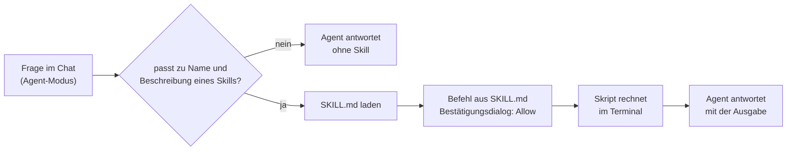
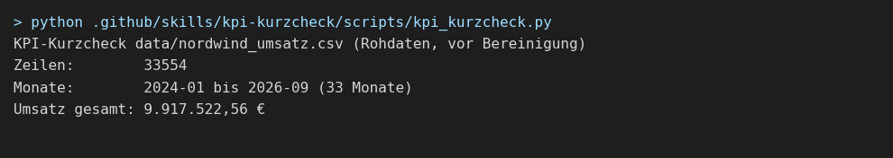

# Lab 7.1: Was ist ein Skill?

**Leitfragen:**

<details>
<summary>Was muss man einer Kollegin erklären, damit sie den Monatsbericht ohne Hilfe erstellt?</summary>

Wann der Bericht fällig ist, welches Programm sie mit welchen Angaben startet und was sie am Ende zurückmeldet. Genau diese drei Teile stehen in einem Skill: Auslöser, Vorgehen, Antwortformat.

</details>

<details>
<summary>Woran soll ein Assistent erkennen, wann genau diese Auswertung gemeint ist?</summary>

An Schlüsselwörtern in der Frage, z. B. „Monatsbericht“, „Umsatz im September“. Ein Skill nennt sie in seiner Beschreibung; passt die Frage dazu, lädt der Agent den Skill.

</details>

<details>
<summary>Welche Teile soll die KI frei formulieren, welche nie?</summary>

Frei: Kurzfazit und Erklärung in Alltagssprache. Nie: Zahlen und Prüfergebnisse – die kommen wörtlich aus der Ausgabe des Skripts.

</details>

- Ein **Agent Skill** ist ein Ordner mit einer Anleitung (`SKILL.md`) und einem Skript. Der KI-Agent liest die Anleitung nur, wenn eine Frage dazu passt, und führt dann das Skript aus.
- Damit lösen sich die vier Wege aus Lab 1.2 auf: **Das Skript rechnet, die KI erklärt** – ausgelöst mit einem Satz im Chat.

## Begriffe

| Begriff | Bedeutung |
| --- | --- |
| Agent Skill | Ordner mit `SKILL.md` und Skripten, den ein KI-Agent bei passender Frage selbst nutzt; wie eine Einarbeitungsmappe mit Werkzeug für eine neue Kollegin |
| `SKILL.md` | die Anleitung des Skills: oben Name und Beschreibung, darunter das Vorgehen in Markdown |
| Frontmatter | der Kopf zwischen den beiden Zeilen `---` ganz oben in `SKILL.md`; enthält `name` und `description` |
| Beschreibung (`description`) | ein Absatz, was der Skill tut und wann er gilt; danach entscheidet der Agent, ob er den Skill lädt (Auslöser) |
| Auslösesatz | die Frage im Chat, die den Skill startet, z. B. „Führe den KPI-Kurzcheck für die Nordwind-Daten aus.“ |
| Bestätigungsdialog | Rückfrage im Agent-Modus, bevor ein Befehl im Terminal läuft (Lab 1.2) |
| Slash-Befehl | `/` plus Skill-Name im Chat-Eingabefeld, z. B. `/kpi-kurzcheck`: ruft den Skill ausdrücklich auf |

## Ein Skill in einem Bild



Der Agent rechnet selbst nichts. Er erkennt die Aufgabe, startet den festgelegten Befehl und gibt das Ergebnis im festgelegten Format weiter.

## Aufbau einer `SKILL.md` am Beispiel `kpi-kurzcheck`

Der Beispiel-Skill aus dem Technik-Test (Lab 1.2) liegt im Kursordner:

```text
.github/
└── skills/
    └── kpi-kurzcheck/            ← Ordnername = name im Frontmatter
        ├── SKILL.md              ← Anleitung
        └── scripts/
            └── kpi_kurzcheck.py  ← rechnet
```

Die vollständige Datei `.github/skills/kpi-kurzcheck/SKILL.md`:

````markdown
---
name: kpi-kurzcheck
description: Schneller Überblick über die Nordwind-Umsatzdatei data/nordwind_umsatz.csv – Zeilenzahl, Monatsbereich und Gesamtumsatz der Rohdaten. Verwenden, wenn nach dem KPI-Kurzcheck, einem Kurzcheck, Schnellcheck oder Überblick über die Nordwind-Daten gefragt wird.
---

# KPI-Kurzcheck

Zeigt drei Eckdaten der Rohdatei `data/nordwind_umsatz.csv`. Die Zahlen rechnet immer das Skript, nie das Sprachmodell.

## Vorgehen

1. Im Wurzelordner des Arbeitsbereichs diesen Befehl ausführen:

   ```bash
   python .github/skills/kpi-kurzcheck/scripts/kpi_kurzcheck.py
   ```

2. Die vier Ausgabezeilen des Skripts unverändert wiedergeben.
3. Danach in einem Satz sagen, dass es Rohdaten vor der Bereinigung sind.

## Regeln

- Keine Zahl selbst berechnen, schätzen oder runden.
- Meldet das Skript `STOPP`, die Meldung wiedergeben und nichts weiter rechnen.
````

| Teil | Aufgabe | im `kpi-kurzcheck` |
| --- | --- | --- |
| `name` | Kennung; nur Kleinbuchstaben, Ziffern, Bindestriche; gleich dem Ordnernamen; höchstens 64 Zeichen | `kpi-kurzcheck` |
| `description` | **was** der Skill tut und **wann** er gilt, mit den Wörtern, die in Fragen vorkommen; höchstens 1024 Zeichen | „Schneller Überblick … Verwenden, wenn nach dem KPI-Kurzcheck … gefragt wird“ |
| Wann verwenden | Beispiele für passende Fragen, auch „wofür nicht“ | steckt hier in der Beschreibung („Verwenden, wenn …“) |
| Vorgehen | nummerierte Schritte mit dem genauen Befehl | Schritt 1 |
| Antwortformat | was in die Antwort gehört und was wörtlich bleibt | Schritte 2 und 3 |
| Regeln | was der Agent nie tun darf | keine eigene Zahl, bei `STOPP` aufhören |

Feldregeln laut VS-Code-Doku; ein ungültiger `name` lässt den Skill ohne Meldung ausfallen (Quelle: [Agent Skills in VS Code](https://code.visualstudio.com/docs/copilot/customization/agent-skills), Stand 11/2026, vor Kursbeginn prüfen).

Das Skript im Terminal ausgeführt (im Kursordner):



_Quelle: eigene Auswertung (Terminal-Ausgabe), Nordwind-Daten, 15.11.2026._

## Schrittweises Laden

Ein Agent kennt viele Skills, lädt aber nur, was er gerade braucht – wie bei einem Regal mit Aktenordnern: Zuerst liest er nur die Rückenschilder (Name und Beschreibung), einen Ordner öffnet er erst, wenn das Thema passt.

| Stufe | Was der Agent liest | Wann |
| --- | --- | --- |
| 1 · Entdecken | `name` und `description` aller Skills | bei jeder Frage |
| 2 · Anleitung | den Rest von `SKILL.md` | wenn die Frage zur Beschreibung passt oder der Skill per `/` aufgerufen wird |
| 3 · Dateien | Skripte und weitere Dateien des Ordners | nur, wenn die Anleitung sie nennt |

Das Skript wird ausgeführt, nicht gelesen: An den KI-Dienst gehen der Befehl und die Terminal-Ausgabe, nicht die Rohdaten (Datenschutz-Tabelle aus Lab 1.2).

## Wo Skills liegen

| Werkzeug | Projekt-Skills (im geöffneten Arbeitsbereich) | persönliche Skills |
| --- | --- | --- |
| VS Code mit Copilot (Kurs) | `.github/skills/<name>/SKILL.md` im Kursordner | `~/.copilot/skills/` |
| Claude Code | `.claude/skills/<name>/SKILL.md` | `~/.claude/skills/` |

**Claude Code:** liest nur `.claude/skills/`. Den Ordner `.github/skills` im Explorer kopieren und im Wurzelordner als `.claude/skills` einfügen; danach gelten alle Pfade mit `.claude` statt `.github`.

Stand: 11/2026, vor Kursbeginn prüfen (Quellen: [Agent Skills in VS Code](https://code.visualstudio.com/docs/copilot/customization/agent-skills), Doku vom 11.11.2026; [Claude Code: Skills](https://code.claude.com/docs/en/skills)). `SKILL.md` folgt dem offenen Format [Agent Skills](https://agentskills.io), das mehrere Werkzeuge lesen.

Skills liegen im **Wurzelordner** des geöffneten Arbeitsbereichs; ein Skill in einem Unterordner wird nicht gefunden. Welche Skills VS Code gefunden hat, zeigt die Befehlspalette (**Strg+Umschalt+P**, macOS: Cmd+Umschalt+P) → **Chat: Open Customizations** → **Skills**, Abschnitt **Workspace**. Ein `/` im Chat-Eingabefeld listet sie ebenfalls.


_Quelle: Microsoft, VS Code Docs „Use Agent Skills in VS Code“ (https://code.visualstudio.com/docs/copilot/customization/agent-skills), abgerufen am 15.11.2026._

## Der Bestätigungsdialog

Bevor der Agent einen Befehl im Terminal ausführt, zeigt VS Code ihn im Chat an (Lab 1.2). **Allow** führt ihn einmal aus, **Skip** lässt ihn aus.


_Quelle: Microsoft, VS Code Docs „Approvals and permissions“ (https://code.visualstudio.com/docs/agents/run/approvals), abgerufen am 15.11.2026._

| Prüfen | Beispiel `kpi-kurzcheck` |
| --- | --- |
| Steht der Befehl so in `SKILL.md`? | `python .github/skills/kpi-kurzcheck/scripts/kpi_kurzcheck.py` |
| Läuft das Skript aus dem Skill-Ordner? | Pfad beginnt mit `.github/skills/kpi-kurzcheck/` |
| Ändert der Befehl Dateien (`del`, `rm`, `mv`, `pip install`)? | nein |

Nur **Allow** wählen, nicht **Always Allow**: So bleibt jeder Befehl sichtbar. **Claude Code:** fragt ebenfalls vor jedem Befehl; dort die einmalige Erlaubnis wählen.

## Die vier Wege, aufgelöst

| | Weg 1 · KI-Chat | Weg 3 + 4 · Skript und Modell | Skill |
| --- | --- | --- | --- |
| Bedienung | ein Satz im Chat | Befehl im Terminal | ein Satz im Chat |
| wer rechnet | Sprachmodell, jedes Mal neu | Skript, immer gleich | Skript, immer gleich |
| Prüfung | keine | Summenkontrolle, Sollwert-Prüfung | dieselben Prüfzeilen in der Antwort |

> **Merksatz:** Das Skript rechnet, die KI erklärt. Der Skill verbindet die Bequemlichkeit von Weg 1 mit der Verlässlichkeit von Weg 3 und 4.

## Die fünf Skill-Regeln

| Nr. | Regel | Warum |
| --- | --- | --- |
| 1 | Ein Modell im Auswahlfeld neben **Agent** wählen und für alle Skill-Läufe beibehalten (Auswahl Stand 11/2026 prüfen) | ein anderes Modell löst anders aus und formuliert anders |
| 2 | Erst den natürlichen Satz probieren; löst der Skill nicht aus, neuer Chat und „Nutze den Skill kpi-kurzcheck und …“ oder `/kpi-kurzcheck` | die Beschreibung trifft nicht jede Formulierung |
| 3 | Fehlen in der Antwort die festen Ausgabezeilen des Skripts (beim Monatsbericht: `Summenkontrolle:` und `Sollwert-Prüfung:`), hat der Agent selbst gerechnet: neuer Chat, ausdrücklicher Satz | nur die Skriptzeilen belegen einen echten Skriptlauf |
| 4 | Letzter Rückfall: denselben Befehl aus `SKILL.md` im Terminal ausführen | gleiche Datei, gleiche Zahlen, auch ohne Agent |
| 5 | Im Bestätigungsdialog nur Befehle aus `SKILL.md` erlauben | der Agent könnte einen anderen Befehl vorschlagen |

## Typische Fehler

| Symptom | Ursache | Lösung |
| --- | --- | --- |
| Agent antwortet ohne Befehl | Modus Ask statt Agent oder Skill nicht erkannt | Modus **Agent** wählen; Skill-Regel 2 |
| Skill fehlt unter **Customizations → Skills** | Ordner nicht im Wurzelordner des Arbeitsbereichs, `name` ≠ Ordnername oder VS Code liest den Ordner nicht | Pfad und `name` prüfen; weiterhin nicht gefunden: VS Code neu laden (**Developer: Reload Window**) |
| Dialog zeigt einen anderen Befehl als `SKILL.md` | Agent improvisiert | **Skip**, neuer Chat, Skill-Regel 2 |
| `STOPP: data/nordwind_umsatz.csv nicht gefunden` | Terminal nicht im Kursordner | Kursordner als Arbeitsbereich öffnen |
| Zahlen in der Antwort anders als im Terminal | Agent hat umformuliert oder gerundet | Skill-Regel 3: neuer Chat, ausdrücklicher Satz |

## Fazit

- Ein Skill = `SKILL.md` (Name, Beschreibung, Vorgehen, Antwortformat, Regeln) + Skript in `.github/skills/<name>/`.
- Der Agent liest zuerst nur Name und Beschreibung; die Beschreibung entscheidet, ob der Skill auslöst.
- Im Bestätigungsdialog nur Befehle aus `SKILL.md` erlauben; die festen Ausgabezeilen belegen den Skriptlauf.

In der Übung läuft der Beispiel-Skill `kpi-kurzcheck` erst im Terminal, dann per Satz und per `/` im Agent-Modus.
