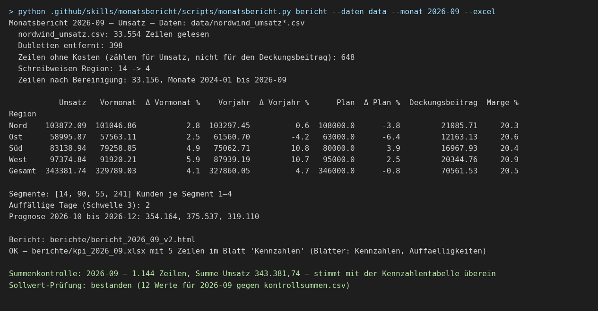
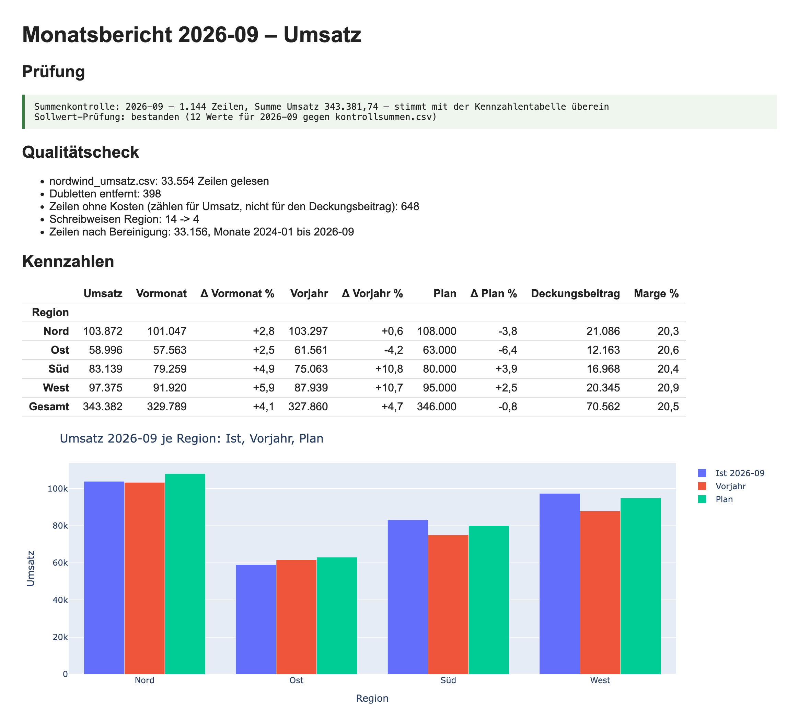

# Lab 7.2: Den Monatsbericht-Skill bauen

**Leitfragen:**

<details>
<summary>Was soll im Kurzfazit eines Monatsberichts stehen?</summary>

Gesamtumsatz und die Abweichung zu Vormonat, Vorjahr und Plan, in zwei bis drei Sätzen. Details stehen in Tabelle und HTML-Bericht.

</details>

<details>
<summary>Was soll der Agent tun, wenn eine Datei fehlt oder eine Spalte anders heißt?</summary>

Laut melden und aufhören. Das Skript stoppt mit einer `STOPP`-Meldung (Lab 6.2); der Skill legt fest, dass der Agent sie wörtlich weitergibt und nicht selbst weiterrechnet.

</details>

<details>
<summary>Wie formuliert man eine Beschreibung, die eindeutig auslöst?</summary>

Mit dem, was der Skill liefert, und den Wörtern, die Menschen in ihrer Frage benutzen („Monatsbericht“, „Umsatz im September“). Dazu, wofür er nicht gilt.

</details>

- Der Skill `monatsbericht` verpackt das fertige Skript v2 aus Lab 6.2 mit einer Anleitung: Ab jetzt erzeugt ein Satz im Chat den Bericht.
- Das Skript bleibt unverändert; neu ist nur `SKILL.md`.

## Der Skill-Ordner

```text
.github/skills/
├── kpi-kurzcheck/                 ← Beispiel aus Lab 7.1
└── monatsbericht/                 ← neu in diesem Lab
    ├── SKILL.md                   ← Kopie von project/starters/m07-l02-SKILL.md, umbenannt
    └── scripts/
        └── monatsbericht.py       ← Kopie von project/examples/m06-forecast-report/l02-report-v2/monatsbericht.py
```

| Teil | Herkunft | Hinweis |
| --- | --- | --- |
| `scripts/monatsbericht.py` | Beispiel v2 aus Lab 6.2 | die geprüfte Fassung, nicht die eigene aus dem Playground |
| `SKILL.md` | Starter `m07-l02-SKILL.md` | Dateiname genau `SKILL.md`, Großbuchstaben |
| Daten | bleiben in `data/` | der Skill ruft das Skript immer mit `--daten data` auf |
| Berichte | entstehen in `berichte/` im Kursordner | wie in Lab 6.2 |

Im Explorer von VS Code: Rechtsklick auf `.github/skills` → **New Folder…** → `monatsbericht/scripts` legt beide Ordner auf einmal an. Dateien kopiert Rechtsklick → **Copy**, dann Rechtsklick auf den Zielordner → **Paste**; **F2** benennt um.

## Das Gerüst

`project/starters/m07-l02-SKILL.md` gibt Name, Wann verwenden und Regeln vor. Offen sind zwei Stellen:

````markdown
---
name: monatsbericht
# >>> AUFGABE 1: description in einer Zeile – was der Skill tut und wann er verwendet wird – Prompt siehe Übung, Aufgabe 3
description:
# <<< ENDE AUFGABE 1
---

# Monatsbericht Umsatz (Nordwind)

Das Skript rechnet, die KI erklärt. Alle Zahlen kommen aus der Ausgabe von `scripts/monatsbericht.py`; nie selbst rechnen, schätzen oder runden.

## Wann verwenden

- Monatsbericht, Umsatzbericht oder Kennzahlen eines Monats, z. B. „Erstelle den Monatsbericht für September 2026.“
- auffällige Tage eines Monats, z. B. „Was ist im September 2026 auffällig?“
- Umsatzprognose für die nächsten Monate
- eine neue Umsatzlieferung in `data/` soll ausgewertet werden

Nicht verwenden für Kosten je Kostenstelle oder für andere Dateien als `data/nordwind_umsatz*.csv`.

<!-- >>> AUFGABE 2: Abschnitte "## Vorgehen" und "## Antwortformat" – Prompt siehe Übung, Aufgabe 3 -->

<!-- <<< ENDE AUFGABE 2 -->

## Regeln

- Nur die Befehle aus dem Abschnitt Vorgehen ausführen; keine Dateien ändern, verschieben oder löschen.
- Keine Zahl selbst berechnen; fehlt eine Zahl in der Ausgabe, sagen, dass sie fehlt.
````

Zeilen mit `#` im Frontmatter und `<!-- … -->` im Text sind Kommentare: Sie stören weder den Skill noch die Markdown-Vorschau.

## Was in die Lücken gehört

**Beschreibung (Aufgabe 1)**

| schwach | besser |
| --- | --- |
| „Erstellt Berichte.“ | sagt, **was** entsteht: Kennzahlen je Region mit Vormonat, Vorjahr, Plan, Marge, Segmente, Auffälligkeiten, Prognose, HTML und Excel |
| ohne Auslösewörter | nennt die Wörter aus echten Fragen: Monatsbericht, Umsatzbericht, Umsatz eines Monats, Auffälligkeiten, Prognose, neue Lieferung |
| nur der Skriptname | nennt Firma und Daten (Nordwind, Umsatz), damit andere Berichte nicht auslösen |

**Vorgehen (Aufgabe 2)**

1. **Monat bestimmen** im Format JJJJ-MM. Fehlt er in der Frage: **fragen statt raten**. Sonst nimmt das Skript den letzten Monat der Daten, und niemand merkt es.
2. **Genau einen Befehl** ausführen, immer mit `--daten data` und dem Pfad im Skill-Ordner:

   | Frage | Befehl (im Kursordner) |
   | --- | --- |
   | Monatsbericht | `python .github/skills/monatsbericht/scripts/monatsbericht.py bericht --daten data --monat 2026-09 --excel` |
   | Auffälligkeiten | `… auffaelligkeiten --daten data --monat 2026-09` |
   | Prognose | `… prognose --daten data --monat 2026-09` |

3. **Bei `STOPP:`** die Zeile wörtlich melden, sagen, dass kein Bericht entstanden ist, und aufhören. Das Skript endet dann mit Exit-Code 2 (Lab 6.2).

`--daten data` steht ausdrücklich da, obwohl es der Standard ist: Der Agent soll keinen Ordner erraten, und jeder Befehl ist ohne Nachdenken im Terminal wiederholbar (Skill-Regel 4).

**Antwortformat (Aufgabe 2)**

| Teil | Inhalt | frei formuliert? |
| --- | --- | --- |
| Kurzfazit | 2–3 Sätze: Gesamtumsatz, Δ Vormonat, Δ Vorjahr, Δ Plan | Text ja, Zahlen nur aus der Ausgabe |
| Kennzahlentabelle | Tabelle aus der Ausgabe als Markdown | nein |
| Prüfung | `Summenkontrolle: …` und `Sollwert-Prüfung: …` wörtlich | nein |
| Dateien | Pfade zu `berichte/bericht_2026_09_v2.html` und `berichte/kpi_2026_09.xlsx` | nein |

Die Prüfzeilen sind das Erkennungszeichen eines echten Skriptlaufs (Skill-Regel 3). Fehlen sie, hat der Agent selbst gerechnet.

## Testen in drei Stufen

| Stufe | Wie | Erwartet |
| --- | --- | --- |
| 1 · Skript am neuen Ort | Befehl aus der Tabelle oben im Terminal | gleiche Ausgabe wie in Lab 6.2 |
| 2 · Skill per Satz | neuer Chat, Agent: „Erstelle den Monatsbericht für September 2026.“ | Bestätigungsdialog mit genau diesem Befehl |
| 3 · Antwort prüfen | Antwort gegen Stufe 1 | gleiche Zahlen, beide Prüfzeilen, „bestanden“ |



_Quelle: eigene Auswertung (Terminal-Ausgabe), Nordwind-Daten, 15.11.2026._

Der Bericht im Browser ist derselbe wie in Lab 6.2:



_Quelle: eigener Screenshot, `bericht_2026_09_v2.html`, Nordwind-Daten, 15.11.2026._

## Typische Fehler

| Symptom | Ursache | Lösung |
| --- | --- | --- |
| Skill fehlt unter **Customizations → Skills** | Datei heißt noch `m07-l02-SKILL.md` oder `description` ist leer | in `SKILL.md` umbenennen; Aufgabe 1 füllen |
| `can't open file '.github/skills/monatsbericht/scripts/monatsbericht.py'` | Skript nicht in `scripts/` kopiert oder Ordner vertippt | Ordnerbaum oben vergleichen |
| Agent fragt nach dem Monat | Frage ohne eindeutigen Monat | gewollt („fragen statt raten“); Monat nennen |
| Antwort ohne Prüfzeilen | Agent hat selbst gerechnet | Skill-Regel 3: neuer Chat, „Nutze den Skill monatsbericht und …“ |
| Copilot hat Text außerhalb der Markierungen geändert | Prompt zu offen oder **Keep** zu schnell | **Undo**, Starter neu kopieren, Prompt erneut senden |

## Fazit

- Skill = Kopie von v2 in `scripts/` + `SKILL.md` mit Beschreibung, Vorgehen, Antwortformat und Regeln.
- Befehle stehen vollständig in `SKILL.md`, immer mit `--daten data`; ohne Monat fragt der Agent nach.
- Getestet wird in drei Stufen: Terminal, Satz im Chat, Antwort gegen Terminal.

In der Übung entsteht der Skill `monatsbericht` und erzeugt per Satz den September-Bericht.
