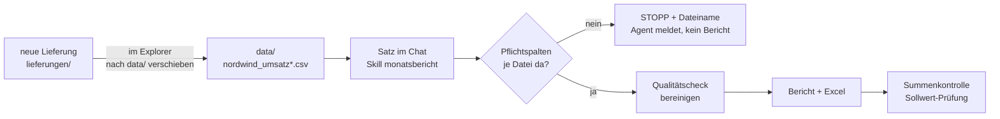
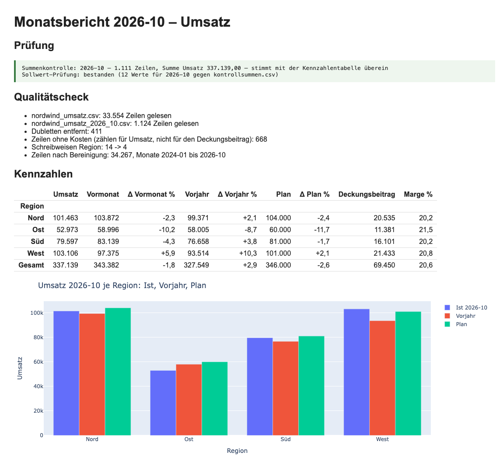
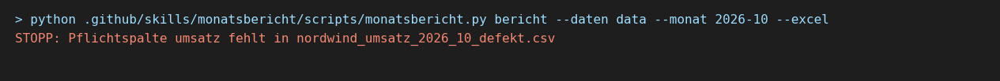

# Lab 7.3: Neue Daten, gleicher Bericht

**Leitfragen:**

Was geht heute schief, wenn die Lieferung einmal anders aussieht?

Eine umbenannte Spalte oder ein anderes Format bricht Formeln und Verknüpfungen, oft ohne Fehlermeldung. Im schlimmsten Fall stehen Nullen oder alte Werte im Bericht.

Wer merkt es zuerst?

Ohne eingebaute Prüfung oft erst die Empfänger des Berichts. Mit Prüfung je Datei merkt es das Skript beim Einlesen, bevor eine Zahl entsteht.

Was ist besser: ein Bericht mit Lücke oder kein Bericht?

Kein Bericht, aber eine klare Meldung, was fehlt. Ein Bericht mit stiller Lücke sieht richtig aus und wird weitergegeben.

- Jeden Monat kommt eine neue Datei. Der Skill `monatsbericht` aus Lab 7.2 wertet sie mit einem Satz aus: prüfen, bereinigen, rechnen, Prüfzeilen.
- Ist die Lieferung unbrauchbar, stoppt das Skript laut, und der Agent meldet den Stopp statt eines Berichts.

## Der wiederkehrende Fall

| Ordner | Inhalt | Warum getrennt |
| --- | --- | --- |
| `lieferungen/` | Eingang: neue und noch ungeprüfte Dateien | eine Datei dort stört keinen Lauf |
| `data/` | alles, was der Bericht liest: Historie, Plan, Sollwerte, freigegebene Lieferungen | v2 liest **jede** Datei `nordwind_umsatz*.csv` in diesem Ordner |

Der September-Bericht bleibt auch mit der Oktober-Datei in `data/` gleich: v2 nutzt nur Daten bis zum Berichtsmonat (Lab 6.2).

## Die Oktober-Lieferung

`lieferungen/nordwind_umsatz_2026_10.csv` hat dieselben Spalten und dieselben Qualitätsprobleme wie die Historie: Dubletten, fehlende Kosten, Regionsschreibweisen, zwei Datumsformate. Der Qualitätscheck aus Lab 6.2 bereinigt sie ohne Änderung am Skript.

| Qualitätscheck | nur Historie (September) | Historie + Oktober |
| --- | ---: | ---: |
| Zeilen gelesen | 33.554 | 33.554 + 1.124 |
| Dubletten entfernt | 398 | 411 |
| Zeilen ohne Kosten | 648 | 668 |
| Schreibweisen Region | 14 → 4 | 14 → 4 |
| Zeilen im Berichtsmonat | 1.144 | 1.111 |

_Quelle: eigener Screenshot, `bericht_2026_10_v2.html`, Nordwind-Daten, 15.11.2026._

Die Sollwert-Prüfung besteht, weil `kontrollsummen.csv` die unabhängig berechneten Werte bis Oktober 2026 enthält. Im Unternehmen kämen sie aus dem Vorsystem.

## Fehler laut melden

In `lieferungen/nordwind_umsatz_2026_10_defekt.csv` heißt die Pflichtspalte `umsatz` plötzlich `umsatz_eur`, alles andere ist gleich. v2 prüft die Pflichtspalten **je Datei vor dem Zusammenführen** und hält an:

_Quelle: eigene Auswertung (Terminal-Ausgabe), Nordwind-Daten, 15.11.2026._

| | still weiterrechnen | laut stoppen (v2) |
| --- | --- | --- |
| Ergebnis | Bericht ohne Oktober-Umsatz oder mit leeren Werten | kein Bericht, eine Zeile `STOPP: …` |
| Wer merkt es | Empfänger, vielleicht | sofort, im Chat |
| Hinweis auf die Ursache | keiner | Spaltenname und Dateiname |
| Exit-Code | 0 | 2 |

Der Skill legt in `SKILL.md`, Vorgehen Schritt 3, fest: bei `STOPP:` die Zeile wörtlich melden, sagen, dass kein Bericht entstanden ist, und nichts weiter tun. Der Agent rechnet dann nicht mit der Spalte `umsatz_eur` weiter und ändert keine Datei – das entscheidet ein Mensch.

Ein Stopp schreibt nichts in `berichte/`. Eine ältere Datei gleichen Namens aus einem früheren Lauf bleibt dort liegen; maßgeblich ist deshalb die Meldung im Chat, nicht der Ordner.

**Rückfrage festlegen (Erweiterung):** Eine zusätzliche Zeile in Schritt 3 kann vorgeben, was der Agent nach dem Stopp fragt, z. B. ob eine korrigierte Lieferung angefordert werden soll. Die Rückfrage ersetzt nie den Stopp.

## Typische Fehler

| Symptom | Ursache | Lösung |
| --- | --- | --- |
| `STOPP: keine Daten für den Monat 2026-10 in data/` | Oktober-Datei liegt noch in `lieferungen/` | Datei nach `data/` verschieben |
| `STOPP: Pflichtspalte umsatz fehlt …` auch für September | defekte Datei liegt in `data/`; v2 liest alle passenden Dateien | defekte Datei zurück nach `lieferungen/` |
| Explorer fragt „Are you sure you want to move …?“ | normale Rückfrage beim Ziehen | **Move** bestätigen |
| Agent schlägt nach dem Stopp vor, die Spalte umzubenennen oder `--muster` zu ändern | Agent will helfen statt melden | **Skip**; Regel in `SKILL.md`: keine Dateien ändern |
| Antwort nennt Oktober-Zahlen trotz Stopp | Agent hat selbst gerechnet | Skill-Regel 3: neuer Chat, ausdrücklicher Satz |

## Fazit

- Neue Lieferung = Datei von `lieferungen/` nach `data/` verschieben und den Skill mit einem Satz auslösen.
- Qualitätscheck und Prüfzeilen laufen bei jeder Lieferung mit; für Oktober 2026: 1.111 Zeilen, Sollwert-Prüfung bestanden.
- Eine unbrauchbare Lieferung erzeugt keinen Bericht, sondern eine Meldung mit Spalte und Datei.

In der Übung entstehen der Oktober-Bericht per Skill und, mit der defekten Lieferung, eine klare Stopp-Meldung.
