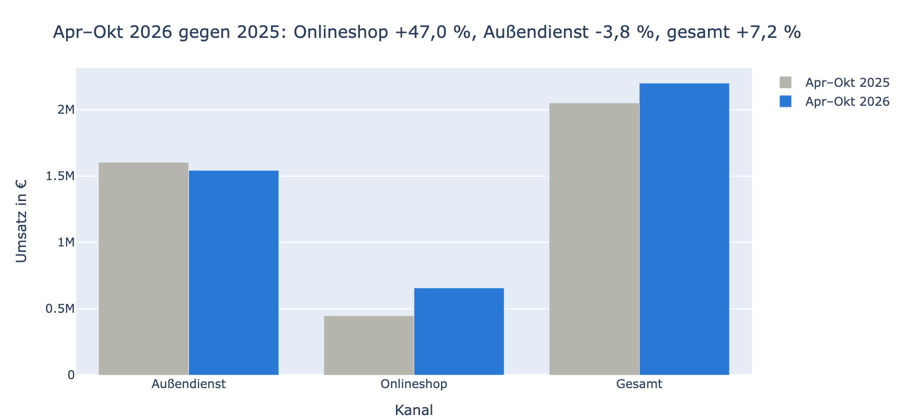
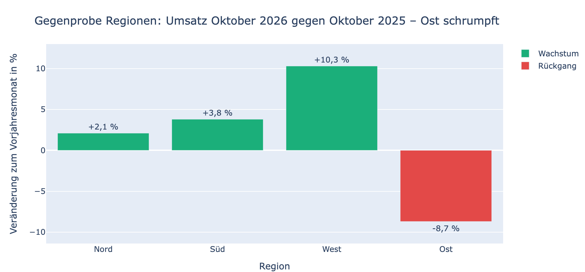

# Lab 8.1: Zahlen und Aussagen prüfen

**Leitfragen:**

Welche Zahl in einem Bericht wird immer nachgeprüft, bevor er rausgeht?

Die Gesamtsumme des Monats gegen eine unabhängige Quelle, z. B. das Vorsystem. Im Kurs übernehmen das Summenkontrolle und Sollwert-Prüfung aus Lab 6.2.

„Seit dem neuen Onlineshop steigt der Umsatz“ – was müsste man wissen, um das zu glauben?

Wie stark der Umsatz ohnehin gewachsen wäre (Trend, Saison), ob nur Umsatz vom Außendienst in den Onlineshop gewandert ist und ob im selben Zeitraum etwas anderes passiert ist. Erst der Vergleich mit gleichen Vorjahresmonaten und je Kanal zeigt das.

Wer trägt die Verantwortung, wenn eine KI-Analyse falsch war?

Die Person oder Stelle, die das Ergebnis weitergibt oder darauf entscheidet. Eine KI ist ein Werkzeug; sie unterschreibt keinen Bericht.

- Ein Text kann gut klingen und trotzdem falsch sein. Jede Zahl und jede Aussage in einem Kommentar braucht eine Quelle oder eine Gegenprobe.
- Validieren heißt: KI-Ergebnis, klassische Statistik und Fachwissen zusammenbringen. Entscheiden und weitergeben bleibt beim Menschen.

## Begriffe

| Begriff | Bedeutung |
| --- | --- |
| Validierung | prüfen, ob ein Ergebnis stimmt und für den Zweck taugt, bevor es weitergeht |
| Gegenprobe | dieselbe Frage auf einem zweiten, unabhängigen Weg beantworten; gleiche Antwort = mehr Vertrauen, wie die Probe beim schriftlichen Rechnen |
| Plausibilität | passt das Ergebnis zu Größenordnung, Vorzeichen und Erfahrung? |
| Korrelation | zwei Dinge treten zusammen auf (Relaunch und Umsatzplus) |
| Ursache (Kausalität) | das eine bewirkt das andere; lässt sich aus Zeitreihen allein selten belegen |
| Bias (Verzerrung) | ein Ergebnis bevorzugt systematisch eine Gruppe oder übersieht eine, z. B. eine kleine Region im Gesamtwert |

## Chancen und Grenzen von KI-Modellen

| | Sprachmodell (Chat, Skill-Antwort) | ML-Modell und Formel (Modul 5–6) |
| --- | --- | --- |
| stark in | Text formulieren, erklären, Code schreiben, Auffälliges benennen | Muster in vielen Zeilen, Segmente, Prognose |
| Grenze | erfindet plausible Zahlen und Begründungen, verallgemeinert | kennt nur die Vergangenheit, keine Ursachen; Strukturbrüche (Relaunch) verzerren |
| Gegenmittel | Zahlen nur aus dem Skript, Prüfzeilen, Gegenprobe | Backtest, Sollwerte, Fachwissen |

## Vier Arten zu prüfen

| Prüfung | Frage | im Kurs |
| --- | --- | --- |
| Sollwerte | Stimmt die Zahl mit einer unabhängigen Quelle? | `kontrollsummen.csv`, `check_zahlen.py` (Lab 2.3), Sollwert-Prüfung in v2 (Lab 6.2) |
| Backtest | Hätte die Methode früher gestimmt? | MAPE der Prognose (Lab 6.1) |
| Plausibilität | Größenordnung, Vorzeichen, Summe der Teile = Ganzes? | Kommafehler 10.02.2026 Ost (Lab 5.3) |
| zweite Methode | Kommt ein anderer Rechenweg zum selben Ergebnis? | drei Gegenproben in diesem Lab |

## Drei typische Fehler in einem KI-Kommentar

Der vorbereitete Managementkommentar zum Oktober 2026 enthält genau diese drei Fehlerarten:

| Fehlerart | Erkennungszeichen | Gegenprobe |
| --- | --- | --- |
| (a) falsche Zahl | Ziffern vertauscht, gerundet, aus dem falschen Monat; passt nicht zu den Prozentwerten daneben | Zahl im geprüften Bericht nachschlagen |
| (b) Ursache behauptet | „hat … gesteigert“, „wegen“, „dank“ | gleiche Monate im Vorjahr (Saison), je Kanal (Verlagerung) |
| (c) Verallgemeinerung | „alle“, „überall“, „durchgehend“ | Tabelle je Gruppe statt Gesamtwert |

## Korrelation ist nicht Ursache: der Relaunch

Der Onlineshop wurde am 01.03.2026 neu gestartet. Der Vergleich April–Oktober 2026 mit denselben Monaten 2025 schaltet die Saison aus (Lab 6.1); die Aufteilung nach Kanal zeigt, woher das Wachstum kommt:

_Quelle: eigene Auswertung, Nordwind-Daten (Historie + Oktober-Lieferung), 15.11.2026._

- Der Onlineshop wächst stark, der Außendienst schrumpft: Ein Teil des Online-Wachstums ist Umsatz, der nur den Kanal gewechselt hat.
- Schon vor dem Relaunch wuchs Nordwind: April–Oktober 2025 lag 3,5 % über denselben Monaten 2024. Wie viel des Gesamtplus auf den Relaunch zurückgeht, lässt sich aus diesen Zahlen nicht trennen.
- Belastbar ist die Beobachtung („wuchs seit dem Relaunch“), nicht die Ursache („hat gesteigert“). Für eine Ursache braucht es mehr, z. B. Vertriebswissen oder einen Vergleich mit einer Gruppe ohne Relaunch.

## Bias: Was der Gesamtwert verdeckt

Im Oktober 2026 liegt Nordwind insgesamt 2,9 % über dem Vorjahresmonat. Je Region sieht es anders aus:

_Quelle: eigene Auswertung, Nordwind-Daten (Historie + Oktober-Lieferung), 15.11.2026._

Ost ist die kleinste Region (knapp 16 % des Oktober-Umsatzes) und fällt im Gesamtwert kaum auf. Dasselbe gilt für Modelle: Die Kundensegmente aus Lab 5.2 entstehen ohne Blick auf die Region; ob eine kleine Region darin untergeht, zeigt erst die Aufteilung je Region. Gegenmittel: Ergebnisse immer auch je Gruppe ansehen.

## KI, Statistik und Fachwissen zusammen

| Beitrag | liefert | Beispiel Oktober 2026 |
| --- | --- | --- |
| Skript und Statistik | geprüfte Zahlen, Vergleiche, Auffälligkeiten | Kennzahlentabelle, Sollwert-Prüfung bestanden |
| Sprachmodell | Entwurf des Textes, Hinweise auf Auffälliges | Kurzfazit, Kommentar-Entwurf |
| Fachwissen | Ursachen, Zusammenhänge, Bewertung | Warum schrumpft Ost? Was hat der Relaunch verändert? |
| Mensch | Entscheidung, Freigabe, Verantwortung | korrigierter Kommentar geht raus |

**EU-KI-Verordnung:** Die Verordnung (EU) 2024/1689 ist seit 01.08.2024 in Kraft; ihre Pflichten gelten gestaffelt ab 02.02.2025, je nach Risiko des KI-Einsatzes (Quelle: [EUR-Lex, Verordnung (EU) 2024/1689](https://eur-lex.europa.eu/eli/reg/2024/1689/oj/deu); Stand 11/2026, vor Kursbeginn auf Änderungen prüfen).

## Typische Fehler

| Symptom | Ursache | Lösung |
| --- | --- | --- |
| `FileNotFoundError` für `nordwind_umsatz_2026_10.csv` | Oktober-Datei weder in `data/` noch in `lieferungen/` | Lab 7.3, Aufgabe 5: Datei nach `data/` legen |
| `FileNotFoundError` für `kpi_2026_10.xlsx` | Beispielordner von Lab 7.3 fehlt | Kursmaterial vollständig kopieren |
| Prüfzelle meldet `nicht OK – … fehlt` | Kommentar nicht nach `project/playground/` kopiert | Starter `m08-l01-kommentar_oktober.md` kopieren |
| Prüfzelle bleibt `nicht OK` nach Korrektur | Datei nicht gespeichert | **Strg+S**, Prüfzelle erneut ausführen |

## Fazit

- Zahlen gegen den geprüften Bericht, Ursachen gegen gleiche Vorjahresmonate und je Kanal, Verallgemeinerungen gegen die Tabelle je Gruppe prüfen.
- Korrelation ist nicht Ursache: Der Relaunch fällt mit Online-Wachstum zusammen; wie viel er bewirkt hat, zeigen die Zahlen allein nicht.
- Ein Gesamtwert kann eine schrumpfende kleine Gruppe verdecken (Bias).
- KI entwirft, Statistik prüft, Fachwissen erklärt, der Mensch entscheidet.

In der Übung wird der vorbereitete Managementkommentar zum Oktober 2026 mit drei Gegenproben geprüft und korrigiert.
