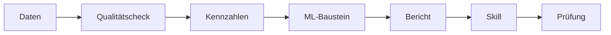
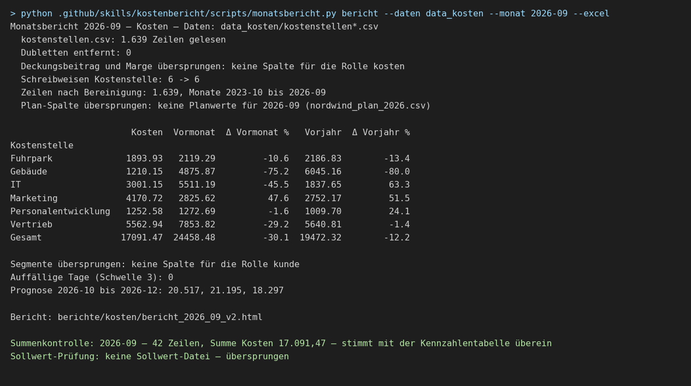
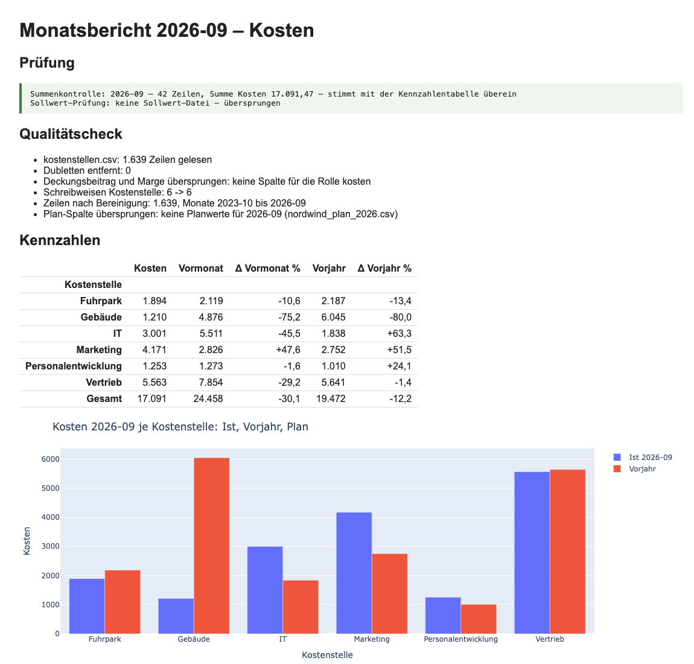

# Lab 9.1: Das Muster auf eigene Daten übertragen

**Leitfragen:**

<details>
<summary>Welche Auswertung im eigenen Job ist der beste erste Kandidat?</summary>

Eine, die jeden Monat gleich läuft, heute Handarbeit kostet und deren Summe sich gegen ein Vorsystem prüfen lässt, z. B. Kosten je Kostenstelle oder Umsatz je Kundengruppe.

</details>

<details>
<summary>Welche Daten dafür dürfen das Haus verlassen, welche nicht?</summary>

Das entscheiden Datenschutz und IT. Beim Skill-Muster verlassen nur Befehl und Terminal-Ausgabe den Rechner (Lab 7.1); Rohdaten mit Personen- oder Kundenbezug bleiben lokal und gehören nie in den Chat.

</details>

<details>
<summary>Was wäre nach vier Wochen ein sichtbarer Erfolg?</summary>

Ein Monatsbericht, der per Satz oder Befehl entsteht, dessen Summe mit dem Vorsystem übereinstimmt und den jemand anderes ohne Hilfe erzeugen kann.

</details>

- Das Muster aus Modul 2–8 passt auf jede Tabelle mit Datum und Betrag: Einstellungen anpassen, Skill kopieren, prüfen.
- Basis ist ein fremder Datensatz, `kostenstellen.csv`; die eigene CSV ist die Erweiterung.

## Das Muster



| Schritt | Nordwind-Umsatz | Kosten je Kostenstelle |
| --- | --- | --- |
| Daten | `data/nordwind_umsatz*.csv` | `data_kosten/kostenstellen.csv` |
| Qualitätscheck | Pflichtspalten, Dubletten, Schreibweisen, Datum (Lab 2.2, 6.2) | gleich, automatisch |
| Kennzahlen | Umsatz je Region, Vormonat, Vorjahr, Plan, Marge | Kosten je Kostenstelle, Vormonat, Vorjahr |
| ML-Baustein | Segmente, Auffälligkeiten, Prognose | Auffälligkeiten, Prognose (keine Kunden → keine Segmente) |
| Bericht | `berichte/bericht_JJJJ_MM_v2.html` | `berichte/kosten/bericht_JJJJ_MM_v2.html` |
| Skill | `monatsbericht` | `kostenbericht` |
| Prüfung | Summenkontrolle + Sollwert-Prüfung | Summenkontrolle + Gegenrechnung im Notebook |

## Ein guter erster eigener Fall

| Kriterium | gut | schlecht |
| --- | --- | --- |
| wiederkehrend | jeden Monat dieselbe Auswertung | einmalige Sonderanalyse |
| Kontrollsumme | Summe steht im Vorsystem (ERP, Hauptbuch) | keine unabhängige Zahl zum Vergleich |
| Daten freigegeben | anonymisiert, Freigabe von Datenschutz und IT | Personaldaten, Kundennamen ohne Freigabe |
| Format | Langformat: eine Zeile je Buchung oder Monat, Spalten Datum und Betrag | breiter Export mit Monaten als Spalten |
| Historie | ≥ 13 Monate (Vorjahr), ≥ 24 Monate (Prognose) | drei Monate |
| Umfang | ein Bericht, ein Empfänger | „alle Auswertungen der Abteilung“ |

## Der zweite Datensatz: `kostenstellen.csv`

Deutscher Excel-Export: Trennzeichen `;`, Dezimalkomma, Zeichensatz cp1252, Datum TT.MM.JJJJ, 1.639 Buchungen von 10/2023 bis 09/2026.

```text
Buchungsdatum;Kostenstelle;Betrag
02.10.2023;Vertrieb;925,56
02.10.2023;Marketing;316,82
02.10.2023;Fuhrpark;233,64
```

| Rolle in v2 | Nordwind | Kostenstellen |
| --- | --- | --- |
| `datum` (Pflicht) | `datum` | `Buchungsdatum` |
| `betrag` (Pflicht) | `umsatz`, Anzeigename „Umsatz“ | `Betrag`, Anzeigename „Kosten“ |
| `gruppe` | `region` | `Kostenstelle` (6 Werte) |
| `kunde` | `kunde_id` | gibt es nicht → `None` |
| `kosten` | `kosten` | gibt es nicht → `None` |

Die Lese-Optionen von v2 stehen auf `"auto"` und erkennen `;`, Dezimalkomma und cp1252 selbst (Lab 6.2).

## Vom Monatsbericht zum Kostenbericht

1. Skill-Ordner `.github/skills/monatsbericht` als `.github/skills/kostenbericht` kopieren und **sofort** `name` und `description` ändern. Sonst gibt es zwei Skills mit derselben Beschreibung, und Umsatzfragen landen im falschen.
2. `kostenstellen.csv` in einen eigenen Datenordner `data_kosten/` legen: Das Muster `nordwind_umsatz*.csv` in `data/` bleibt unberührt.
3. In der Skript-Kopie nur den Block **1. EINSTELLUNGEN** ändern:

```python
DATEN_STANDARD = "data_kosten"            # Ordner mit den Lieferungen (relativ zum Kursordner)
MUSTER_STANDARD = "kostenstellen*.csv"    # welche Dateien im Ordner gelesen werden
AUSGABE_STANDARD = "berichte/kosten"      # hier landen HTML und Excel (eigener Ordner, damit der Umsatzbericht bleibt)

SPALTEN = {
    "datum": "Buchungsdatum",   # Pflicht
    "betrag": "Betrag",         # Pflicht
    "gruppe": "Kostenstelle",   # optional: Kennzahlen und Auffälligkeiten je Gruppe
    "kunde": None,              # optional: Kundensegmente – gibt es hier nicht
    "kosten": None,             # optional: Deckungsbeitrag und Marge – gibt es hier nicht
}
ANZEIGENAMEN = {"betrag": "Kosten", "gruppe": "Kostenstelle", "kunde": "Kunde", "kosten": "Kosten"}
```

`AUSGABE_STANDARD` bekommt einen eigenen Unterordner: Beide Skripte benennen den Bericht `bericht_JJJJ_MM_v2.html`; ohne Unterordner würde der Kostenbericht September den Umsatzbericht September überschreiben.

4. In `SKILL.md` des neuen Skills Pfade und Befehle auf `.github/skills/kostenbericht/…` und `--daten data_kosten` umstellen.



_Quelle: eigene Auswertung (Terminal-Ausgabe), Kostenstellen-Daten, 15.11.2026._

| Abschnitt | Kostenbericht | Grund |
| --- | --- | --- |
| Kennzahlen | je Kostenstelle mit Vormonat und Vorjahr | Rolle `gruppe` gesetzt |
| Plan, Deckungsbeitrag, Marge | übersprungen, mit Hinweis | keine Plan-Datei in `data_kosten/`, Rolle `kosten` = `None` |
| Kundensegmente | übersprungen | Rolle `kunde` = `None` |
| Auffälligkeiten, Prognose | laufen | 36 Monate Historie (mindestens 24) |
| Sollwert-Prüfung | `keine Sollwert-Datei – übersprungen` | keine `kontrollsummen.csv` in `data_kosten/` |



_Quelle: eigener Screenshot, `berichte/kosten/bericht_2026_09_v2.html`, Kostenstellen-Daten, 15.11.2026._

## Gegenrechnung statt Sollwert-Datei

Ohne Sollwerte prüft eine **Gegenrechnung**: dieselbe Monatssumme auf einem zweiten Weg (Lab 8.1), hier mit wenigen Zeilen pandas direkt aus der CSV. Stimmen Anzahl und Summe mit der Zeile `Summenkontrolle` überein, hat der Bericht alle Buchungen erfasst. Im Unternehmen ersetzt eine Summe aus dem Vorsystem diese Gegenrechnung; als `kontrollsummen.csv` mit den Spalten `monat`, Gruppenspalte und Betragsspalte in `data_kosten/` gelegt, meldet v2 dann `bestanden` oder `n Abweichungen`.

## Strategie für den Einsatz im Unternehmen

| Schritt | Was | Warum |
| --- | --- | --- |
| Klein anfangen | ein Bericht, ein Datensatz, ein Empfänger | schneller sichtbarer Erfolg, Fehler bleiben überschaubar |
| Verantwortliche festlegen | wer pflegt Skript und `SKILL.md`, wer gibt den Bericht frei | ein Skill ohne Besitzer veraltet |
| Prüfregeln festlegen | Kontrollsumme aus dem Vorsystem, Toleranz, was bei `STOPP` passiert | jede Ausgabe muss prüfbar sein |
| KI-Assistent klären | welcher Assistent ist freigegeben, mit welchem Konto | Verträge regeln, was mit Eingaben passiert (Lab 1.2) |
| Datenfreigabe klären | welche Daten lokal verarbeitet werden dürfen, was in den Chat darf | Datenschutz, Betriebsrat, IT-Sicherheit |

Checklisten: [Anpassung an eigene Daten](../anhang-anpassung-eigene-daten.md) · [Voraussetzungen im Job](../anhang-voraussetzungen-job.md)

## Typische Fehler

| Symptom | Ursache | Lösung |
| --- | --- | --- |
| `STOPP: keine Datei kostenstellen*.csv im Ordner data_kosten/ gefunden` | Datei noch in `lieferungen/` oder Ordner vertippt | Datei nach `data_kosten/` verschieben |
| `STOPP: keine Datei nordwind_umsatz*.csv im Ordner data_kosten/ gefunden` | Einstellungen der Kopie noch nicht geändert oder nicht gespeichert | `MUSTER_STANDARD` setzen, **Strg+S** |
| `STOPP: Pflichtspalte datum fehlt in kostenstellen.csv` | `SPALTEN` noch auf Nordwind-Namen | Spaltenrollen wie oben setzen, speichern |
| Umsatzfrage startet den Kostenbericht | `name` und `description` der Kopie noch die alten | Schritt 1 nachholen |
| Bericht und Summenkontrolle sagen „Summe Umsatz“ | `ANZEIGENAMEN` nicht geändert | `"betrag": "Kosten"` |
| `nicht OK – summe ist keine Zahl` in der Gegenrechnung | CSV ohne `decimal=","` gelesen | Lese-Optionen im Notebook ergänzen |

## Fazit

- Das Muster Daten → Qualitätscheck → Kennzahlen → ML-Baustein → Bericht → Skill → Prüfung überträgt sich über den Einstellungsblock, ohne den Rechenteil anzufassen.
- Fehlt eine Rolle, entfällt nur der passende Abschnitt; fehlen Sollwerte, prüft eine Gegenrechnung.
- Im Unternehmen klein anfangen, Verantwortliche und Prüfregeln festlegen, KI-Assistent und Datenfreigabe klären.

In der Übung entsteht der Skill `kostenbericht` mit Bericht und Gegenrechnung; wer Zeit hat, überträgt ihn auf die eigene CSV.
